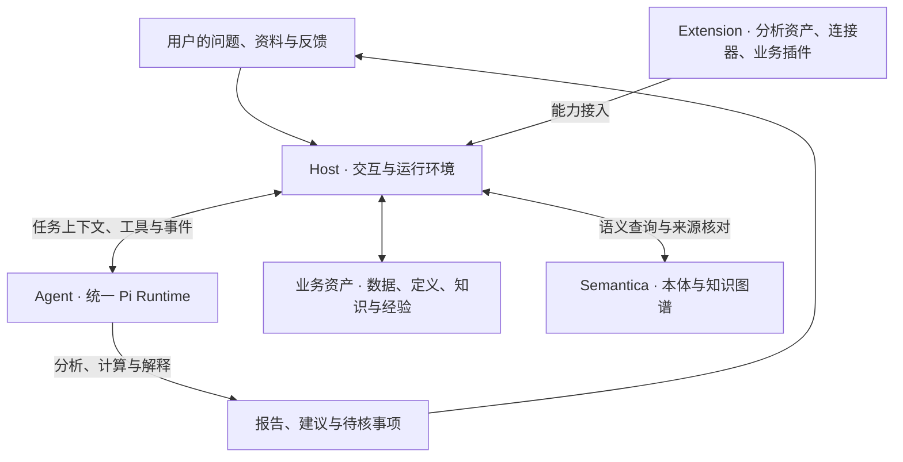

# OptraCall

**持续做出更好的决策。**

OptraCall 是面向数据驱动决策者的分析与决策 Agent 工作台。用户提出业务问题、提供资料和约束，Agent 自主查找依据、选择方法、调用工具、计算并解释结果。工作台保存业务口径、分析成果、人的决策与后续反馈，让后续任务能够找到并核对已有积累。

名称取自 Optima（最优）、tra（迭代）与 call（决策）。产品围绕企业经营分析、方案比较和决策复盘持续迭代，当前采用 macOS 本地浏览器工作台形态。

## 用 OptraCall 做什么

- **分析一个具体问题。** 从数据、文档或业务情况出发，连续追问、补充资料、核对计算并形成报告。
- **建设可复用的业务资产。** 整理企业资料、业务概念、字段映射、指标口径和分析方法，按准确版本审核、发布和使用。
- **承接需要持续跟进的决策。** 用 Case 关联项目与任务，保留建议、人的取舍、行动及反馈，支持后续复盘。

例如，面对“哪些门店的销售下滑值得优先核查”，可以向 Agent 提供销售资料及已确认的经营背景。Agent 按需读取相关指标和业务定义，自主检查数据、比较差异、说明可能解释与待补证事项。用户结合结果决定下一步，将实际观察和反馈留在原事项中。

## 产品架构

OptraCall 采用 **Host + Agent + Extension**，全产品共用官方 Pi Agent Runtime。



| 层次 | 主要职责 | 在产品中的体现 |
| --- | --- | --- |
| Host | 提供工作空间、业务上下文、权限、资源生命周期、交互和持久化 | 项目与任务、模型配置、文件、资产版本、状态及成果展示 |
| Agent | 自主理解问题、取材、选择方法、调用工具、检查和修订 | 对话分析、文件读取、bash／Python 计算、Skill 使用、结果解释 |
| Extension | 提供可复用的专业能力与业务入口 | 分析 Skill、指标与分析方法资产、MCP 连接器、Studio、决策看板等 |

会话创建、续聊、停止、工具调用和上下文管理经统一入口复用 `pi-coding-agent`。业务插件沿同一入口使用隔离会话与能力配置。Host 负责真实资源及权限，分析路线和专业判断由 Agent 在授权范围内决定。

Pi SDK 当前锁定 **1.4.0**，Semantica 当前锁定 **0.7.0**。两者采用官方原包，升级目标版本由用户指定，产品适配维护在 OptraCall 自身。Semantica 提供业务概念、关系及来源的语义支撑，查询结果与原业务资产的准确版本关联。

产品持续遵循四点原则——**Host 管环境、Agent 自主执行、优先复用第三方 SDK 已有能力、减少人的操作**。[架构与责任边界](docs/OptraCall_产品讨论稿_v0.4.md) · [统一会话接入](docs/agent-session-integration.md)

## 主要功能

以下按当前 `main` 的已实现能力组织。实际可用范围取决于所选模型、任务权限、已启用的扩展和本机运行环境。

| 功能 | 用户可以完成的工作 |
| --- | --- |
| 项目与多任务空间 | 一个项目内创建多个独立任务，共享项目文件，分别保存会话、草稿、模型选择与运行状态。支持项目重命名、归档和恢复 |
| Agent 对话与工具 | 流式对话、过程查看、停止与续聊，使用 Pi 原生工具、bash／Python、Skill 和扩展；通过界面管理模型配置并导入本机 Pi 凭据 |
| 需求梳理 | 讨论目标、约束与资料，形成可编辑、可发布的分析需求框架，选择送入目标任务 |
| 企业资料与数据上下文 | 保存业务资料及其修订、项目数据说明和来源，为分析提供企业背景、字段含义与适用条件 |
| Studio 语义与分析资产 | 在统一入口查看企业基础资产，创建建设任务，维护业务概念、数据映射、指标与方法，并将普通任务中的资产问题和增量建议提交为候选 |
| 指标与分析方法 | 维护指标和分析方法草稿，审核发布，按版本启用、读取与引用；保留原发布记录及适用范围 |
| 报告复核与结论审查 | 主 Agent 可委派计算与框架覆盖复核，固定版报告支持逐主张审查，保留原稿、意见和修订版本 |
| Case 与决策反馈 | 关联多个项目，将本版受支持的结论及选中的关联建议确认入板，记录采纳、驳回、下一步及实际反馈，再用于复盘或后续任务 |
| 分析 Skill 与连接器 | 内置运营数据分析、深度研究、目标测算、优惠券测算、ROI 测算和 PPT 报告 Skill，接入联网搜索与可选商圈、天气连接器 |
| PPT 与方案推演 | 从报告生成 PPT 候选稿并逐页精修，使用 SimLab 比较经营方案及情景，按版本导入和调用本机纯计算模型包 |

当前真实模型验证保留了计算、解释及复核漏报等质量问题，使用分析结论时需要核对依据与适用条件。需求框架、报告复核与结论审查的工程验证，以及 Studio 的场景验证，分别在对应记录中维护。[分析与决策流程交付记录](docs/analysis-decision-workflow-delivery.md) · [Studio 使用说明](docs/studio-phase2-usage.md)

## 设计特点与创新点

### 让自主 Agent 使用企业业务上下文

同一任务可以从讨论业务情况，推进到资料查证、数据计算和报告修订。企业背景、口径、资料和权限由产品提供，Agent 根据当前问题选择分析方法与执行顺序。用户可以直接开始任务，再按实际需要补充资料或处理业务取舍。

### 将业务资产建设与日常分析连接起来

Studio 支持提前建设企业基础资产。普通任务可以获得同企业合格的正式目录，由 Agent 按需读取正文、检查适用条件，再开展分析。任务中发现的资产缺陷、方法增量或个案例外，可以带着来源回到资产建设与演进流程，形成经过核对和正式发布的版本。

### 保留可以回查的依据与版本

数据、定义、知识和经验围绕同一业务问题关联。任务记录区分目录提供、实际读取、作者采用声明和独立核验，并保留对应来源、报告及版本。后续任务可以发现新版，历史报告仍能回到当时的依据。

### 把决策后的反馈纳入后续工作

Case、决策看板和反馈记录将分析成果与人的选择、实际行动和观察结果关联。有价值的经验可以选择保留，在下一次任务中重新检查条件、来源和反例，支持修订原判断。

这些设计的目标是减少重复解释业务背景、查找资料和维护口径的工作。具体场景的分析质量、效率和经营效果，按对应模型、资料与验收记录核定。[产品方向](docs/OptraCall_产品讨论稿_v0.4.md) · [Studio 二期实施记录](openspec/changes/studio-phase2-unified-assets/implementation-result.md)

## 业务资产怎样组织

产品用以下六类逻辑内容描述业务积累，关联相应来源和适用条件。

| 内容 | 服务的问题 |
| --- | --- |
| 数据 Data | 用哪份资料、什么版本，一行代表什么，字段怎样解释？ |
| 本体与概念 Ontology | 业务对象和术语是什么，怎样区分与关联？ |
| 知识 Knowledge | 有哪些制度、事实、观点和方法可以参考？ |
| 经验 Memory | 以前怎样判断，后来怎样，哪些条件值得借鉴？ |
| 假设 Hypothesis | 哪种解释可能成立，什么证据会改变判断？ |
| 策略 Strategy | 有哪些可选行动，适用条件和实际结果如何？ |

这些内容沿项目文件、企业资料、指标与方法资产、Case、反馈与 Pi 原生历史等现有存储关联。正式指标、方法和原文各自保留准确来源，语义关系可以回查原资产。文件、SQLite、DuckDB 与 Semantica 分别承担成果保存、业务记录、可选计算和语义查询职责。

## 本地使用

已部署的版本提供三个双击入口。

| 入口 | 操作 |
| --- | --- |
| `启动 OptraCall.command` | 启动本机工作台并打开浏览器 |
| `停止 OptraCall.command` | 正常停止当前试用实例 |
| `更新并启动 OptraCall.command` | 停止服务后，快进到通过 CI 的 `main`，安装依赖、构建并启动 |

默认地址为 `http://127.0.0.1:4173/`。首次使用时，在模型设置中保存模型配置和凭据，或导入本机 Pi 凭据。随后创建项目与任务，准备资料并开始对话。

每个项目默认包含以下目录。

```text
010_draw/       上传原件
020_clean/      用户供分析的资料与分析过程文件
060_reports/    最终报告
```

Agent 通过系统提示词约定使用 `020_clean` 的分析资料，过程输出默认保存到 `020_clean`，最终报告保存到 `060_reports`。原件读取规则属于提示词软约束，敏感资料应按所选模型、工具和连接器的数据出口核定后提供。

配置和原生会话保存在 `~/.optracall/`，项目文件默认保存在 `~/OptraCallProjects/`。本地 Host 将获准内容发送给所选模型或外部服务，使用前应核对相应数据授权。部署、更新与故障处理见[本地试用说明](docs/macbook-trial.md)。

## 开发

前端使用 React、TypeScript 和 Vite，Host 使用 Node.js，Agent Runtime 使用官方 Pi SDK。需要 Node.js 25 或更新版本，Agent 通过 bash 使用本机 Python。语义引擎采用独立的 Python 环境，具体依赖与准备方式见[语义环境说明](openspec/changes/fourbase-l2-rollout/formal-adoption-handoff.md)。

```sh
npm ci --ignore-scripts
npm run dev
```

浏览器访问 `http://127.0.0.1:4173/`。`npm run check` 运行统一会话边界检查、测试、类型检查和生产构建。开发流程使用 SDD／TDD、非作者独立复核及适用的 Git／CI 检查，完整规则见[工程规范](docs/engineering-workflow.md)。

```text
src/host/                    界面、环境、权限、持久化与接入
src/host/ui/                 产品前端
src/agent/                   统一 Pi Runtime 与 Agent 能力适配
extensions/analysis-assets/  分析 Skill 与资产
extensions/connectors/       数据及外部服务连接器
extensions/business-plugins/ 业务插件
scripts/                     启动、构建与运行环境工具
tests/                       回归与集成检查
openspec/changes/             变更规格、验收与交付记录
docs/                        产品与工程资料
```

## 进一步阅读

- [产品讨论稿 v0.4](docs/OptraCall_产品讨论稿_v0.4.md)记录产品方向、业务内容和演进目标，具体实现以对应变更记录为准。
- [Studio 二期使用说明](docs/studio-phase2-usage.md)介绍企业基础资产、任务使用与资产演进。
- [本地试用说明](docs/macbook-trial.md)介绍启动、更新、本机数据与反馈方式。
- [工程规范](docs/engineering-workflow.md)定义开发、任务范围、复核和交付流程。
- [AGENTS.md](AGENTS.md)提供工程 Agent 的开工阅读入口。

本仓库公开。公开样例使用合成或明确获准公开的材料，凭据、客户数据、私有经营资料、原始会话和运行日志保存在授权的本机位置。
