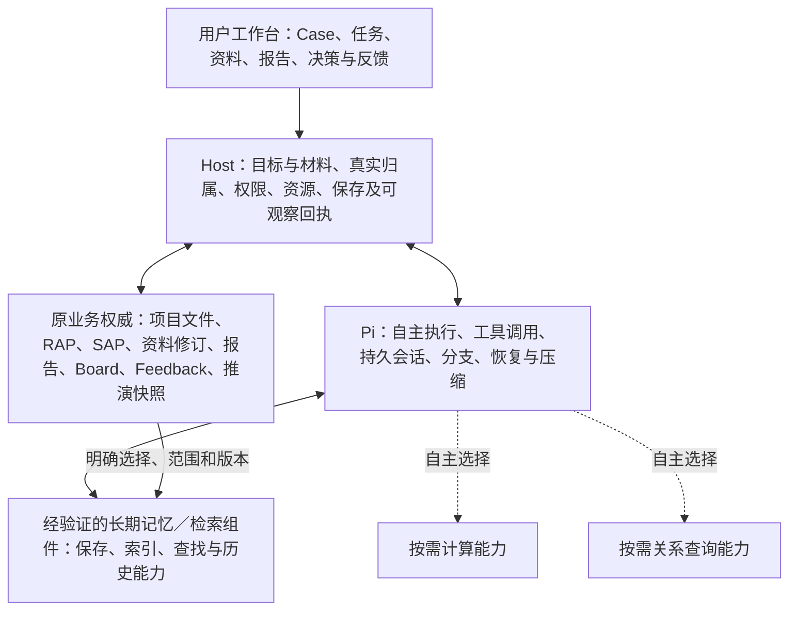

# OptraCall 概念四库与逻辑双库：业务上下文、Agent 记忆与决策学习整体方案

v1.2 整合重写稿 · 2026-11-02 · 吸收多源证据的产品行为、表达与验收要求

**状态：用户已接受 Pi／开源复用方向、整体重构及本次多源证据需求吸收；本文为完整产品与架构提案，不表示新增结构、组件或功能已实施／验收。** 本文统一取代此前“个人工作台方案＋后续路线图”的方案组织方式，不沿用 Phase 0–5 作为章节结构。原附件和未批准结构候选保留历史身份，见第13节。

## 1. 要建设的产品能力

让用户在 OptraCall 做过的工作，逐渐成为以后能找到、看懂、核对和重新利用的业务积累。当前分析能取得正确的数据与口径；结果能回到依据；下一次工作能找到相关经验，同时识别旧经验不适用、已过期或受到反证的情况。

当前问题也可以在信息不完备时向前推进：企业具体情境、制度、流程、事件、用户陈述和案例都能成为起点。没有数据表时，仍可形成有边界的判断、候选解释或补证计划；需要回答规模、差异或改变是否有效时，继续提供可复核的计算与相称的比较，不能用行业常识或通用业务对话替代企业事实与量化能力。

产品价值体现在减少重复找资料、反复解释口径和重复踩坑，以及提高判断依据的可核对性。保存条目数量、摘要长度、记忆命中次数、安装组件数量都不能单独证明价值。

当前产品定位是个人分析与决策工作台。团队共享、协作审批与企业治理是由真实需求触发的后续产品升级。个人阶段本身可以逐步拥有数据、概念、知识、记忆、假设、策略及反馈学习能力，不要求为了产品完整性先建设企业底座。

### 1.1 已确认的决定

| 编号 | 用户已接受的决定 | 本文如何落实 |
| --- | --- | --- |
| P01 | 首批只定义和映射双库、引用现有对象；新增 Case 级假设／策略结构后续再做 | 第6节写完整目标行为，第10节明确首批只用原对象，后续独立落实结构 |
| P02 | 个人统一查找概念、知识、记忆；数据保留 Project 归属，跨项目使用明确来源和访问 | 个人查找入口聚合内容，数据读取／复制保持真实项目身份，不由相似度授予访问 |
| P03 | 用已有数据、报告、一次复盘反馈和第二个相似 Case 验证复用 | 首批验收贯穿两次工作；具体真实 Case 尚未指认，合成工程场景与用户体验分别记录 |
| P04 | 以本次研究为依据优先复用 Pi 与开源记忆能力，整体重构四库双库方案 | Pi 继续持有会话权威；跨会话记忆先验证组件；产品只补可证明的业务缺口 |
| P05 | 吸收多源证据稿的产品行为、证据表达和验收要求，沿用v1.1 Pi／开源复用架构 | 增补无表启动、主任务连续分析、证据分义、结论修订和评估；不自动选择补货试点、方法清单或扩大首批实施 |

P04 包含用户随后明确的“全部重写、合为一份、可重构章节”，不意味着指定采用某个组件，也不意味着批准原 D01–D08 结构。本文覆盖全部长期能力；当前可执行范围仍是方案文档升级。

P05来自本会话用户对评估建议的接受，不以附件中“已认可方向”的自述追认其他决定。无需完整Case、RAP或SAP即可开始，任务仍在已有或新建项目内创建；Case用于需要承接的业务事项，不能把“入口轻量”解释为没有Project归属的任务。

### 1.2 一条完整的用户工作链

用户在项目任务中直接提出业务问题，提供已授权的业务情况或材料；需要业务承接时再关联Case。Agent查找数据、解释口径、参考资料与历史，自主分析和检查，形成报告。用户可以采纳、驳回或暂不决定建议，记录行动和实际反馈。某次工作里程碑后，用户选择保留有价值的知识或经验。新Case或后续项目任务找到它们，查看来源和适用范围，由Agent结合新材料重新判断。

这是可以追溯的业务关系，不是 Host 指挥 Agent 的固定执行顺序。描述性分析可以不提出假设，没有行动反馈的工作也可以结束并保留未知；未建完资产库不妨碍开始分析。

### 1.3 主任务中连续推理与计算

统一入口允许先讨论制度／流程冲突，再追加审批日志和订单计算；也允许从数据异常转向调查规则、权限与实际行为。普通材料追加和工具计算保留在同一主任务的连续分析上下文，不因材料性质切换要求用户重建任务、切换专用分析模式或搬运背景。只在缺失内容实质影响判断或访问权限时有针对性地澄清，其余可说明假设后继续。

新增材料、计算输入／口径／产物、关键前提及判断修订都应能回查。用户看到的是可检查的理由摘要、证据与计算产物，不要求保存或展示模型内部逐步思维过程。独立核算、冷读及封闭出稿资源继续遵守第9.4节隔离；主任务连续性不等于合并所有会话或向冷读灌入作者结论。

## 2. 四库与双库的含义

六类概念帮助用户理解和整理业务，不决定物理数据库、服务、独立工作台或统一 schema 的数量。

| 逻辑能力 | 用户的问题 | 内容与权威来源 | 重要区别 |
| --- | --- | --- | --- |
| Data 数据 | 用哪份数据？一行代表什么？ | 项目文件、可校验的固定输入、结构观察及业务说明 | 登记描述、结构推断和实际数据字节各有含义 |
| Ontology 概念 | 字段和业务术语是什么意思？ | 概念、别名、属性、轻关系、字段解释；正式指标引用 SAP 发布版 | 概念关联不复制一套可独立修改的指标公式 |
| Knowledge 知识 | 有哪些规则、背景、观点或方法可参考？ | 企业资料精确修订、用户明确陈述及有原文位置的整理成果 | 原文、整理者解释、模型摘要和已确认规则分别展示 |
| Memory 记忆 | 过去怎样判断，后来怎样，值得借鉴什么？ | 选择性的 Case／报告／决策／行动／反馈经验 | 用户保留表示值得参考，不能据此认定专业正确或因果成立 |
| Hypothesis 假设 | 为什么可能发生，哪些证据会改变判断？ | Case 内的主张、机制、范围、支持／反对证据与未知 | RAP 方法假设、普通推测和经业务检验的假设不自动等价 |
| Strategy 策略 | 有哪些可选做法，何时适用，结果如何？ | 备选方案、人的选择、行动与反馈的关联 | 建议、采纳、执行和效果是不同事实 |

四库之间允许关联，不强制把同一内容复制四份。业务知识可视为语义记忆，Case 经验可视为情景记忆；方法经验可以成为 skill 候选，但保存知识不会自动安装可执行资源。原始数据、正式口径与会话原件保持各自权威，不能全部摘要进 memory 后再把摘要当原件。

## 3. 整体架构与职责

架构采用现有业务权威、Pi 会话能力、经过验证的记忆／检索组件和少量产品接线。优先让成熟组件承担其已有功能，再补真实缺口。

图中调用均通过获准工具／文件及当前统一会话接缝。记忆组件不取得跨 owner 管理资格，也不从一份 scope metadata 推导真实访问权限。派生索引可以有内容副本，须纳入数据出口、备份和清理范围；它不因可重建而天然没有敏感内容。

### 3.1 Pi 直接承担的能力

项目当前锁定并安装 Pi1.4.0：SessionManager 持久保存 entry tree、活动分支和原生历史，SDK 负责恢复、分支、压缩、工具循环与扩展生命周期。Pi 的历史可以长期持久存在，不能简单称为“只有短期记忆”。跨 Case 经验选择、用户保留和业务版本引用则是另一层产品含义。

现有会话原件及指针继续原位使用，不新增第二份消息库、压缩器、会话恢复引擎或全局运行队列。SDK 支持扩展，不代表 CLI 插件已经适配嵌入式产品。SDK／CLI 的资源发现和默认工具也需要按锁定版本核对。[官方 SDK](https://pi.dev/docs/latest/sdk)、[会话说明](https://pi.dev/docs/latest/sessions)

### 3.2 可复用组件承担的能力

候选可能提供文件记忆、条目管理、搜索、embedding、排序、版本历史、出处或快照。对每个能力先检查固定版本真实覆盖范围：能读取旧正文但没有旧 metadata、能看到版本编号但找不到旧字节、能检索文本但没有业务确认，都必须准确区分。已有能力够用就直接适配，不再造同类引擎。

开源后端自身的摘要、抽取、查询规划或重排可能调用模型，甚至有内部整理循环。它们是明确的可选服务能力，不能被包装成“只是一次数据库查询”。是否启用、运行归属、费用、取消和数据出口须在接入时说明，不允许隐含触发。

### 3.3 OptraCall 必须表达的业务含义

产品负责真实 Project／Case／Task 身份和材料准入，呈现来源性质与精确业务版本，提供候选保留、修订和归档入口，区分人的决定、行动与真实反馈，记录实际交付及报告明确声明的引用。实现时优先复用现有模块或组件字段；只有已验证缺口才增加最小持久记录。

“必须表达业务含义”不等于必须新建一套通用 Asset Registry、MemoryBackend 注册平台或全域状态机。具体组件选择前，不冻结新存储根、UUID 体系、统一修订引擎、sidecar 或数据库迁移。

### 3.4 SQLite、DuckDB、Semantica 与文件的技术分工

四库与双库定义业务内容；下表说明支撑这些内容的技术部件。SQLite 与 DuckDB 都是数据库引擎，但本产品为它们安排不同职责；Semantica 是语义／上下文处理框架候选，不能当作同一层面的第三种数据库或已选定的物理本体库。

| 部件 | 在本方案中的职责 | 当前状态与接入条件 |
| --- | --- | --- |
| SQLite | 保存需要结构化关系、约束和事务的产品业务记录；现有 Case、Decision Board 各自持有其数据权威 | 两处已有接线，保持独立；不为“四库双库统一”合库或把所有内容迁入。新增记录确需SQLite时先核对现有schema与兼容，不默认给旧库增表 |
| 项目／资料文件与Pi JSONL | 保存数据正文、原资料修订、RAP／SAP发布物、报告／PPT以及原生工作历史；项目／任务等现有JSON存储继续沿用 | 保留现有存储方式；不是把正文、会话和项目metadata全部迁入SQLite或记忆组件 |
| DuckDB | 按需扫描、聚合、关联结构化数据，支撑可复现SQL分析；可查询所支持文件，也可按实际需要保存派生表／分析结果 | 当前未发现产品内置依赖或统一接线；多表／多文件、数据量、性能或SQL复现需求触发评估，第7.1节定义采用证据。它不接管Case状态、用户决定或Pi会话 |
| Semantica等语义组件 | 组织和查询概念、实体、关系及来源，提供Agent可按需使用的语义能力；底层图／向量等后端随实际组件核验 | 当前未发现产品接线；轻概念／显式引用不足时再比较，第7.2节定义触发。Semantica仍是候选，不默认安装全部模块，也不将其推断变成正式SAP定义 |
| 记忆／检索组件自己的存储 | 承担所选组件已实现的记忆内容、索引和历史能力；可能内部使用SQLite、文件或其他后端 | 随组件验证确定；例如组件使用SQLite，不意味着应将它与Case／Board数据库合并。先查已提供能力，再决定最小业务适配 |

以一次业务分析为例：Case和人的决策记录沿现有SQLite业务模块保存，实际数据与报告仍有明确文件／版本来源；Agent在确有需要且已获可用工具时使用DuckDB计算；关系问题再使用经验证的语义组件查询；最后由用户选择哪些内容保留为经验。这些部件可以组合使用，不要求同时安装，也不把技术分工编成强制分析步骤。

职责定位依据：[SQLite本地应用存储说明](https://www.sqlite.org/whentouse.html)、[DuckDB分析型工作负载说明](https://duckdb.org/why_duckdb)、[Semantica官方概念说明](https://github.com/semantica-agi/semantica/blob/main/docs/concepts.md)。Semantica具体能力与后端尚未做本项目采用验证；这里只确认其框架定位，不将官网能力声明当作运行保证。

## 4. 业务上下文：数据、概念和知识怎样可用

### 4.1 项目数据及固定输入

从项目文件区登记实际需要的数据，展示文件身份、格式、大小、更新时间／观察时间、内容校验以及结构扫描对应的文件版本。结构观察说明字段、类型、行数、扫描是否完整；未知不填零，样本行数不冒充总量。

用户和 Agent 可以补充“一行代表什么”、关键字段、时间归属、单位、来源与限制。自动扫描只提供结构观察，不能自动确认主键、业务粒度、字段意义或指标公式。允许说明不全、推断和未知，Agent 在当前任务自主判断是否需要澄清。

关键输入的引用需要能回到当时内容。先核验来源或组件是否已提供可证明的固定版本；没有保证时，仅对明确采用的内容按需固定证据。路径和 hash 用于定位／校验，不能自行恢复旧字节。保存中内容变化或快照失败应明确反馈，不能静默改用新文件或生成成功回执。

数据继续归属项目。个人查找概念／知识／经验不自动授权读取另一项目数据；跨项目数据使用须明确源、目标与操作，优先受控复制形成目标项目材料并保留来源。沿用 `010_draw`、`020_clean`、`060_reports` 规则，分析使用获准的020材料，不借登记入口扩大原件读取；不改变现有软约束和敏感数据提示。

首批优先用 CSV／JSON 等已有本地支持能力完成场景；最终格式、编码、大小和解析限制必须在实施规格固定。Excel、多表和连接器跟随真实需求补充，不在整体方案中冒称首发支持任意格式。

### 4.2 业务概念与指标语义

轻量概念包含名称、定义、别名、属性说明、简单有向关系、来源及适用范围。概念能关联明确数据版本中的字段，映射区分用户已确认、推断和未知。多概念／多字段关系可表达冲突，不靠 Host 自动挑出正确解释。

SAP 继续是正式指标口径的权威发布物。概念关联精确 SAP 身份；检索摘要、图谱与 Agent 解释不能各自维护另一套正式公式。修改概念或指标发布新版本，不追改旧任务的原引用。

首次建立字段映射需要有可定位的数据版本；优先复用已有版本，确无版本时可在明确操作中固定所选内容，不要求用户先跑一次空分析。关系编辑是业务定义，不要求安装图数据库或 OWL 推理机。

### 4.3 原资料与可引用知识

继续使用 EnterpriseMaterial 的原文与修订能力。知识条目整理一项可独立引用的内容，标明属于事实陈述、制度、观点、推断、假设或方法说明；提供资料精确修订及实际原文位置，支持多个来源和相反材料。

用户陈述可以作为明确标识的来源，不能伪装成外部制度或已核验证据。没有可定位来源时可以保留草稿／候选并展示缺口，不得宣称“原文已核定”。格式暂不支持正文定位时提供原件位置并说明限制，禁止伪造 PDF／Office 抽取成功。

Agent 可以提出知识候选，用户决定哪些进入长期可复用内容。用户编辑解释不会改原文；一份报告生成 PPT、一次资料摘要或一次工具成功，都不自动晋升为正式知识。

### 4.4 多源材料、关键主张与目标取舍

业务上下文保留材料的性质，也说明重要主张核到什么程度。下面是面向用户的表达维度，不是新增库、强制表单或已经批准的状态枚举。

| 输入性质 | 可帮助回答什么 | 需要保留什么 |
| --- | --- | --- |
| 量化记录与计算 | 变化、差异、数量与估计 | 指标口径、样本、业务时间窗、缺失、输入版本和计算来源 |
| 制度／流程／事件／访谈等定性材料 | 规则、权限、行为与具体情境 | 来源视角、适用对象、发生／生效时间、版本和争议；书面授权与实际执行分别核对 |
| 知识与历史经验 | 候选机制、参考做法与检查问题 | 来源及原场景范围；不能自动成为当前企业已确认事实 |
| 目标、约束与价值取舍 | 要优化什么、愿意承担什么风险 | 谁提出／确认、适用范围、取舍及未决分歧；不能伪装成事实证据 |

“来源存在”“关键主张已核验”“用户决定长期保留”“本次实际提供或声明引用”各有不同含义。核验说明须能指出针对哪个主张、哪些对象／时间、依据什么、由谁或哪次分析作出判断；待核验、有争议或已失效在关键判断旁清楚显示，不能因存入知识／记忆、通过格式校验或引用数量增加就升级为已证实。已核验也只覆盖其明确范围。

有分歧时保留双方原话或准确摘要、来源、时间和对象，说明争议影响哪个判断，以及什么证据可能帮助核对。制度规定与实际执行可能描述不同事实，不能简单投票、取最新文本或用未经校准的精确可信度消除分歧。Agent或人提出有依据的核验判断，Host负责记录和展示，不充当企业事实的自动裁判。

目标的提出者、决策责任与材料提供者可以不同；个人阶段明确这些业务角色不等于新增认证、团队成员或审批系统。例如“希望降低库存”是一项目标，不能充当“库存考核造成缺货”的证据。目标或风险偏好改变应与事实前提被推翻分别说明；Agent协助解释冲突和选项，由有相应责任与授权的人作取舍。

## 5. Agent 记忆：保存什么、怎样找回和修正

### 5.1 工作历史与长期经验分开承担

Pi 原生记录保存实际工作过程；业务记忆只整理值得将来参考的部分。报告完成、一次重要判断、建议被驳回、行动回录或反馈出现都可以形成候选，不必等整个 Case 结束。失败、反证和未解决问题同样有价值。

每条可复用经验应能解释：发生过什么、当时怎样判断、依据哪些来源、业务时间与适用范围、后续是否有反馈、有哪些局限。时间和范围可以未知，但不能被保存时间或默认成功替代。记忆引用原对象，不搬运完整 JSONL 成为第二份工作历史。

### 5.2 形成与保留

首批采用用户显式发起的整理／保留方式，候选生成沿普通项目任务或人工编辑；不额外自动调用模型。后续若需要自动捕获或后台整理，单独决定哪些内容可处理、何时触发、何处运行、如何取消及如何防止污染。

保留表示这条内容值得再次参考；它不是事实已证实、策略已有效或用户同意全部推断。候选可以作为明确标识的本次材料被使用，但这不自动改变其长期保留状态。草稿、用户保留、归档与业务可信度是不同含义。

### 5.3 选择性召回与按需读取

个人范围可以查找概念、知识和历史经验，先查看名称／摘要／来源，再按需打开正文和原件。用户可手动选入，Agent 也可在已授权范围自主检索；普通读取和分析不新增逐条确认门槛。

默认当前查找优先提供可用、已保留内容。候选、归档、过期、被反证或存在冲突的条目需要可辨认，不无提示地作为当前结论。检索相关性不是正确性或访问许可；没有命中不能被解释成不存在相关事实。

检索方式从代表场景需求出发。先核对原生查找和文件记忆是否足够；关键词／别名不足时，再比较语义与混合检索。对命中、漏检、陈旧索引、同名项目、近义表达和错误相似都要验证，不以 benchmark 宣传替代业务样本。

### 5.4 冲突、过期、归档和遗忘

新材料与旧经验矛盾时保留双方来源、业务时间和适用范围，允许用户修订或标记冲突；Agent 在当前任务自主判断。新任务的当前可用内容与旧任务当时引用的版本分开，不能更新一条记忆后让过去报告改换依据。

归档影响新发现／默认召回，不能切断历史引用。用户提出遗忘或清理时，必须同时检查源文件、组件内容副本、索引、历史与备份的保留范围；检索隐藏不等于物理删除。首批不做自动物理清理，后续基于明确保留规则处理，不把组件的 delete／restore 当作已批准的产品删除流程。

## 6. 决策学习：假设、策略、行动与实际反馈

这部分是整体产品能力的实质目标。首批引用现有对象；后续基于工作需要增量引入 Case 级结构，实施前对照原对象确认唯一权威与关系。

### 6.1 可检验的业务假设

一项假设表达一个有业务范围的解释或预期，能够指出哪些观察会支持它、哪些结果会削弱或反驳它。应关联陈述、可能机制、对象／时间、支持与反对证据、尚未知的条件和当前判断的历史。

用户可以逐步补充；不要求每个问题都凑假设。Agent 自主选择统计、因果、定性或其他适当方法。Host 不规定检验步骤／次数，也不凭状态或引用数量判断假设成立。支持增强、被削弱、被证伪和未定是专业判断的表达，不是 Host 自动执行的工作流。

RAP 中的需求／方法假设是潜在来源，不能直接变成“已经检验的业务假设”。业务假设变更保留先前说法与证据；相关关系和模型推演不自动升级为因果证明。

判断强度应与依据相称：

| 判断类型 | 可以说明什么 | 仍需保留的边界 |
| --- | --- | --- |
| 数值分解 | 总变化对应哪些构成项 | 不是自动识别原因 |
| 相关线索 | 哪些现象共同变化 | 不排除竞争解释或混杂因素 |
| 机制解释 | 可能的作用路径与成立条件 | 列出支持、反对、未知和其他可行解释 |
| 条件测算／推演 | 假定条件成立时可能怎样 | 假设不是实测，时间节省不直接等于可兑现成本 |
| 因果效果估计 | 在明确比较与识别条件下估计影响 | 说明数据、比较方式、识别假设、不确定性与适用范围 |

正式数量结论保留输入、单位、口径、公式／代码、结果及敏感假设。证据不足时可以交付机制判断、区间情景或补证计划，不编造损失、提升幅度或精确置信度；定性问题不强行统计化，量化问题也不能仅靠定性报告交差。

### 6.2 策略备选与人的选择

策略描述为某个目标考虑的做法，能够说明作用机制、行动安排、适用条件、资源／成本、风险、预期观察和限制。多个假设可以关联多个策略，策略也可以没有单一解释性假设，不能为了关系完整强造因果链。

报告建议、策略候选、人的采纳／拒绝及理由、BoardTask 行动实例分别表达。一项策略可以对应多个行动，同一行动或反馈也可能涉及多项策略；具体关联在后续结构设计核对，不能直接把 BoardItem 重命名为 Strategy。

新证据削弱或证伪假设时，应能找到依赖该假设的策略，由用户或 Agent 重新评估适用性，保留原选择与行动历史。Host 不自动改变采纳状态、决定替代方案或重放行动；首批可沿现有引用回查，不据此提前增加双库结构。

修订还应说明“材料／前提→判断→报告或建议”的影响关系：哪些前提撤回或修改、哪些结论因此变化、哪些暂不受影响，以及新依据是什么。生成可区分的新稿并保留旧稿和修订理由，不只更新一个摘要，也不无证据地换成另一种归因。先复用原引用、成果版本和明确说明，不为影响展示预建依赖图或因果引擎。

产品支持比较、解释和记录选择；经营动作仍沿有效授权由人执行。自动派发到真实系统、经营审批和执行回执不是本方案默认开放的能力。

### 6.3 行动和结果回录

BoardTask 继续承接行动，FeedbackRevision 继续保存实际反馈修订及观察期、适用性和局限。采用策略、完成行动和取得效果分别记录；没有反馈保持未取得反馈，取消和不明副作用保持 UNKNOWN。

下一步可以是小范围试行、补充关键证据、暂缓或明确不行动，比较时保留维持现状的风险与重新评估条件。需要承接时，至少能看清责任人、授权／资源范围、实施或补证时间、复核日期与提前复核条件、预期机制／中间信号／结果观察、基线或比较方式、副作用和停止／回滚条件；未确定的时间与门槛标待确认，不以演示数字填成承诺。首批优先沿现有Board／反馈关联表达，不据此提前创建独立假设／策略结构。

复盘要能分别回答行动是否按计划发生、材料是否覆盖同一对象／时间、预期与实际有哪些差异，以及哪些判断受到支持、未受支持或仍未知。没有改善可能与执行偏差有关，改善也可能来自并发变化，不能直接判定机制无效或有效。记录谁确认继续、调整、停止或补证，以及何时再复核；个人阶段可由当前用户承担审核和业务确认，不增加多用户审批链。

SimLab 快照及导出报告保持“假设模型下的推演结果”性质，合成工程反馈保持合成标识。它们可以帮助比较方案，不能当成真实经营结果。即便实际指标改善，也需保留同时发生的其他因素，不直接判定策略有因果效果。

### 6.4 跨 Case 经验与模式成熟

基础跨 Case 找回和显式复用属于首批能力。进一步学习是比较多个场景中的条件、证据、反例、选择及反馈，识别可复用假设模式、策略模式或方法经验，并持续修订适用边界。

形成模式需保留支撑 Case、反对 Case、失败、业务范围、来源版本及尚未解释的差异；由用户决定是否整理为可复用模板／知识。单次成功、召回次数、Agent 自评或简单计数都不构成晋升依据。方法经验要成为可执行 skill 时，另核权限、输入输出和停用方式，保存记忆不自动安装技能。

这一能力可以基于简单文件和显式关系逐步完成，不以向量库、DuckDB 或语义图已安装为前提。退出标准是新场景能找到适用与不适用的经验并说明依据，而不只是展示“相似 Case 命中”。

## 7. 按真实需求增强计算与关系查询

### 7.1 结构化计算增强

持续出现多表／多文件关联、大数据扫描、Parquet／SQL 复现或可证明的性能瓶颈时，再评估 DuckDB 等成熟计算组件。Agent 可自主选择 Python、SQL 或其他工具；引擎提供计算能力，不选择分析路径。

需要复现的计算保留输入版本、实际查询／参数、引擎版本、相关 SAP 身份及输出位置。派生产物与原数据、技术执行成功与业务结论正确分别记录。输入变化、超能力或中断明确反馈；停止／失败保留现场，不由 Host 另补计算。

采用条件是代表数据上的收益可以复测，且保存／重开、取消和派生来源可核对。停用引擎后原数据和历史依据仍可回读，不全量迁入一个新明细库，不为未来规模预建连接池服务或数据仓库。

### 7.2 关系与时间语义增强

当轻概念目录与显式引用无法完成反复出现的跨材料关系／时间查询时，再比较 Graphiti、Semantica 或其他适用组件。依据实际问题选择，不能因为旧图里写了某个名称就自动采用。

产品概念与 SAP 发布继续作为正式定义；图谱、实体抽取及关系索引是能回到来源的派生表示。若现成组件已提供时间窗口、episode 来源和历史快照，应直接映射；不能再建设平行图历史引擎，也不能假装任一组件原生支持全部 OWL／业务推理语义。

查询结果需显示关系方向、来源、业务时间、版本和推断性质；推断关系、统计相关与因果证据分开。源内容更新、停用或索引落后时有明确状态，历史任务保留当时依据。图重建不得改变正式指标定义。

采用条件是能完成一个简单检索确实不能解决的关系问题，结果可核对、收益超过引入成本，并覆盖更新／失效／重建。未满足就继续轻关系；图可视化、完整 OWL、公理治理和企业图服务均非默认交付。

## 8. 工作台与日常交互

保留统一的项目任务入口；Case、RAP、SAP按需关联，不是开始分析的必填前置。入口提示用户描述问题、目标、已知事实或限制，数据文件可选；可提供轻量问题提示，但不拆成互不相通的分析模式。提供一个个人资产查找入口，按数据、概念、知识、经验切换浏览，展示名称、范围、来源、版本、时间、当前可用性和未知；无需四个独立工作台。

| 工作发生的位置 | 顺手完成的操作 |
| --- | --- |
| 项目文件 | 登记数据、查看扫描、补粒度／单位、选择固定版本 |
| 指标与业务概念 | 查看 SAP 发布、定义／别名、字段映射与冲突 |
| 企业资料 | 分类、打开精确修订、整理有原文位置的知识 |
| Case／任务 | 查找相关资产、查看选材范围和当次实际提供记录 |
| 报告／PPT | 查看固定成果及其明确引用的来源；从里程碑保留经验 |
| 决策板／反馈 | 查看人的选择、行动和实际反馈；后续增加假设／策略关联 |
| 新 Case | 找回相关经验、查看原案与范围，由 Agent 重新判断 |

界面允许未知、暂不保留、修订、忽略及归档，不要求补齐全部表单才能分析。用户确认聚焦长期保留、正式定义、权限和真实动作；产品不增加普通读取／工具迭代的确认门槛。空态说明尚无内容，不展示伪装成真实资产的演示数据。

## 9. 技术接入：复用选择、来源与可观察证据

### 9.1 有限的组件验证路线

以本轮[固定研究](../openspec/changes/personal-assets-phase01/agent-memory-research.md)为依据，优先验证现有 Pi＋原生文件检索基线与 `pi-memory`／`pi-memory-md` 的必要能力；这两个是第三方生态包，不是 SDK 默认内置。若同一代表场景已满足需求，就停止扩大选型。

确有中文近义表达／跨材料召回缺口，再比较 qmd 或 Mem0 OSS；需要更广的上下文资源服务时再评估 OpenViking。Letta／LangMem／Graphiti 的具体机制可借鉴，是否直接引入取决于真实需求。一次只围绕已识别缺口验证，不在比较前先建通用 provider 注册、迁移或运行框架。

评估必须固定包／源码、模型与配置，逐项列出直接复用、最小适配、缺口和不采用理由。自动捕获、Git 同步、退出摘要、后台 embedding、context takeover 或整理等行为，首次验证从所需最小集合开始；无法证明关闭的额外副作用明确记录，不把配置声明当作关闭成功。

候选的本地运行、许可、模型条款、数据出口、原生依赖和成本纳入采用决定。组件 main、已发布包和实际安装内容分别核对。研究本身不安装、不调用模型；后续验证沿当时明确授权在隔离根进行。

### 9.2 业务引用的语义合同

稳定身份与路径分开。沿用 Project、Case、RAP、SAP、企业资料、报告、Board、Feedback、推演等原生身份；保存历史时固定适用版本，解析失败不回落 latest。不把所有来源对象硬塞进六类枚举，也不为了统一而重编号旧对象。

业务引用至少能说明对象是谁、由谁维护、哪一版本／时点、来源在哪里、能否回读及当前限制。具体字段、类型、存储和接口在组件验证后做最小决定；组件已有历史／出处能力时映射使用，保证不足时再固定必要证据。文件 hash、版本号、Git 提交和 metadata 各自能证明什么须有实测。

### 9.3 三种事实分开记录

| 层次 | 可以证明什么 | 不能据此声称什么 |
| --- | --- | --- |
| 可发现／可检索 | 当前授权范围中有目录条目或命中结果 | 正文已进入本次请求，或 Agent 已读／采用 |
| 实际提供 | 某请求或工具结果交付了目录、摘要、片段或全文，及其身份／范围／时间 | 已理解、已采用或结论正确 |
| 明确声明引用 | 报告作者或用户声明采用某来源，绑定该成果身份与来源 | 来源真实无误、业务有效或因果已证实 |

继续使用现有 `providedContext` 和 native entry。插件在后续工具结果里返回的材料，不会自动变成请求开始时的回执；优先关联真实工具／entry 身份，确需补充时只加必要记录，不另建全局上下文台账。没有旧证据显示未记录／未知，禁止按当前索引回填历史。

### 9.4 不同运行入口分别接入

| 入口 | 方案要求 |
| --- | --- |
| 普通项目任务 | 可提供经审查的记忆工具或文件目录，使用真实 projectId/taskId，沿当前公共生命周期 |
| 受管任务 | 只提供核定材料或可安全委派的受限查询；不能加载整个用户扩展环境或放宽到全部 dataRoot；无法安全表达就明确不可用并补最小接入决定 |
| fixed-draft／封闭文本 | 只接受本次已固定正文，不自动发现记忆、MCP、执行扩展、skills 或祖先上下文 |
| 独立核算（含冷读） | 沿原 Agent 资源和固定输入及独立性要求执行；不能自动召回主分析结论或历史专业答案，材料增量单独明确 |
| 历史查看／记录回读 | 仅回读已保存材料、native 和回执；不开 Agent，不触发 session_start、同步、服务连接或摘要抽取；这与需要模型工作的冷读核算不同 |

统一接入沿工程规范 IN01–IN07、Interface v3 与现有 owner/profile；普通记忆消费不另注册会话域。若某具体能力确需另一种业务资源，先证明现有入口不足并补最小决定，不从库名推导新 Agent。

## 10. 首批交付及后续增量

这是一张可调整的建设顺序，不是全部必做的技术流水线。用户当前要求完整方案；首批仍聚焦原先已确认的业务上下文与一次跨 Case 复用，后续能力根据实际证据推进。

| 工作包 | 可观察产出／进入与完成条件 | 保留的边界 |
| --- | --- | --- |
| 复用接缝确认 | 固定 Pi 基线与代表场景，核清组件能力、profile、版本／来源、自动行为及最小适配；形成可审查的选择结论 | 未验证兼容不进入默认；不预建通用记忆平台 |
| 第一条业务积累闭环 | 无数据表可从制度／案例开始，按需在原主任务追加数据计算，报告及修订来源可回读；里程碑经验由人保留，第二个Case实际找回并复用 | 首批双库仅映射现有对象；不新增Hypothesis／Strategy结构或经营执行；资产复用与真实试点完成分开验收 |
| Case 决策记录增强 | 出现持续的假设／策略记录需求后，明确 Case 级对象与原 RAP／Board／Feedback 的关系；能展示新证据改变假设和策略从选择到反馈的区别 | 不建设全局双库服务，不用状态机编排 Agent |
| 计算增强 | 有真实多表／性能／SQL复现问题；代表数据证明收益，派生来源和取消可核对 | Python／现有工具仍可用，计算组件可独立停用 |
| 关系查询增强 | 有轻目录无法解决的关系／时间问题；来源／时效／推断／重建验证完成 | 不复制 SAP，不强制完整本体平台 |
| 经验成熟与模式复用 | 积累多个可比较 Case 及实际反馈；验证适用与反例、过期与冲突，形成可修订模式 | 基本检索早已可用；不用次数自动晋升，不以计算／图组件为强前提 |

第一条闭环应尽早纵向跑通，不先各自完成四套 CRUD 再做集成。新组件在验证中不能证明必要时，可以保留现有方法并收缩方案；必须记录实际缺口与结果，不为预设架构补理由。

## 11. 验收：证明下一次工作确实用得上

### 11.1 两个相连 Case 的代表场景

为便于验收，将两次相连的业务事项标为Case A／B；实际用户可以先在项目任务开展工作，按承接需要关联Case。Case A可以从获准的制度、流程、用户陈述和具体案例开始；补充量化材料时标明数据粒度和未知，仅对适用计算关联精确SAP、概念和资料修订。两条路径都应覆盖：无表时形成有边界的交付，有数据时保留扎实、可复核的计算。

Agent经统一Runtime自主分析，报告展示其明确引用，实际提供记录单独可查看；新证据和计算能在原主任务中改变判断，并保存修订说明。从报告／决策／反馈中的一个里程碑保留少量有来源经验，保留无反馈或失败的原状态。

Case B 按主题／关键词或经验证的其他方式找到相关内容，查看来源、时间和范围，Agent 依据当前材料重新判断适用性；能实际提供并引用原经验，也能明确拒用不适用内容。

随后改变原数据／资料／概念，回看 A 应仍定位当时内容；缺失就显示缺失，不能换成 B 的材料或当前最新版本。归档经验后默认召回改变，历史引用仍可读。同名项目、推演、合成反馈和真实反馈不会串成一份事实。

这套场景是验收，不是要求每次产品运行都经过同样步骤。具体真实 Case 尚待用户指认；先用合成场景做工程检查，不把它算成真实经营效果。

### 11.2 完成证据

| 维度 | 最低证据 |
| --- | --- |
| 用户价值 | 两次工作完成实际查找／读取／引用，能解释复用或拒用原因；记录维护负担和重复解释是否减少 |
| 四类上下文 | 数据粒度与结构观察可辨，SAP／概念映射明确，知识能回原文，经验保留局限与来源 |
| 版本与变更 | 新旧内容、缺文件、陈旧索引、冲突和归档可区分；历史引用不静默漂移 |
| 记忆组件复用 | 固定包身份、实际调用和存储分工；列出直接复用、适配、缺口及未启用功能 |
| 决策学习 | 后续增强能回看反证、选择、执行与实际反馈，不把推演／完成状态当成效果 |
| 工程接入 | 保存／重开、取消、配置变化、迟到结果、重复请求、跨 owner、各 profile、旧记录兼容及停用检查有适用证据 |
| 专业效果 | 工程接线、召回质量、分析正确性和业务效果分别判断；合成 Provider 不证明语义记忆质量，官网分数不证明本产品收益 |

### 11.3 多源证据与修订的代表测试

| 测试情形 | 可观察表现 |
| --- | --- |
| 只有制度、流程和案例 | 不强索数据表，不编造损失；说明哪些判断有依据、哪些是候选，以及补什么最可能改变决策 |
| 定性分析后追加日志／订单 | 在同一主任务连续分析，计算有输入、单位、口径和结果引用，并说明原解释是否变化 |
| 从数据异常进入 | 保留量化能力，区分口径、分解、相关线索与机制解释，再按需调查业务规则 |
| 制度过期或不同视角冲突 | 核对生效时间、对象和来源，保留争议及其影响，不凭记忆或最新一份材料自动裁定 |
| 关键前提被反证 | 撤回／修订受影响主张，保留未受影响判断与旧稿；关联建议供人／Agent重新评估，不换一个无证据归因 |
| 保存、重开和后续复用 | 原材料、计算、适用方法版本和成果修订可回读；新任务可引用或拒用旧经验，缺失保持明确状态 |
| 决策与反馈回到业务事项 | 区分选择、实际执行与结果，预期和观察并列，有明确下一步；无反馈显示待反馈，合成反馈不算真实效果 |

补货责任／权限冲突可作为候选合成样例：加入“相关时期、相关门店实际已有小额紧急补货权限”的新材料，检查Agent先核范围和时间，再修订“完全无权”的前提，而非无证据改称员工执行力不足。这里只吸收可检验的反证要求，未选定真实补货试点、供应链专属定位或特定方法清单。测试安排不成为每次产品分析的固定步骤。

### 11.4 记忆与方法资产的增量评估

沿同一代表任务，比较现有Agent基线与候选记忆组件或方法资产的增量；记忆与方法尽量分别改变，避免同时更换模型、组件和资产后把全部收益归给一项。固定共同基础材料、提示、权限和预算，并按工程规范核对实际Provider／协议／线路、模型版本、reasoning／thinking与输入输出限制。新增资产内容、召回工具及其上下文／时间／成本差异是被比较因素，明确记录，不能声称最终上下文完全相同。

保留首次、重复、失败和无增益结果；业务评阅关注事实错误、无依据因果、冲突／约束识别、方案可行性、反证修订和使用负担，技术评阅关注引用、计算、恢复、延迟与成本。定性评分给尺度和实例，尽可能隐藏候选版本名称。可选通用证据提醒作为诊断对照，不建设强制第三组或评测平台，也不为凑方法数量新增资产。

只增加篇幅、模板化或损害计算与效率时，可以缩减或不采用候选。伪造来源／数值、越权动作和静默覆盖历史应阻断相关候选通过；其余门槛取得基线后确定，不预先承诺提升比例。以上是验证要求，本次文档吸收不启动真实模型或业务材料实验，也不追溯改写已交付版本的验收。

### 11.5 两类闭环分别判定

| 验收对象 | 完成条件 | 不得混称 |
| --- | --- | --- |
| 资产积累与复用能力 | 原事项来源清楚、成果与修订可回读，用户保留经验，后续事项实际找回、判断适用并引用或拒用 | 工程合成场景或无反馈记录不证明真实经营闭环、策略有效或经营收益 |
| 真实决策试点 | 新候选先通过原件保护、材料／计算／成果关联、版本留存、失效引用提示和恢复后主要成果可读的受控验证，再进入真实用户试用；另行指认负责人、授权材料、对象范围与时间／复核安排，形成真实选择（包括补证／暂缓／不行动），记录执行或实际后续观察并完成复盘 | 到期仍无反馈保持待反馈，不能用报告交付、模拟结果或离线质量通过冒充试点完成 |

首批能力验收仍沿已确认范围；真实试点完成是另一个使用目标，尚未选定负责人、材料与排期，不自动变成所有功能的全局阻断门槛。两者均按明确候选和证据记录，不用其中一个通过替代另一个。

完整候选依[工程规范](engineering-workflow.md)完成适用检查、非作者独立复核与职责边界／SDK 复用专项检查。Git／CI、运行采用、安装和用户产品验收分开报告；本方案不重复维护工程流程规则。

## 12. 兼容、权限与产品演进

### 12.1 既有工作与故障保留

保留项目、会话、父链、RAP／SAP 发布物、企业资料修订、报告、PPT 版本、核算 FAIL／UNKNOWN、决策／反馈和推演快照。只读查询不迁移或补写旧内容，不自动重放、换模型或猜测成功。组件加入不接管既有任务权威。

新增业务关联优先最小适配，不为统一改写严格校验的旧数据库。实施前明确实际存储、并发冲突、版本变化和迁移／回退：回退代码仍需保留新增成果，不能恢复旧副本覆盖新工作。索引重建、快照恢复与业务数据回退是不同操作，不能把一个组件的 restore 当成全产品安全回退。

损坏或未知 schema 保留并报错，不重置；已选择的必要材料缺失／变化时反馈具体问题，可选目录不可用明确说明。没有选择新资产的普通任务仍能按原能力运行，不能强制启用新记忆服务才能聊天。

### 12.2 从个人到团队和企业

| 产品范围 | 升级触发 | 新增能力 | 延续与重新设计 |
| --- | --- | --- | --- |
| 个人工作台 | 当前范围 | 本地资料、明确来源、可复用概念／知识／经验和决策记录 | 稳定身份与版本，署名不冒充认证；本机路径不当共享身份 |
| 团队工作台 | 已有资产真实需要共享、多人处理同一事项 | 成员身份、个人／团队可见性、共享审核、协作 Case、冲突处理和团队经验 | 保留原资产来源；私有记忆不默认共享，个人保留不等于团队审核 |
| 企业工作台 | 跨团队标准、组织权限、业务系统执行与运维要求出现 | 企业身份／组织／权限、连接器、正式语义治理、授权执行、审计和部署运维 | 重新评估访问与部署边界，不能只加登录；不让一个组件的 scope 代替企业授权 |

个人阶段只保留未来迁移必需的身份、出处和版本含义，不预埋未使用的租户／角色字段或共享服务。团队／企业单独立项；它们不是旧建设阶段编号的同义词。

## 13. 已有证据、替代关系与未决决定

依据：用户三份讨论稿《个人工作台优先_四库双库建设方案_v0.2》《Phase2-5_后续建设路线图_产品讨论稿_v0.1》《多源证据驱动决策_产品方案讨论稿_v0.2》，以及[产品基础方向](OptraCall_产品讨论稿_v0.2.md)、[工程规范](engineering-workflow.md)、[统一接入说明](agent-session-integration.md)和[Pi／开源记忆研究](../openspec/changes/personal-assets-phase01/agent-memory-research.md)。多源证据稿先经只读评估，再由用户在本会话接受所列行为／表达／验收建议；原附件内容、“已认可”自述和启动Prompt不额外授权开发或追认全部建议。

本方案沿用的源码核对快照为 `fd6f9714909d1628cd81d751f7fe9537af9b5b6f`、Pi1.4.0；该快照已有项目文件、RAP、SAP、Case、企业资料、统一会话、报告／PPT、核算、Board／Feedback 与推演接缝，不将快照冒称实时最新 main。存在接缝不表示本方案所有能力已实现或本次实机重验。行业研究固定到各自版本，采用前重新核对实际候选和届时产品基线。

| 决定类别 | 当前状态 |
| --- | --- |
| 产品目标、P01–P04、Pi与开源复用方向、单一整体方案重写 | 用户已确认 |
| P05多源证据行为／表达／验收吸收，沿用v1.1架构 | 用户已确认；本次仅更新文档，不新增存储或Runtime |
| 首批候选路线：原生基线＋文件式Pi记忆，真实缺口再扩展 | 基于研究的推荐顺序，尚未选定／实测具体组件 |
| 原 D01–D08：统一个人新根、四类同构对象、统一修订／sidecar等 | 从未获批；已撤回原整包 A 请求，仅保留[历史候选](../openspec/changes/personal-assets-phase01/historical-structure-proposal-v0.2.md)用于追溯 |
| 最终存储／接口／字段／状态／迁移与逐 profile 采用范围 | 由组件与接缝验证收敛，实施持久结构前给出完整、最小的结构决定包 |
| 真实体验 Case、材料、反馈修订及专业判断基准 | 尚未指定；工程合成与真实体验分开 |
| 补货作为首个真实试点、特定用户／方法清单、真实闭环排期与门槛 | 尚未选定；候选样例不构成批准，个人审核不引入团队审批 |
| 后台自动捕获／抽取／整理、真实业务执行、多用户治理 | 不由本次方案默认启用，按真实需求与有效授权决定 |

本文不要求重复确认已批准的产品方向，也不让用户替开发者选择 SQL 类型。准备实施时，只提交已被真实接缝收敛的剩余产品／结构决定，写清推荐、原因和代价；不再提交一套未经复用验证的通用记忆平台设计。

本次实际文档范围、复核与未完成事项见[变更记录](../openspec/changes/personal-assets-phase01/result.md)。

## 附：原建设内容的覆盖核对

此表只证明重组时没有丢失旧需求，不恢复旧章节或强制瀑布顺序。

| 原建设内容 | 本文位置与调整 |
| --- | --- |
| 最小资产规范／来源引用 | 第2、3、9、12节；先查现有能力，不先建设通用注册中心 |
| 四库最小能力 | 第4、5、8、10、11节；沿一个业务闭环纵向交付 |
| Case级假设与策略 | 第6节；目标行为完整，首批只映射原对象，新增结构后续落实 |
| 本地计算增强 | 第7.1节；由真实计算问题触发，非记忆前置 |
| 语义关系增强 | 第7.2节；按需求选组件，保留业务定义权威 |
| 跨Case学习与个人资产成熟 | 第5、6.4、11节；基础召回首批可用，模式成熟依赖真实案例与反馈 |
| 团队／企业演进 | 第12.2节；按产品需求独立升级，不提前增加治理负担 |
| 多源证据补充 | 第1.3、4.4、6、11.3–11.5节；区分输入／核验／价值，连续分析、反证修订及两类闭环，保持Pi／开源复用 |
