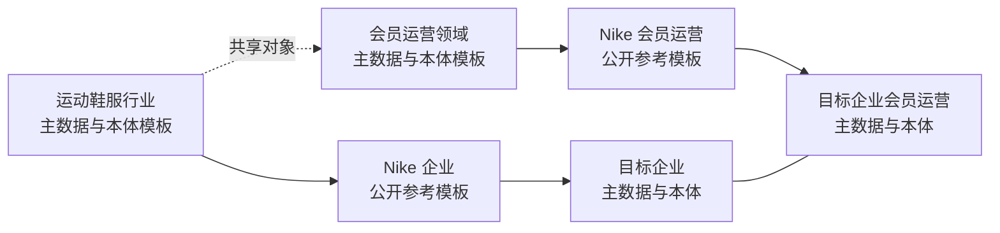

# 企业基础层参考模板包

版本 v0.1 · 2026-11-12 · 状态：参考草稿，供用户审核

本包按用户本轮修正，从行业、领域及标杆公开参考出发建设企业基础层，撤下此前“哪些门店的首购会员复购偏低”的范围限定。具体分析问题在基础层内化后再选择。本轮只形成研究与模板，不读取目标企业资料，不建立其正式资产，不运行分析模型或修改产品。

**2026-11-12 后续补充：** 用户要求将数据分析指标体系纳入同步建设。四份 v0.1 模板保留，其下一版应统一包含主数据、指标体系、本体及三者关联。现有工具评估与最小调整建议见[三类资产建设调整思路](foundation-adjustment-v0.1.md)，当前待确认、暂不开发；不能将原四份模板视为已完成完整指标体系。

## 两条建设路线

箭头表示参考、扩展和企业内化的建设路径。企业、品牌、商品、门店、账号等共享对象使用一致含义，两条线通过引用连接，避免重复创建两套身份。Nike 是参考企业；其经营政策不自动成为目标企业规则。“Nike 会员运营”表示公开可见的业务功能域，内部部门名称与组织架构保持未知。

## 模板目录

| 编号 | 模板 | 主数据范围 | 本体范围 |
| --- | --- | --- | --- |
| T01 | [运动鞋服行业](01-sportswear-industry.md) | 企业组织、品牌、商品款与变体、尺码、门店渠道、地点、业务伙伴等 | 对象含义与粒度、经营关系、商品与交易事件、适用约束 |
| T02 | [会员运营领域](02-membership-domain.md) | 会员主体、账号、会员计划及关系、可选等级、权益、触点、偏好与权限记录等 | 入会与状态变化、权益资格及使用、触点参与、购买与服务关系 |
| T03 | [Nike 企业公开参考](03-nike-enterprise-public.md) | 对 T01 的公开事实填充与建议扩展 | 品牌、产品、市场、渠道与合作关系的公开参考模型 |
| T04 | [Nike 会员运营公开参考](04-nike-membership-public.md) | 对 T02 的公开事实填充、地区化权益与应用触点 | 会员关系、权益适用条件、触点与功能关系的公开参考模型 |

来源核查分别见[通用标准与词汇研究](generic-reference-sources-v0.1.md)和[Nike 公开资料研究](nike-public-reference-sources-v0.1.md)。模板中的标准映射是候选对齐，不代表实施、符合性认证或 Nike 使用这些标准。

## 每条内容如何标记

| 标记 | 含义 | 使用方式 |
| --- | --- | --- |
| 标准参考 | 官方标准或词汇明确定义的对象、标识或关系 | 保留标准链接；核对适用语义后选择映射 |
| 公开事实 | 标杆官方资料实际披露的事实 | 记录来源、地区、资料期间、查阅日及限制 |
| 建模建议 | 本包为组织知识而提出的对象、字段、关系或约束 | 可以调整，不能表述为 Nike 内部实现或已确认企业事实 |
| 企业待定 | 需要目标企业制度、系统或数据才能核定的内容 | 留空并记录所需证据，不由模型补成事实 |

未逐项标为公开事实或标准参考的字段、类型、基数及检查项，均为建模建议。字段名采用本包的逻辑名称，不声称与任何企业实际数据库一致。

## 统一填写结构

主数据模型描述稳定共享对象；实际企业记录需另从获准来源取得。本体明确概念、关系、事件和规则。订单、支付、退款、积分流水、权益使用等保留事件身份；余额、生命周期标签、复购率等计算结果有各自方法与时点，分别管理。此划分参考 [SAP 的主数据、参考数据和交易数据说明](https://www.sap.com/uk/resources/what-is-mdm)，具体归属仍由企业使用方式核定。

四组模板统一使用以下记录头；可落实为表格、资料字典或现有 Studio 资产，当前不规定序列化格式。

逻辑类型约定：`text` 为文本或不透明标识，`code` 为有命名空间的枚举，`ref` 为带对象类型的标识引用，`date` 为日期，`datetime` 为保留时区的日期时间，`int` 为整数，`period` 为明确起止边界含义的期间，`map` 为结构化条件或属性集合。`?` 表示按场景可空，`[]` 表示多值；未知、不适用和明确为空分别表达。没有日期依据时不填造有效期间，基数及必填条件在企业内化时核定。

| 字段 | 类型 | 填写要求 |
| --- | --- | --- |
| `template_id` / `version` | 标识 / 版本 | 参考模板身份及准确版本 |
| `item_id` / `label` / `definition` | 标识 / 文本 | 对象、属性、关系、事件或规则的稳定名称与含义 |
| `item_kind` | 枚举 | 主数据模型／参考数据／关系／事件／规则／分析资产引用 |
| `grain` / `value_type` | 文本 / 类型 | 一条记录代表什么；值类型或关系两端 |
| `required_when` / `cardinality` | 条件 / 文本 | 在何条件下必填、可有几个；没有企业依据时标候选 |
| `evidence_kind` | 枚举 | 标准参考／公开事实／建模建议／企业待定 |
| `source_ref` / `source_locator` | 引用 / 定位 | 来源版本及原文位置；缺证据保持未知 |
| `market_scope` / `business_scope` | 集合 / 文本 | 地区、渠道、人群和业务适用条件 |
| `valid_from` / `valid_to` | 日期时间，可空 | 事实或规则的业务有效期间；未知不以查阅日代替 |
| `observed_at` / `retrieved_at` | 日期时间 | 资料表达的观察时点／实际查阅时点，与业务有效时间分开 |
| `enterprise_decision` | 枚举 | 待定／采用／修改／排除／新增 |
| `target_binding` | 引用，可空 | 目标来源、表或资料、字段、键、粒度、转换与检查依据 |
| `difference_reason` / `owner` | 文本 / 责任角色 | 企业内化差异、依据和维护责任 |

实际主数据候选记录另有 `entity_id`、`entity_type`、`enterprise_scope`、状态与来源键映射。跨系统标识映射采用独立关系记录，带来源、核验状态和有效时间；手机号、邮箱、设备号或相似姓名不直接被定义为自然人统一主键。

四组模板的共享规范名为 `Party`（研究中的 CustomerParty／PartyCustomer 为候选别名）、`OrganizationUnit`（可对照标准词汇 `org:OrganizationalUnit`）、`CampaignActivity`、`BenefitDefinition` 和 `PolicyDocumentVersion`。研究记录保留不同候选叫法；内化时先做术语对照，不能因别名重复创建对象。

## 目标企业内化工作表

用户随后提供目标企业资料。Agent 基于两条路线完成以下对照，必要业务选择集中提交，不要求用户逐字段填完整模板。

| 参考项与版本 | 目标企业证据 | 采用／修改／排除／新增 | 企业定义与适用范围 | 实际数据映射 | 缺口／冲突及处置 |
| --- | --- | --- | --- | --- | --- |
| 待填 | 待提供 | 待定 | 待核定 | 待核定 | 待核定 |

资料可涵盖组织与品牌、商品和门店字典、渠道及系统清单、会员制度、账号与身份关系、权益及活动规则、触点说明和获准样本。先盘点已有材料再提出精确缺口，不要求一次性提供完整企业资料。

内化后，企业基础层保存可跨 Case／项目／任务复用的正式资产；后续普通任务发现新资料或共享定义问题，沿任务演进层贡献、核定并入基础层。SAP 指标及方法依企业规则和后续使用场景扩充，基础模板不预先冻结首购、复购、活跃或价值等级口径。

## 本轮目标与后续顺序

| 步骤 | 成果 | 当前状态 |
| --- | --- | --- |
| R01 | 四组主数据与本体参考模板、公开来源与未知项 | 已完成起草、来源核查和独立一致性复核，待用户审核 |
| R02 | 用户审核参考对象、覆盖范围与模板结构 | 待审核 |
| R03 | 用户提供目标企业资料，Agent 盘点并完成两条线差异对照 | 尚未启动 |
| R04 | 企业内化、映射与检查，沿既有机制形成正式基础资产 | 尚未启动 |
| R05 | 选择实际分析任务验证使用，后续贡献与修订再用 | 尚未启动 |

原 v0.1／v0.2／v0.3 方案及 M01–M04 清单保留历史版本。本包记录本轮方向修正；后续执行清单应据审核结果同步调整顺序，不能把模板起草记成目标企业基础层已完成。

本轮核对覆盖四组模板完整性、共享对象命名与引用、公开事实与建模建议边界、来源抽核及本地链接；已修复关联记录缺项和命名不一致。独立复核未发现本轮交付阻断。七份文件的本地链接、围栏与空白检查通过。官方资料的访问限制在两份研究记录中保留；这些核对不等于目标企业业务核定或正式资产验收。

## 方法依据

- [Stanford Ontology Development 101](https://protege.stanford.edu/publications/ontology_development/ontology101-noy-mcguinness.html)：从范围、术语、复用、概念、属性及约束逐步建模；本包把范围设为行业与会员领域基础知识，不绑定单一分析问题。
- [W3C Organization Ontology](https://www.w3.org/TR/vocab-org/)：组织、组织单元、角色与地点可作候选词汇；消费者加入会员计划与员工在组织任职应使用各自明确的关系。
- [SAP 主数据说明](https://www.sap.com/uk/resources/what-is-mdm)：支持区分核心共享对象、分类值与业务事件；不构成目标企业 MDM 系统选型。

模板为研究与建模草稿，核对日期为 2026-11-12；公开内容后续变更应更新对应依据与参考版本。
