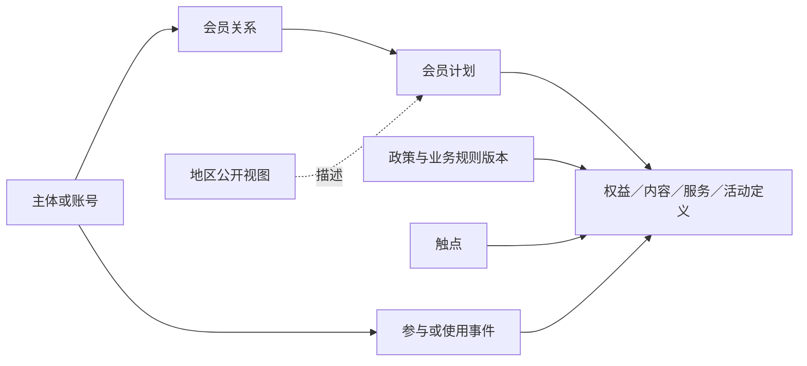

# T04｜Nike 会员运营主数据、指标体系与本体公开参考模板

版本 v0.2 · 2026-11-12 · 公开参考草稿，供审核

本版增加指标体系、三类资产关联和分项状态；上一版原文保留在[同名 v0.1 模板](../04-nike-membership-public.md)。全部候选与公开参考仍待用户审核，目标企业正式资产尚未建立。

建设路线：会员运营领域 T02 → Nike 会员运营公开参考 T04 → 目标企业会员运营。此处“部门”按业务功能域组织；Nike 内部会员部门名称、汇报关系、系统分工和权限尚无本次可用证据。共享企业、品牌、商品、渠道与门店引用 [T01](01-sportswear-industry.md)／[T03](03-nike-enterprise-public.md)，会员概念引用 [T02](02-membership-domain.md)。

本稿通过购物、运动内容、活动体验、服务和偏好等功能组织公开参考。这些分组是建模建议，不是对 Nike 内部部门设置的陈述。事实来源 N03–N08 及访问限制见[Nike 研究记录](../nike-public-reference-sources-v0.1.md)。

## 公开参考内容

| 参考项 | 来源可支持的事实 | 建模建议及边界 |
| --- | --- | --- |
| 美国会员计划视图 | 美国会员页展示免费加入及 Nike App、NRC、NTC、SNKRS 等入口 | 建立带市场范围的计划视图及触点参考；不推断全部地区均可用或属于同一技术账户系统 |
| 中国会员计划视图 | 中国会员页展示课程、线下活动、定制、SNKRS 中国 App 和会员体验 | 建立购物、内容、活动与服务定义，不把这些功能强制折叠为购买行为 |
| 地区化权益 | 美国与中国会员页展示的权益内容和条件有所不同 | 权益定义关联市场、渠道、条件及准确来源，动态网页查阅日与业务生效日分开 |
| 条款与订单条件 | 中国销售条款说明平台附加规定、账户状态和下单条件等可影响适用规则 | 营销说明、政策和具体订单条件分别保留；无法判断优先或冲突时回源核定 |
| 偏好设置 | 澳大利亚帮助页描述部分网站／App 设置及跨平台保存 | 建立偏好记录及适用平台；不推断全球所有字段实时同步 |

以上事实分别见 [Nike 美国会员页](https://www.nike.com/membership)、[Nike 中国会员页](https://www.nike.com.cn/membership)、[中国销售条款](https://agreementservice.svs.nike.com.cn/rest/agreement?agreementType=termsOfSale&country=CN&language=zh&requestType=redirect&uxId=com.nike.tos)及[澳大利亚设置帮助](https://www.nike.com/au/help/a/nike-settings/app)。实际资格与权益履行须回到相应地区、期间和具体规则。

## 主数据模板：公开填充与企业待定

字段类型和统一来源／时间字段沿 T02 与[包说明](README.md)。下表字段均为本包逻辑字段，不是 Nike 内部字段。

| 对象 | 建议关键字段 | 公开资料可填充 | 保持未知／企业内化时填写 |
| --- | --- | --- | --- |
| `MemberProgramView` 计划公开视图 | `view_id:text`、`public_name:text`、`market_scope:ref[]`、`source_ref:ref`、`underlying_program_ref:ref?` | 中国／美国页面名称、地区及展示内容 | 不同视图是否属于同一全球计划、实际计划主键和运营组织；本对象是资料视图而非认定独立计划 |
| `Account`／`ProgramMembership` | `account_id:text`、`source_namespace:text`、`membership_id:text`、`program_ref:ref`、`status:code`、`valid_period:period?` | 可定义账号和入会关系两个概念；不创建真实个人实例 | 企业注册与入会是否同一动作、状态、退出流程及账号映射 |
| `Touchpoint` | `touchpoint_id:text`、`public_name:text`、`touchpoint_type:code`、`market_scope:ref[]`、`source_ref:ref` | 来源明确地区内的官网、App 或活动入口 | 全部可用国家、账号共享、接口和事件可得性 |
| `BenefitDefinition` | `benefit_id:text`、`type:code`、`description:text`、`eligibility_rule_ref:ref?`、`market_scope:ref[]`、`valid_period:period?` | 资料展示的权益类别及明确条件 | 未公开门槛、实际领取对象、目标企业是否采用此权益 |
| `BusinessRule`／`PolicyDocumentVersion` | `rule_id:text`、`document_ref:ref`、`scope:map`、`conditions:text?`、`exceptions:text?`、`effective_period:period?` | 官方规则原文、版本和明示范围 | 没有写明的例外、生效时间及优先关系 |
| `ContentService` | `service_id:text`、`name:text`、`service_type:code`、`touchpoint_refs:ref[]`、`access_rule_ref:ref?` | 公开提及的课程、定制或其他服务定义 | 完整内容库、服务资格及内部服务目录 |
| `CampaignActivity` | `activity_id:text`、`public_name:text`、`type:code`、`market_scope:ref[]`、`rule_ref:ref?` | 有来源的活动类别或公开活动定义 | 全量活动、实际报名／到场数据及内部活动码 |
| `PreferenceDefinition`／偏好记录 | `preference_key:text`、`value_domain:ref`、`platform_scope:ref[]`、`source_ref:ref`、`valid_period:period?` | 帮助页明确的设置类别和适用平台 | 内部字段、实时同步承诺、每名会员实际选择 |
| `IdentityLink` | `from_ref:ref`、`to_ref:ref`、`link_type:code`、`evidence_ref:ref`、`verification_state:code` | 只能提供结构槽位，不从公共页面填真实关联 | 身份归并规则、历史合并拆分和目标企业实际映射 |
| 权限／用途定义与记录 | `purpose_id:text`、`scope:text`、`policy_ref:ref?`、`record_source:ref?`、`effective_period:period?` | 官方政策可作为范围和概念参考，细节限已取得原文 | 内部同意记录结构、全部数据流及目标企业适用依据 |

本次资料未足以核定 Nike 的等级、积分、家庭会员、付费订阅及内部优惠券体系；这些内容继续作为 T02 可选模块。未知不表达为“不存在”。内部会员数、活跃阈值、生命周期分层、留存与复购定义均保持未知。

## 本体模板

以下均为建模建议；只有明确引用的名称、体验及条款内容作为公开事实。

| 关系／事件 | 含义与约束候选 |
| --- | --- |
| 计划公开视图—描述—会员计划 | 页面是计划说明来源；先保留地区视图，不因名称相同就合并全球制度 |
| 会员关系—连接—账号／主体与会员计划 | 入会关系引用准确计划范围；自然人身份和账号一致性需证据 |
| 计划—通过—触点提供内容／服务／活动 | 触点、服务定义与参与事实分别建模；有入口不等于某会员已参与 |
| 权益定义—受限于—业务规则版本 | 明确地区、期间、渠道、商品和资格；条件未知时不得写“全员无条件” |
| 会员关系—符合资格／获授／领取／使用—权益 | 四类语义及相应事件分开；公开营销信息只支持权益介绍，不证明个体资格或使用 |
| 账号—具有—偏好记录 | 偏好项、值、来源、适用平台与有效期分别记录；推断标签另有方法依据 |
| 账号／主体—参与—交易角色 | 购买者、付款者、收件人和会员可能不同；访客订单允许会员关联未知 |
| 注册／入会／退出／身份关联变更 | 作为候选事件骨架；内部状态机、必经步骤和真实事件字段待企业资料 |
| 报名／活动参与／课程使用／服务履行 | 区分定义与实际事件、报名与到场、访问与使用，不直接推断营销效果 |
| 权限选择／撤回—引用—目的及政策版本 | 模型表达有范围的历史记录；具体制度和获准数据由目标企业核定 |

图是本包模型建议，不描述 Nike 内部架构。真实账号关联、事件采集和资格计算都须由企业证据补齐。

## 目标企业内化示例工作表

| 参考内容 | 企业可选动作 | 必需依据 |
| --- | --- | --- |
| 账号、计划与会员关系分离 | 采用，或保留概念分离并映射同一来源记录 | 实际注册入会流程、主键、资格与状态定义 |
| 多触点内容、活动和服务 | 按已有业务取舍或扩展 | 企业实际触点、服务、活动清单及数据覆盖 |
| 地区化、条件化权益 | 采用规则结构，重新填写企业制度 | 企业权益条款、门槛、例外、期间与权威来源 |
| 等级／积分等可选机制 | 有证据时启用 | 企业实际制度和流水定义；不因标杆模板就默认存在 |
| 共享身份与偏好 | 采用追溯结构，核定具体事实 | 获准关联资料、业务规则和状态历史 |

正式企业资产的发布、后续普通分析实际使用及任务贡献，并回现有 Studio 两层体系。本轮成果到三类资产参考模板为止，用户提供资料后再进行企业内化。

## 指标体系：公开事实启发的测量建议

公开资料确认了若干会员体验、触点和带条件权益；它们没有提供本次所需的内部会员 KPI、计算公式、活跃窗口、分层门槛或完整数据结构。因此本节**全部运营指标均为 M：建模建议**，不是 Nike 已采用指标。F 仅表示其所依托的体验或业务概念可在来源查到。`metricKey` 是本模板参考项，未绑定正式 SAP 包。

| 测量主题 | F：公开业务线索 | M：候选指标族 | U：内部制度与数据 |
| --- | --- | --- | --- |
| 资格与规模 | 会员加入及地区公开计划视图，N03／N04 | 账号、有效会员关系、新增资格 | 全球计划是否统一、资格状态、去重与历史 |
| 运动与内容参与 | 课程、活动及运动触点，N03／N04 | 合格内容参与、报名／到场、服务使用 | 内部活跃判定、事件名、采集覆盖与 KPI |
| 购物与体验 | 定制、商品体验及购物入口，N03–N05 | 购买会员关系、服务／定制订单、关联交易 | 会员交易映射、统计资格、退款归属 |
| 权益履行 | 地区化权益及条件，N03–N05 | 资格覆盖、授予、使用、履行及时性 | 是否逐实例管理、分母、窗口和履约数据 |
| 偏好与服务 | 部分平台设置与偏好帮助，N07 | 有来源的偏好资料覆盖、服务案件 | 内部字段、同步能力、联系许可及运营目标 |

## 候选指标条目

下列骨架供目标企业决定采用、调整、排除或新增；定义及公式核定后进入原 SAP，目录和本体只保存准确引用。

| metricKey／候选名称（M） | 定义或测量骨架 | 对象、粒度、单位 | 维度、时间及资格 | 所需资料与未知 |
| --- | --- | --- | --- | --- |
| `nike.ref.member.active_memberships` 有效会员关系数 | 在约定时点满足计划及状态规则的不同关系数 | `ProgramMembership`；计划内关系；个 | 地区、计划、品牌；资格期间、状态及账号／主体范围待核 | 内部状态与身份历史未知；不能用网页注册人数或账号替代 |
| `nike.ref.content.participating_memberships` 内容参与会员关系数 | 期间有约定合格内容参与事件的不同关系数 | 会员关系；个／期间 | 内容、触点、市场；有效参与及去重待核 | 官网只支持内容入口概念，不提供此事件或 KPI 定义 |
| `nike.ref.activity.attended_memberships` 活动到场会员关系数 | 可核实际到场事件关联的不同关系数 | 会员关系×活动；个 | 活动、市场、时间；报名与到场分开，身份可关联 | 需要报名／到场与身份依据，公开活动页不证明实际参与 |
| `nike.ref.service.customization_orders` 合格定制订单数 | 在企业约定订单状态下的不同定制服务订单数 | 服务订单；单 | 服务、市场、渠道、期间；取消退款影响待核 | N04 只启发服务概念，内部订单键与资格规则未知 |
| `nike.ref.benefit.fulfilled_instances` 权益履行实例数 | 有依据确认符合规则履行的不同权益实例数 | 权益实例；份等待企业定义单位 | 权益版本、市场、渠道、期间；资格、授予和使用分开 | 逐实例机制及事件是否存在未知，不能默认所有权益有券实例 |
| `nike.ref.benefit.fulfillment_rate` 权益履行率 | 同一合格且完成观察资格的授予／服务队列中，按规则履行的比例 | 权益实例或服务单位，企业择定；比率 | 承诺、有效期、截止与例外一致，未知不能当未履行 | 对应规则与完整分母、履行记录待企业资料；不是 Nike 官方 SLA |
| `nike.ref.preference.sourced_coverage` 有来源的偏好记录覆盖率 | 指定资料范围内，具有明确来源与适用期间偏好记录的合格对象比例 | 账号／主体择一；比率 | 目的、平台、市场、时点；主动与推断分开 | N07 支持部分设置概念，不支持全量字段、实际选择或全球同步 |
| `nike.ref.purchase.member_net_sales` 会员关联交易净额 | 在核定身份及购买规则下归属会员范围的净金额 | 交易行及归属；货币 | 地区、商品、门店渠道、期间；退款及多主体分摊待核 | 访客、购买人／付款人／收件人可不同；真实关联和金额规则未知 |

不能从这些候选反推 Nike 内部目标、绩效、工具部署或现有数据完备性。T02 的留存、生命周期、等级、积分及价值指标继续作为通用可选内容，有企业依据再采用。

## 四种指标关系的候选表达

| 关系类别 | 可建模的内容 | 本节边界 |
| --- | --- | --- |
| 目录归属 | 资格规模、内容参与、活动服务、权益和交易等主题 | 本包分类建议，不代表内部部门及 KPI 目录 |
| 公式依赖 | 例如履行率引用同队列履行数与合格观察分母 | 队列、单位、期间、状态与例外先核定；缺分母时保持待核 |
| 统计分解 | 按市场、计划、触点或活动分组 | 多触点参与可能重叠，跨触点人数不能直接相加；计划统一性未知 |
| 分析用途关联 | 参与、权益和交易可以共同作为分析输入 | 浏览、参加、购买和效果分别留证，不能形成未经证明的因果链 |

## 三类资产关联表

以下逻辑项与 T01／T02 共享身份含义，保持参考归属。`ont.*` 为建模建议项，不是 Nike 内部本体或已生成图节点。

| 主数据／关系项 | 参考指标 | 事件、维度、时间及资格 | 本体关联候选 | 实际 Binding 与待核 |
| --- | --- | --- | --- | --- |
| `md.account`、`md.program_membership`、计划公开视图 | `nike.ref.member.active_memberships` | 注册、加入、退出、状态期间；地区计划范围 | `ont.view_describes_program`、`ont.membership_valid_at` | 原计划、账号与关系键未知；不由页面名合并全球资格 |
| 触点、内容／活动、会员关系 | 内容参与、活动到场指标 | 访问、内容使用、报名、到场分别表达 | `ont.access_via_touchpoint`、`ont.participates_in` | 公开入口不能证明真实事件字段、身份或参与覆盖 |
| 权益定义／规则、可选实例 | 权益履行数与履行率 | 资格、授予、履行及截止；市场、渠道及例外 | `ont.eligible_for`、`ont.fulfilled_under_rule` | 公开条款与营销资料并存，实际适用及实例机制待核 |
| 偏好定义、账号／主体 | 有来源偏好记录覆盖 | 声明／更新、来源、用途、平台及有效期 | `ont.expresses_preference`、`ont.preference_scope` | 未披露字段、个人选择及同步保证保持未知 |
| 会员关系、`md.store`、`md.sku` | 会员关联交易净额 | 订单、付款、退货、退款；参与角色与时间归属 | `ont.transaction_role_of`、`ont.refund_of_transaction` | 内部交易—会员关联未知，访客允许未关联 |

## 企业内化与四项状态

每项标记 F／M／U 及来源地区、时间范围，保存参考准确版本、参考 item、目标 item、采用动作、企业证据和差异理由。数据不支持的标杆内部内容保持未知，目标企业可用自身制度补齐并形成独立正式资产。

当前各运营候选的目标企业状态均为：定义待核、数据未映射、当前不可计算、实际使用未验；公开体验有来源不改变这些状态。候选／正式身份另存。定义可核但缺数据时，只能按核定范围发布定义参考，不能显示为已测量或经营有效。
