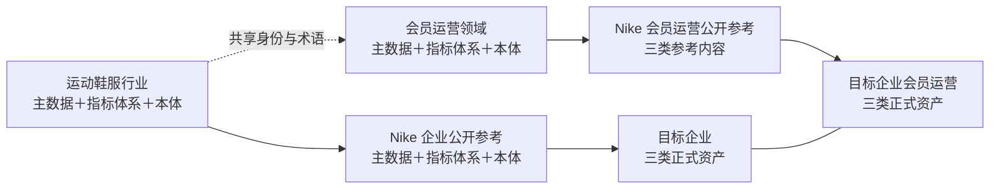

# 企业基础层参考模板包 v0.2

2026-11-12 · 待审核候选 · 仅方案、模板与原型，不代表产品已实现

本版按用户认可的调整方向，将主数据、数据分析指标体系、本体作为同步建设、相互校验的三类成果。两条路线保持“行业—标杆企业—目标企业”和“领域—标杆部门／业务域—目标部门／业务域”。基础层先建立共享知识与度量结构，再选择实际任务检验使用，不以单一道分析题裁剪基础范围。

v0.1 的四模板、研究记录、调整稿与原批准产品方案均保留原字节。本目录是独立新版；参考草稿审核、产品 spec／UI 审核、产品实施、目标企业内化、正式发布与真实使用分别核定。

## 审核入口

| 资料 | 本版重点 |
| --- | --- |
| [企业基础层建设方案](foundation-proposal.md) | 三类成果、两条路线、工具复用与最小增量、流程与完成标准 |
| [T01 运动鞋服行业](01-sportswear-industry.md) | 行业对象、指标主题与候选目录、交易事件、三类关联 |
| [T02 会员运营领域](02-membership-domain.md) | 身份与资格、规模／参与／权益／购买／服务等指标族、口径和关联 |
| [T03 Nike 企业公开参考](03-nike-enterprise-public.md) | 公开经营结构及财报度量，公开事实与建议分列 |
| [T04 Nike 会员运营公开参考](04-nike-membership-public.md) | 公开触点与体验启发的测量结构，内部 KPI 保持未知 |
| [工具与流程 spec](../../../openspec/changes/studio-foundation-three-assets/spec.md) | 拟实施的最小合同、职责和可核对需求 |
| [可点击 UI Demo](../../prototypes/studio-foundation-v0.2/index.html) | 虚构企业的体系总览、关联、内化差异、检查及发布使用路径 |
| [目标任务清单](../../../openspec/changes/studio-foundation-three-assets/tasks.md) | 本轮准备与后续实施、业务落地分阶段跟进 |

## 两条路线，每站三类成果

箭头是参考、扩展与企业内化路径，不是自动继承政策或权限。“Nike 会员运营”按公开业务功能域表达，内部组织架构未知。企业基础层与任务演进层仍是原两层；参考模板是输入，不增加第三个企业正式层。两条线共享 `Party`、`Account`、`ProgramMembership`、`Store`、`SellableSKU` 等定义，不能复制四套互不关联的身份。

## 统一填写结构

主数据模型与字典描述共享对象；实际企业主记录另从获准资料核定。订单、支付、退货退款、资格变化、权益使用等保留事件身份。指标定义与公式仍由原 SAP 管理，体系索引和本体保存准确引用，不新增可独立编辑的公式副本。SAP 已有包、场景、用途角色和方法引用沿原资产使用；本版补跨包组织及三类资产关系。

本版字段和关系名为逻辑约定，不声称是 GS1、Schema.org 或 Nike 的内部实现。逻辑类型：`text` 文本／不透明标识，`code` 带命名空间的枚举，`ref` 类型化引用，`date/datetime` 日期／含时区时间，`period` 说明起止边界的期间，`map` 结构条件，`[]` 多值，`?` 条件可空。未知、不适用和明确为空分开。

| 字段组 | 最少记录内容 |
| --- | --- |
| 身份与语义 | 模板及版本、稳定 `item_id`、名称／别名、对象类型、定义、粒度、值类型、基数与必填条件 |
| 适用范围 | 行业／领域、企业、品牌、市场、渠道、人群、业务用途；未知范围明确标记 |
| 时间与依据 | 来源准确版本和定位、业务有效时间、观察／记录／查阅时间、证据类型、责任角色 |
| 指标引用 | SAP 包 ID、准确版本、指标名；必要场景身份；引用资格与限制，不以 latest 代版本 |
| 关联 | 对象／属性／键、事件、维度、时间及资格规则、本体关系、实际 Binding、原权威依赖 |
| 内化差异 | 参考准确版本及 item、目标项、采用／修改／排除／新增、企业证据、差异理由及影响 |
| 状态与核验 | 候选／正式／历史等治理身份；定义、映射、可计算、实际使用四项状态；检查证据和缺口 |

参考项标识如 `md.party`、`md.account`、`md.program_membership`、`md.store`、`md.sku` 仅用于本包对照，不是目标企业主键。跨系统真实身份关联需要来源、范围、有效时间与核验依据，不由同名、手机或设备相似性推断。

原 `SourceRef` 的 ID、版本、locator 及权威语义保持；内容内部的 `itemId`／`metricName` 作为独立定位信息，不重新解释原 locator。尚未建立 SAP 包的候选指标使用本模板 `metricKey`，不能填造正式 SAP 引用。下文只有明确标为 Demo 的包身份属于虚构示例。

## 证据与四项状态

“标准参考”“公开事实”“建模建议”“企业待定”分别保留。标杆的公开页面不证明其内部 KPI、字段、身份算法或全部政策；无证据保持未知。

| 独立状态 | 要核定什么 | 不能据此推断 |
| --- | --- | --- |
| 定义已核定／待核 | 统计对象、口径、范围和来源是否明确 | 已有数据或已正式发布 |
| 数据已映射／部分／未映射 | 实际字段、键、粒度和事件覆盖是否可查 | 业务计算已正确 |
| 当前可计算／受限／未知 | 所需数据、规则、截止和工具是否足够 | 已经计算或实际使用通过 |
| 实际使用未验／通过／失败／未知 | 普通独立任务是否正确读取并应用，计算与解释是否核验 | 其他任务、企业或未来版本也通过 |

四项状态与候选／正式资产身份独立。参考模板当前均未形成目标企业定义、映射或使用证明；有些定义可以在限定范围发布，但不能把“已定义、待数据”显示为可计算。局部缺口按用途限制，独立可用内容可继续。

## 联合对照表

每个需要测量或共享的关联片段，至少回答下表。Agent 负责起草和核查，用户无需逐字段手填或逐项审批。

| 主数据项与粒度 | SAP 准确指标引用 | 事件／维度／时间／资格 | 本体项 | 实际 Binding | 来源、差异与状态 |
| --- | --- | --- | --- | --- | --- |
| 待企业材料核定 | 待企业 SAP 候选／正式版核定 | 待核 | 待核 | 待映射 | 明确待核及影响 |

目录归属、公式依赖、统计分解、分析用途关联分别记录。父子目录不意味着可加；分解要说明互斥完备及聚合条件；`driver` 是用途角色，不构成因果证明。本体引用准确测量定义，不在图中另定一份公式。

## 企业内化与审核边界

用户后续提供制度、字典、系统清单和获准资料后，Agent 同步比对三类内容，核对样本，整理必要业务决定，沿原 Studio／SAP 发布及维护机制形成目标企业资产。普通任务按企业资格自主发现、读取和选择资产；新发现沿任务演进层回源，不要求用户预先勾选每份资产。

当前 Demo 的企业 A、字段、发布和读取结果均为虚构状态。示例“有效会员关系数”引用 `demo-member-foundation@1.0.0::active_memberships`；“正常＋宽限”到候选 v1.1“仅正常”是受控政策变化，不代表任何真实企业或 Nike 制度。

来源沿用[通用标准研究](../generic-reference-sources-v0.1.md)和[Nike 公开研究](../nike-public-reference-sources-v0.1.md)。T03 新增财报度量类别另有当次官方年报核对说明。原记录中的 GLN PDF 访问拒绝、隐私页重取超时仍保留，未以模板补齐掩盖证据缺口。
