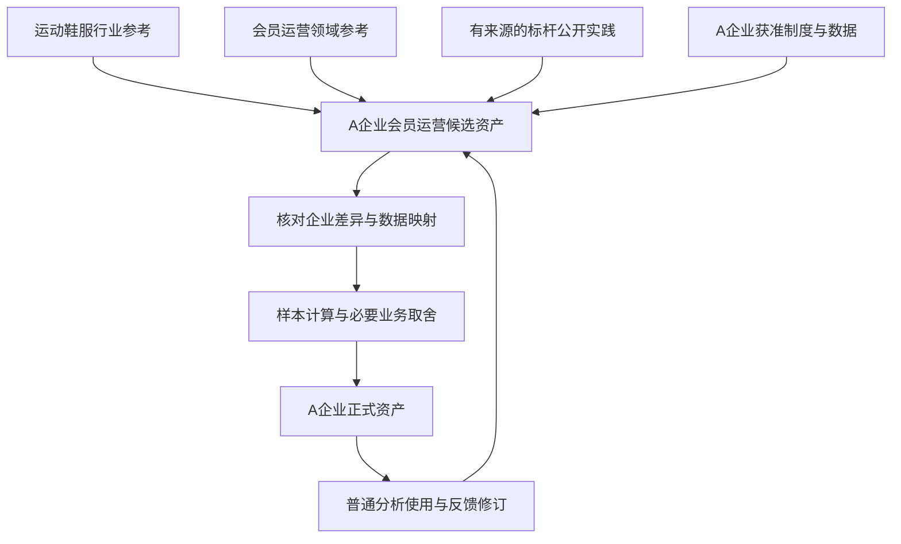

# Studio 二期会员运营资产建设初步方案

版本 v0.1 · 2026-11-12

用户已认可本稿的建设方向：由 Agent 起草通用行业与领域参考资产，结合有来源的标杆公开实践，再依据目标企业的获准资料完成内化，人工参与必要的业务取舍与正式决定。当前仅整理初步方案；具体企业口径、验收资料及产品改动尚未冻结，暂不开发。

## 二期目标与首期基础

二期在首期同一家企业、同一资产体系中扩展会员运营主题，围绕以下问题建设并验证资产：

> 哪些门店的首购会员复购偏低，值得优先核查？

首期已在限定的合成销售退款案例中完成建设、发布、普通分析使用、反馈修订再用的闭环，原专业失败和历次修订保留。二期复用门店、交易、支付、退款资产，以及原建设项目、任务、语义源、数据映射、SAP 指标与方法、版本发布及反馈机制。首期结论的准确范围见[首期最终验收](../openspec/changes/semantic-analytical-asset-studio/result.md#首期最终验收)。

二期同时检验两项能力：一是普通分析 Agent 能关联使用销售退款与会员两个主题的正式资产；二是参考资产经过企业内化后，能够支持实际计算、解释及后续修订。两项均以普通分析的实际使用结果核定。

## 参考资产与企业内化

行业和领域是交叉的知识来源。运动鞋服行业提供商品、款色码、门店、渠道、订单和退换货背景；会员运营领域提供会员身份、入会、权益、购买、生命周期和观察条件。目标企业根据业务问题组合适用内容。

标杆企业的公开实践作为补充参考，可按需要选取一个或多个来源。通用概念可以直接用于目标企业，标杆不构成必经的继承层。会员运营可能跨门店、电商、CRM 和市场部门，具体组织归属与业务概念分别表达，共享会员身份保留一致含义。

图示表达建设依赖与反馈关系。Agent 在授权范围内自主决定取材、工具、先后顺序和内部迭代，Host 沿既有权限、生命周期和发布规则提供环境。

### 通用参考资产

Agent 可以先起草行业与会员领域的概念、主数据模型、字段字典、规则选项及方法骨架。已有标准词汇、适用资产和专业组件优先复用；例如 Schema.org 已有会员计划、等级及会员关系词汇，可作为术语参考。

LLM 的训练知识用于提出候选和待核问题。通用概念仍需核对含义与适用条件；模型生成的具体企业政策、字段或身份关系，需要相应企业依据。

### 标杆公开参考

以耐克为例，成果应表述为“基于公开资料整理的 Nike 会员运营参考模型”。公开会员计划、权益和触点可纳入参考；每条具体做法保留来源、适用地区、时间及资料范围。

公开事实、从事实推导的建模建议和未知内容分别表达。未公开的内部表结构、统一身份算法、首购与复购口径保持未知。标杆拥有某项能力，也不意味着 A 企业需要采用同一制度。

### 目标企业内化

Agent 对照 A 企业的制度、系统字典和获准数据，提出直接复用、修改、删除与新增的内容，说明依据和下游影响。已有事实冲突先回源核查，资料无法决定的实质业务取舍交由用户处理。

参考资产保留自身身份，企业资产记录所参考的准确版本和内化差异。企业特有规则保留归属、生效时间及适用范围；正式发布沿原资产权威完成。

## 拟形成的资产

本稿定义后续产物的范围，具体资产随资料和问题核定；不设新建对象、指标或图节点数量要求。

| 产物 | 主要内容 | 企业内化要求 |
| --- | --- | --- |
| 主数据模型与字典 | 会员、账号、门店等对象；标识、属性、状态、来源和映射规则 | 核对企业实际字段、身份键、权威来源和管理规则 |
| 本体与业务规则 | 概念、属性、关系、事件、约束、有效时间和适用条件 | 依据企业制度与数据核定，保留例外和未知 |
| 数据映射 Binding | 会员与交易的关联、字段、粒度、主键、状态、时间及单位 | 验证重复、多账号、跨店及关联缺失的处理 |
| SAP 指标 | 首购会员、符合观察条件的会员、复购人数及相应比率 | 固定分子、分母、去重、购买资格、队列及观察期 |
| SAP 分析方法 | 门店比较、可比条件、核查排序、样本核验及解释限制 | 支持 Agent 自主分析，保留判断依据及反例 |
| 内化与维护依据 | 参考版本、采用或排除理由、企业差异、检查结果和修订关系 | 能回到原始资料、准确正式版本及历史报告 |

主数据模型与实际主数据记录分别处理。Agent 可以先设计标识与映射规则；实际会员、门店及跨系统身份关系从获准来源核定。例如，“CRM 会员 M001 与 POS 顾客 P008 是同一人”须有企业证据支持。示例记录保持合成标识，不能进入企业正式主数据冒充真实记录。

订单、支付、退款等事件进入相关语义与数据映射。指标定义和计算依赖继续由 SAP 管理，Semantica 和图表示引用这些准确定义。

## Agent 与人工的协作

Agent 承担参考资料查找、候选起草、企业差异比对、数据映射、样本试算、检查、修订及发布准备。人工主要提供获准资料和必要背景，处理无法由现有证据决定的企业事实、冲突及业务取舍，并按原规则作必要正式决定。

| 工作 | Agent 承担 | 人工参与 |
| --- | --- | --- |
| 起草参考资产 | 检索适用来源，整理候选、依据及待核项 | 提供偏好或指定参考对象，可选 |
| 内化企业资产 | 比对制度与数据，提出差异和修改理由 | 补充资料，处理实质冲突与业务取舍 |
| 核对样本 | 自主选择工具，执行映射、计算及正反例检查 | 回答仅由业务方掌握的事实 |
| 准备正式成果 | 汇总准确版本、检查结果、限制和分项发布内容 | 沿既有规则确认必要发布决定 |
| 使用与维护 | 普通分析实际使用，发现问题后修正本次结果并按需回源 | 补充业务反馈及作产品验收决定 |

Agent 自动整理待处理问题及关联依据，合并可以一起决定的事项。普通读取、计算和内部纠错沿授权自主完成，用户无需逐节点审批、手工搬运参考结果或重复说明已保存的背景。缺少关键资料时保存缺口和接续位置，其他独立工作继续。

## 会员主题需要核定的业务口径

以下是企业内化时的核查问题，具体答案尚未预设。

| 问题 | 需要核定的内容 |
| --- | --- |
| 会员主体 | 自然人、顾客、会员账号的关系；多账号、合并、匿名购买和不可识别记录怎样处理 |
| 首购范围 | 企业全渠道首次、本渠道首次或本店首次分别支持什么用途；是否只统计入会后购买 |
| 历史覆盖 | 可追溯起点与缺失范围；资料是否足以判断真正首购，还是只能识别首次可观察购买 |
| 有效购买 | 支付、完成、取消及测试订单的处理；同日多单、拆单和交易去重依据 |
| 退款影响 | 部分退款、全额退款和后续退款对有效购买、首购及复购的影响和观察截止 |
| 观察条件 | 首购队列、复购观察窗、数据截止及完整观察资格；避免观察不足造成虚低 |
| 门店归属 | 首购门店与复购门店如何关联，跨店和跨渠道复购怎样归属，门店变更如何处理 |
| 偏低与优先核查 | 比较对象、样本量、可比条件及排序依据；哪些结论只能作为待核线索 |

原仓库已有[会员复购 SAP 合成样例](../extensions/business-plugins/metric-factory/fixtures/membership-repurchase@1.0.0.draft.yaml)，定义为“指定窗口内购买至少两次的会员数 ÷ 同期购买会员数”。该样例可复用结构与场景思路；本期需核定首购会员队列在后续观察窗内的复购口径，以及门店维度和企业身份映射。

获准资料至少需要覆盖会员与身份映射、带会员或可关联身份的交易、门店及相关支付退款资料，并附状态和时间说明。历史区间和截止日应足以检查首购与后续复购。资料不足时，限制相应结论并说明缺口。

“复购偏低、值得优先核查”属于筛查判断。关于门店运营原因、营销措施或因果效果的结论，另需相应证据。

## 二期预期验收

以下沿用已确定的二期目标，并细化为初步核对项。具体输入、标准答案、模型与环境在后续验收准备中固定。

| 标识 | 要证明的结果 |
| --- | --- |
| P2 01 企业内化 | 参考内容具有来源或明确候选身份；A 企业资产包含实际资料依据、适用范围、内化差异与准确数据映射 |
| P2 02 正式资产 | 所需语义、映射、SAP 指标与方法沿原权威正式发布，项目资格及准确版本可查；未合格候选保持隔离 |
| P2 03 跨主题使用 | 普通分析新任务自主查找并实际读取销售退款与会员两类主题的适用正式资产，完成关联计算 |
| P2 04 业务正确性 | 复购分子分母、身份去重、首购范围、观察条件及退款处理正确；门店核查排序、解释和限制有相应依据 |
| P2 05 实质修订再用 | 完成一次有业务含义的规则、映射或来源修订，按受影响范围重新核对及发布，后续普通分析正确使用新版；旧报告保留原输入及版本依据 |
| P2 06 兼容与保全 | 检查销售退款原正确内容和受影响下游，保留旧版本、原稿、会话及 FAIL／UNKNOWN，明确未解决事项 |

实质修订场景用于验证版本维护能力。资产首次核对即满足要求时可按范围发布，日常维护不预设固定返工轮次。

结构检查、图生成、发布成功、项目采用、实际读取、计算正确、报告解释和用户验收分别留证。作者的使用声明与独立核验区分。验收范围内存在关键缺口时，限制对应成果，保留独立可用部分。

## 复用边界与三期关系

本期优先复用 Studio、SAP、Binding、来源追溯、统一 Pi 会话和官方 Semantica 已有能力。Host 负责权限、资源、生命周期、交互、持久化和真实回执；Agent 自主决定建设和分析方法。组件版本及适配遵守[工程规范](engineering-workflow.md)，本稿不构成 SDK 升级或第三方包改造授权。

Codex 起草参考文稿、OptraCall 内 Agent 使用现有能力建设资产，以及未来新增专门的参考模型生成产品功能，分别核定。若出现必须由产品改动解决的缺口，先记录实际阻塞、复用依据及最小方案；界面或关键交互变化按工程规范准备适用 spec 与 UI Demo。

二期聚焦当前会员问题，不预建完整行业百科、全企业 MDM 平台、高级身份合并引擎或固定专家流水线。本次文档不启动参考资产生成、真实数据读取、模型实验、迁移、Git 交付、设备更新或服务切换。

三期再选第二家服饰企业及有实质差异的主题，复用资料清单、建设方法、资产骨架与检查标准，根据该企业资料形成独立正式资产。第二家企业特有定义保留自身范围；第一家企业的事实及默认口径不直接迁入。

## 后续执行清单与待定事项

目标是交付可由普通分析 Agent 正确使用、可修订且保留历史依据的会员主题正式资产，并沉淀经使用验证的建设方法。

- [x] 将已认可方向整理为二期初步方案，列出产物、职责、验收与待定口径。
- [ ] 明确 A 企业、本轮获准资料、历史范围及数据出口边界，形成可查资料清单。
- [ ] 确定本轮适用的行业、领域和标杆参考范围，形成带依据的参考候选。
- [ ] 完成企业内化、身份与交易映射、样本核对及必要业务决定，形成可发布候选。
- [ ] 沿既有机制正式发布并验证普通 Agent 跨主题使用，保留准确使用证据。
- [ ] 完成一次实质修订后的再用、受影响回归及历史保全，按固定范围核定验收。

后续重点讨论三项：使用哪些获准资料及历史区间；如何核定首购、跨店归属与观察条件；参考资产是否仅先以文稿与已有建设入口试用，还是存在需要产品改动解决的实际缺口。需要新增 Skill 时，另按项目分析类 Skill 规范与测评流程推进。

## 依据与参考资料

本方案承接本 session 已认可的二期建设方向；首期实现与验收、原批准方案身份分别见[首期规格](../openspec/changes/semantic-analytical-asset-studio/spec.md)、[最终结果](../openspec/changes/semantic-analytical-asset-studio/result.md#首期最终验收)及[批准记录](../openspec/changes/semantic-analytical-asset-studio/approval.json)。产品职责和后续工程流程沿[工程规范](engineering-workflow.md)。

- [Stanford Ontology Development 101](https://protege.stanford.edu/publications/ontology_development/ontology101-noy-mcguinness.html)：按用途和问题确定范围，复用并组合已有本体，在使用中迭代。
- [W3C Data on the Web Best Practices](https://www.w3.org/TR/dwbp/#ReuseVocabularies)：优先复用共享、标准化词汇并按需扩展。
- [Schema.org MemberProgram](https://schema.org/MemberProgram)：会员计划及关联概念的通用词汇参考。
- [Nike Membership](https://www.nike.com/membership)：公开会员体验与触点的标杆资料入口，使用时保留实际适用范围。
- [SAP 主数据管理说明](https://www.sap.com/uk/resources/what-is-mdm)：主数据及其来源、核验与持续维护的参考。

上述外部资料在 2026-11-11 的方案讨论中查阅，用于支持建设思路；企业具体规则沿本企业获准资料核定。
