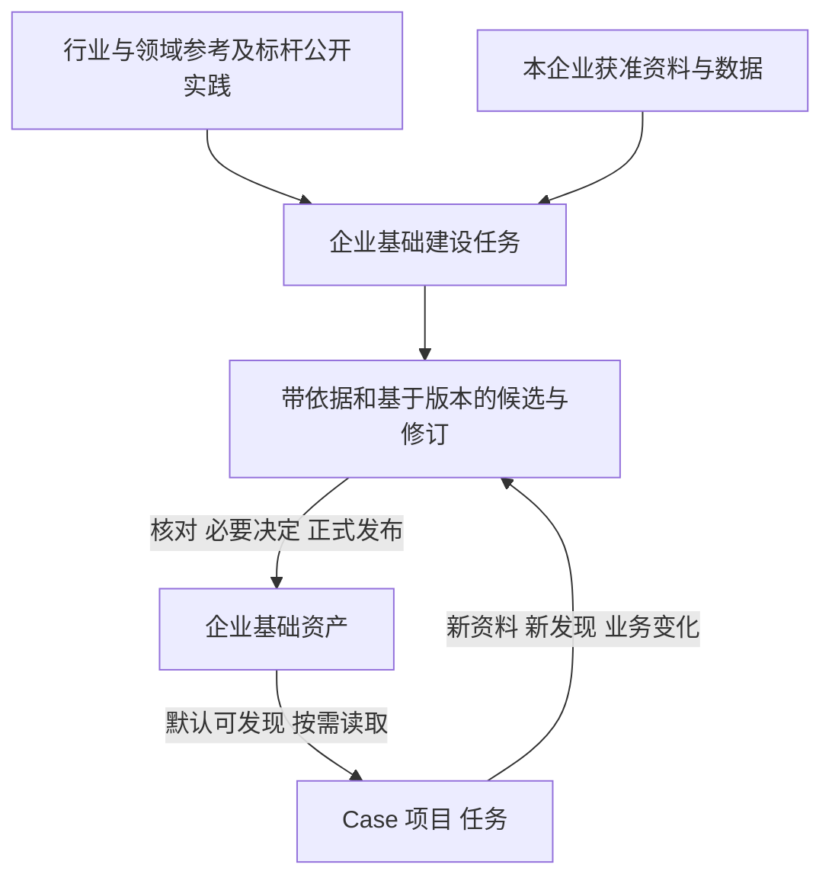

# Studio 二期统一资产管理与会员运营建设方案

版本 v0.2 · 2026-11-12 · 产品方向已认可，方案与交互设计待审核，暂不开发

二期将 Studio 作为企业统一的语义与分析资产中心，纳入企业业务资料、业务语义与主数据标准、数据映射、SAP 指标和分析方法。产品支持企业基础资产的提前建设，也支持 Case、项目和任务中的持续补充与修订，以同一家企业的会员运营作为首个贯通场景。

[v0.1 原稿](studio-phase2-initial-proposal.md)保留原路径和原始内容。v0.2 纳入用户随后认可的统一管理与两层建设方向；配套[spec](../openspec/changes/studio-phase2-unified-assets/spec.md)、[交互状态](../openspec/changes/studio-phase2-unified-assets/interaction-states.md)和[可点击 UI Demo](prototypes/studio-phase2/index.html)用于本轮审核，审核状态与检查结果见[准备记录](../openspec/changes/studio-phase2-unified-assets/result.md)。

## 本轮目标与交付边界

本轮交付更新后的二期方案、产品规格、独立可点击交互原型及相称的设计检查，说明统一 Studio 的用户路径、当前实现差额和后续验收要求。产品源码、测试、依赖、SDK、业务库与运行服务保持原状。

Demo 使用合成企业、资产、任务和版本，在本地内存中模拟操作，刷新后重置。Demo 中的发布、使用、Agent 回复和业务规则均为交互样例；具体企业口径、获准资料、模型质量及实际采用沿后续固定输入核定。

## 当前产品基础与调整内容

本轮源码基线为 `15f40455083c144a185bed4aef6715c7891085dd`。核对时本地 main 多出 PR #63 的两份评估文档，相关产品源码相同。首期已在限定合成销售退款案例中完成建设、发布、普通使用、回补再用，原 FAIL、UNKNOWN 和修订记录保留，见[首期最终验收](../openspec/changes/semantic-analytical-asset-studio/result.md#首期最终验收)。

| 当前情况 | 二期调整 |
| --- | --- |
| Studio 为一级入口，企业业务资料和 SAP 在插件市场中另有入口 | 以 Studio 统一管理，企业资料、指标和方法成为内部资产分类 |
| 企业资料是 Host 公共来源库，Studio 已共源引用但编辑独立 | 同一管理空间内完成原文、来源文件、工作稿、启用修订和历史查阅 |
| SAP 已有共享主库、版本、发布及方法提炼，专业页面仍独立跳转 | 在 Studio 内连续完成指标／方法建设、编辑、发布、治理和使用追溯，继续复用原专业权威 |
| Studio 体系绑定建设项目／任务，已有跨项目关联，尚无完整企业归属模型 | 分开表达企业资产归属、建设执行归属和使用任务归属 |
| 指标初始化索引、通用查读及 Studio 项目采用的资格策略不同 | 收敛企业正式资产的默认发现与实际版本使用规则 |
| 普通任务可反馈、提炼方法，源资产建设主要限于原建设任务 | 明确普通任务贡献候选、回源完善和纳入基础资产的路径 |

取消企业业务资料和 SAP 的独立插件产品入口，同时保留可复用的存储、原始身份、专业校验、版本和发布能力。统一管理不要求把所有对象改成同一种状态或重建一份影子资产库。

## 企业基础层与任务演进层

| 层次 | 内容与作用 | 建设和使用方式 |
| --- | --- | --- |
| 企业基础层 | 本企业已核定适用范围、正式可用的语义与分析资产，以及作为依据的获准企业资料 | 可以提前建设；同企业、相应权限下的 Case／项目／任务默认可发现，Agent 按需读取 |
| 任务演进层 | 提前建设工作，以及具体分析中形成的补充、候选、问题和修订 | 保留实际项目／任务、输入、证据、基于版本及处理结果；合格成果纳入基础层 |

企业资料原文作为依据管理，启用只表示其来源资格；语义、映射、指标和方法各自保留正式版本。候选、已保存、已启用、已发布、实际使用及业务核验分别表达。

企业资产持有逻辑上的持续归属，项目／任务承接 Agent 的实际工作。用户从 Studio 发起提前建设，系统沿已有项目任务机制承接；从业务任务进入补充时，保留原任务贡献及必要的后续维护关联。两种场景共用资产身份与版本链。

原建设项目归档后，原任务与会话继续只读，企业正式资产仍按自身资格供给。后续获准维护任务可以接续同一资产，保留原建设和发布关系；不自动解档原项目，也不复制体系规避归档。

## 企业归属与默认供给

单企业工作默认显示当前企业，新任务沿所属 Case／项目的明确归属取得资产范围，正常分析无需逐轮选择企业、逐资产手工启用或先进入 Studio。跨企业或归属冲突时，显示具体范围并在必要时作一次明确选择。

当前公共资料和 SAP 资产不能因打开某企业视图就自动归入该企业。既有资产由 Agent 盘点来源并提出关联建议，无法确定的保留“待核归属”；公共行业参考与企业正式资产分别标明。具体持久字段与兼容迁移在后续实施设计中核定，本轮不迁移数据。

新任务默认获得本企业合格正式资产的目录与版本位置，由 Agent 根据问题自主取材。用户已有明确版本选择时保留其适用范围。运行过程固定实际采用的准确来源与版本，新版发布供后续任务发现；历史报告继续绑定原依据。旧版确认有问题后，保留历史查阅并限制当前不适用用途。

图快照、来源资格、指标／方法版本及实际使用各自留事实。图未刷新只影响依赖图的用途，仍合格的独立资料或 SAP 成果可继续使用。缺少基础资产也不阻断原本获准的普通分析。

## Studio 的统一界面

一级入口为“语义与分析资产 Studio”。内部使用三个工作视图，共享企业上下文、准确对象和版本：

| 视图 | 核心内容 | 主操作 |
| --- | --- | --- |
| 企业基础资产 | 企业资料、语义与主数据、数据映射、指标、方法；可搜索、分类和查看依据 | 建设基础资产 |
| 建设与演进 | 进行中的建设、任务贡献、修订候选、资料缺口及待决定事项；Agent 与资源工作区 | 继续当前建设或完善具体候选 |
| 发布与使用 | 确定版本预览、模块实际结果、后续任务可用范围、实际使用与历史依据 | 查看当前待发布内容或准确历史 |

资产详情连续呈现定义／口径、制度原文、身份与字段映射、关联指标／方法、来源任务及历史版本。企业资料的编辑／启用和 SAP 指标／方法专业管理都在 Studio 内完成，保留当前工作位置及未保存内容提示。

普通分析任务保留轻量的资产引用与贡献入口，不要求离开分析去维护全部资产目录。来源、历史、权限及高级管理按需展开。

## Agent 驱动的建设方式

行业、领域和标杆资料作为建设输入。行业与领域可以组合，标杆参考按需要选用；它们不构成企业资产的第三层或必经继承链。Agent 起草通用主数据模型、字典、本体和方法骨架，再对照企业制度与获准数据完成内化。真实主数据记录和身份关系由企业来源核定，公开标杆资料保留地区、时间及来源，内部未知不由模型补成事实。

Agent 自主检索、理解、选择工具、安排检查和修订；Host 管理工作空间、权限、预算、公共会话、取消、持久化与真实操作回执。图示仅表达依赖和成果关系，不限定 Agent 的内部分析顺序。

人工主要表达目标、提供获准资料，处理证据无法决定的实质冲突与业务取舍，并按既有权限作必要正式决定。Agent 自动整理依据与问题，可以合并处理的事项集中呈现；不增加逐节点评分、普通读取审批或重复搬运资料。

## 任务贡献如何纳入企业基础资产

普通分析 Agent 发现有复用价值的增量时，可在原任务形成带来源的贡献候选，记录实际输入、当前处理、原资产版本和差异。用户可以查看或立即完善；普通结果错误先在原任务修正，源资产问题再回建设维护。候选保存不自动发布或改变其他任务默认口径。

| 内容 | 纳入方式 |
| --- | --- |
| 可共享的新概念、映射或方法 | 先核已有资产，适用时复用；确有新增含义时形成新资产 |
| 原标准的错误或缺漏 | 在原资产身份下修订，保留旧版本与影响关系 |
| 企业政策变化 | 明确适用时间和对象，保留旧规则的合法历史范围 |
| 个案例外或临时约定 | 保留本案范围；具备企业通用价值后再提炼 |

候选绑定所基于的正式版本。同一资产并发修订时，展示差异和冲突，重新核对后准备确定版本，不能让后发布者直接覆盖前者。发布失败、部分成功和 UNKNOWN 分项记录；UNKNOWN 先查原操作回执，再决定必要后续动作，不盲目重发。

发布后记录企业正式版本及后续任务的可发现资格。实际使用和反馈解决按准确任务、报告与版本核定，保留“已修订、待使用验证”等中间状态。

## 会员运营业务范围

二期继续围绕“哪些门店的首购会员复购偏低，值得优先核查”，复用首期门店、交易、支付和退款资产，补会员身份与交易映射、首购／复购口径、观察条件及 SAP 指标和方法。

首购究竟是企业全渠道首次、本渠道首次还是本店首次，历史不足的处理、有效购买、退款影响、跨店归属、观察窗、比较对象和优先核查依据，均按本企业获准资料核定。资料至少覆盖身份、可关联交易、门店、相关支付退款及足够的回溯与后续观察区间。

现有[会员复购合成样例](../extensions/business-plugins/metric-factory/fixtures/membership-repurchase@1.0.0.draft.yaml)可复用结构和场景思路，其同期购买人群口径与本期首购队列问题分别核定。Demo 的退款与观察窗样例仅展示有业务含义的版本变化，不作为企业已确认口径。

复购偏低用于筛查值得核查的门店。关于运营原因、措施及因果效果的判断，需要相应证据。业务验收保留普通 Agent 跨主题实际使用、清楚解释算法、一次实质修订后正确使用新版、历史依据保全及原销售退款正确内容的受影响回归。

## 设计检查与后续验收

本轮审核以 spec 的可观察需求、交互状态及四原则前置检查为依据，检查三视图、两种建设场景、资料／SAP 站内管理、任务贡献、正式版本与历史、部分成功、UNKNOWN、冲突、归档接续、未归属及空状态。浏览器检查、原型模拟和独立复核均只证明设计候选。

后续实施分别验证实际数据保存与兼容、公共会话接缝、权限和取消、Agent 自主建设与业务专业正确性。真实模型、获准业务资料、Git／CI、运行采用与用户产品验收继续按相应授权和固定候选分别核定。

Pi 与 Semantica 继续优先复用官方已接入能力，不另建 Runtime、固定专家流水线、影子指标库或全企业 MDM 平台。源码基线的 Pi 1.4.0、Semantica 0.7.0 及 Interface v3 约束沿[工程规范](engineering-workflow.md)和[统一会话说明](agent-session-integration.md)核对，本轮不升级依赖。

三期再选第二家服饰企业的差异主题，复用建设方法、资料清单和检查标准，依其获准资料形成独立正式资产。企业事实、身份映射与特有口径保留各自归属。

## 任务目标执行清单

本轮目标是交付可审核的方案、spec 与可点击 UI Demo，明确统一管理、基础建设和任务演进的产品行为；审核完成前停在设计阶段。

- [x] 原路径保留 v0.1，记录原稿身份。
- [x] 更新 v0.2，纳入统一 Studio、两层建设及企业资料／SAP 整合。
- [x] 完成 spec、当前实现差额、推荐决定及交互状态说明。
- [x] 完成合成数据可点击 Demo，验证正常、失败、历史和响应式路径。
- [x] 完成文档／引用／范围一致性和非作者独立复核，修正发现。
- [x] 准备确定版本的 spec 与 Demo 供用户审核；用户具体决定待反馈。

企业资料选择、业务口径确定、真实资产建设、产品实施与工程交付均未由上述设计任务启动。后续依据用户对本版方案、spec 和 UI 的明确决定推进。
