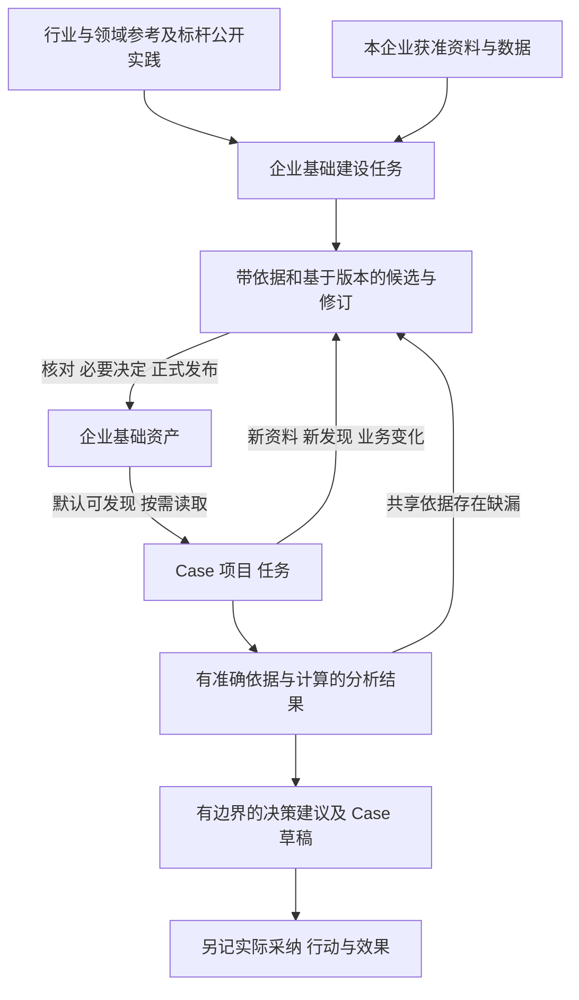

# Studio 二期统一资产建设、管理与实际使用方案

版本 v0.3 · 2026-11-12 · 补齐普通分析与决策使用主线 · 完整方案待审核，暂不开发

二期将 Studio 作为企业统一的语义与分析资产中心，纳入企业业务资料、业务语义与主数据标准、数据映射、SAP 指标和分析方法。建设管理与实际使用是并列的两条主线：企业基础层提前建设，普通分析 Agent 在 Case／项目／任务中自主发现、读取和正确应用，分析中形成的增量再经任务演进层回补。以同一家企业的会员运营贯通建设、使用、决策支持和修订后再用。

[v0.1 原稿](studio-phase2-initial-proposal.md)及[v0.2 审核包](studio-phase2-proposal-v0.2.md)保留原路径和原始内容。v0.3 在 v0.2 的统一管理与两层建设基础上，补齐用户提出的实际使用要求。配套[完整 spec](../openspec/changes/studio-phase2-unified-assets/review-v0.3/spec.md)、[交互状态](../openspec/changes/studio-phase2-unified-assets/review-v0.3/interaction-states.md)和[可点击 UI Demo](prototypes/studio-phase2-v0.3/index.html)共同供审核，检查范围与候选身份见[准备记录](../openspec/changes/studio-phase2-unified-assets/review-v0.3/result.md)。

## 本轮目标与交付边界

本轮交付更新后的完整二期方案、产品规格、独立可点击交互原型及相称的设计检查，覆盖统一 Studio 建设管理与普通分析／决策中的消费使用，说明当前实现差额和后续验收要求。产品源码、测试、依赖、SDK、业务库与运行服务保持原状。

Demo 使用合成企业、资产、任务和版本，在本地内存中模拟操作，刷新后重置。普通分析视图对内置合成明细执行确定性计算，以展示口径变化如何影响分子、分母和结果；Agent 选材、回复、工具事件与发布仍为交互模拟，不调用 Pi 或真实模型。这些检查仅证明原型及其合成数据，具体企业口径、获准资料、模型质量和产品实际采用仍待后续验证。

## 当前产品基础与调整内容

本轮工作树源码基线为 `15f40455083c144a185bed4aef6715c7891085dd`。当前消费端结论以该工作树为准；后续开发前需重核届时 main，不能把本设计包当成最新运行采用证明。首期已在限定合成销售退款案例中完成建设、发布、普通使用、回补再用，原 FAIL、UNKNOWN 和修订记录保留，见[首期最终验收](../openspec/changes/semantic-analytical-asset-studio/result.md#首期最终验收)。

| 当前情况 | 二期调整 |
| --- | --- |
| Studio 为一级入口，企业业务资料和 SAP 在插件市场中另有入口 | 以 Studio 统一管理，企业资料、指标和方法成为内部资产分类 |
| 企业资料是 Host 公共来源库，Studio 已共源引用但编辑独立 | 同一管理空间内完成原文、来源文件、工作稿、启用修订和历史查阅 |
| SAP 已有共享主库、版本、发布及方法提炼，专业页面仍独立跳转 | 在 Studio 内连续完成指标／方法建设、编辑、发布、治理和使用追溯，继续复用原专业权威 |
| Studio 体系绑定建设项目／任务，已有跨项目关联，尚无完整企业归属模型 | 分开表达企业资产归属、建设执行归属和使用任务归属 |
| 指标初始化索引、通用查读及 Studio 项目采用的资格策略不同 | 收敛企业正式资产的默认发现与实际版本使用规则 |
| 普通任务可反馈、提炼方法，源资产建设主要限于原建设任务 | 明确普通任务贡献候选、回源完善和纳入基础资产的路径 |

取消企业业务资料和 SAP 的独立插件产品入口，同时保留可复用的存储、原始身份、专业校验、版本和发布能力。统一管理不要求把所有对象改成同一种状态或重建一份影子资产库。

## 企业基础层与任务演进层

| 层次 | 内容与作用 | 建设和使用方式 |
| --- | --- | --- |
| 企业基础层 | 本企业已核定适用范围、正式可用的语义与分析资产，以及作为依据的获准企业资料 | 可以提前建设；同企业、相应权限下的 Case／项目／任务默认可发现，Agent 按需读取 |
| 任务演进层 | 提前建设工作，以及具体分析中形成的补充、候选、问题和修订 | 保留实际项目／任务、输入、证据、基于版本及处理结果；合格成果纳入基础层 |

企业资料原文作为依据管理，启用只表示其来源资格；语义、映射、指标和方法各自保留正式版本。候选、已保存、已启用、已发布、实际使用及业务核验分别表达。

企业资产持有逻辑上的持续归属，项目／任务承接 Agent 的实际工作。用户从 Studio 发起提前建设，系统沿已有项目任务机制承接；从业务任务进入补充时，保留原任务贡献及必要的后续维护关联。两种场景共用资产身份与版本链。

原建设项目归档后，原任务与会话继续只读，企业正式资产仍按自身资格供给。后续获准维护任务可以接续同一资产，保留原建设和发布关系；不自动解档原项目，也不复制体系规避归档。

## 企业归属与默认供给

单企业工作默认显示当前企业，新任务沿所属 Case／项目的明确归属取得资产范围，正常分析无需逐轮选择企业、逐资产手工启用或先进入 Studio。跨企业或归属冲突时，显示具体范围并在必要时作一次明确选择。

当前公共资料和 SAP 资产不能因打开某企业视图就自动归入该企业。既有资产由 Agent 盘点来源并提出关联建议，无法确定的保留“待核归属”；公共行业参考与企业正式资产分别标明。具体持久字段与兼容迁移在后续实施设计中核定，本轮不迁移数据。

新任务默认获得本企业合格正式资产的目录与版本位置，由 Agent 根据问题自主取材。用户已有明确版本选择时保留其适用范围。运行过程固定实际采用的准确来源与版本，新版发布供后续任务发现；历史报告继续绑定原依据。旧版确认有问题后，保留历史查阅并限制当前不适用用途。

图快照、来源资格、指标／方法版本及实际使用各自留事实。图未刷新只影响依赖图的用途，仍合格的独立资料或 SAP 成果可继续使用。缺少基础资产也不阻断原本获准的普通分析。

## Studio 的统一界面

一级入口为“语义与分析资产 Studio”。内部使用三个工作视图，共享企业上下文、准确对象和版本：

| 视图 | 核心内容 | 主操作 |
| --- | --- | --- |
| 企业基础资产 | 企业资料、语义与主数据、数据映射、指标、方法；可搜索、分类和查看依据 | 建设基础资产 |
| 建设与演进 | 进行中的建设、任务贡献、修订候选、资料缺口及待决定事项；Agent 与资源工作区 | 继续当前建设或完善具体候选 |
| 发布与使用 | 确定版本预览、模块实际结果、后续任务可用范围、实际使用与历史依据 | 查看当前待发布内容或准确历史 |

资产详情连续呈现定义／口径、制度原文、身份与字段映射、关联指标／方法、来源任务及历史版本。企业资料的编辑／启用和 SAP 指标／方法专业管理都在 Studio 内完成，保留当前工作位置及未保存内容提示。

普通分析／决策工作区保留对话、结果和轻量的“本次依据”及贡献入口，与 Studio 共用准确资产和版本。用户无需为了分析先进入 Studio。来源、历史、权限及高级管理按需展开；原始工具记录不挤占默认业务结果。

## 普通分析与决策的完整使用主线

用户从当前 Case／项目／任务直接问“哪些门店的首购会员复购偏低，值得优先核查？”。Host 沿已知归属提供企业、目标、约束、获准资料目录和可用工具，Agent 自主判断需要什么依据。下列描述可观察成果，不规定内部调用顺序或强制执行阶段。

| 用户与 Agent 的工作 | 产品应提供的支持与证据 |
| --- | --- |
| 用户直接提问，必要时补充观察范围与目标 | 默认沿当前企业／Case；正常提问与发送之外，不新增逐资产启用、读前审批或机器身份填写 |
| Agent 发现并判断适用资产 | 先提供轻量目录，按需读取准确对象／版本；按企业、适用时间、目的与权限判断采用、拒绝或仅作参考，不灌入全库正文 |
| Agent 读取所需定义、映射、指标、方法和企业原文 | 可追溯实际读取的正文／片段、分页完整性、来源修订和用途；目录命中、提示词提供及打开 Studio 页面均不能当成已读 |
| Agent 关联获准数据并自主计算、检查、解释 | 保留实际数据快照／范围／截至、身份与交易连接、首购队列、退款处理、成熟观察条件、去重、分子分母和计算产物；SAP 方法提供指导，工具与检查由 Agent 自选 |
| Agent 给出结果和决策支持 | 先回答门店差异、证据与未知，再列优先核查事项、备选行动及判断条件；用户可展开“本次依据”核对准确口径和版本 |
| 用户追问、纠正或保存建议 | 沿当前任务继续分析；建议可保存为 Case 决策草稿，采纳、行动和效果另记事实，草稿保存不代表用户已采纳 |
| Agent 发现错误或共享资产缺漏 | 本次结果错误先修本次报告；共享缺漏形成任务贡献，带原版、差异和证据回 Studio；不自动改其他任务的基础资产 |

结果展示以业务判断为主。“本次依据”按需展开，至少能回答：本次用了哪个口径和版本、为什么适用、数据取自哪里、怎么算、哪些依据未取得或未采用、这次结论的边界是什么。技术调用、内容摘要与保存回执可进一步查看，不要求普通用户理解工具名。

门店复购偏低只支持筛查。观察期不足者列为“尚不能判断”，不能填 0 或排成最差；历史不足不能直接称企业首次购买，样本量与比较条件要一起解释。优先核查身份映射、退款导致的队列变化、跨店归属和运营事实，再判断是否需要行动。低复购本身不能证明员工服务、会员权益或促销导致了问题，也不能直接推出“发券一定提升”。

企业业务资料、语义／映射、SAP 指标／方法可由普通分析结合使用。资料说明制度与适用条件；语义与映射说明对象和连接；SAP 指标说明口径和计算；方法说明适用场景、检查和推理注意事项。各自保留来源权威，图可作为关系／依赖辅助，不替代获准数据和计算，也不是每次分析的必经门槛。

### Pi Agent 如何调用

继续沿项目任务的公共会话入口和官方 Pi SDK 公开工具注册工作，不给 Studio 新建 Agent Runtime。当前基线已有如下能力，二期在原接缝上补齐企业归属、供给资格和真实使用投影。

| 既有接缝 | 二期的使用定位与需补齐内容 |
| --- | --- |
| `studio_assets` 的 `catalog/read/read-source/feedback/declare-use` | 统一资产目录、准确资产与原文、反馈及使用声明；来源读取与声明分别留事实，普通任务的贡献资格需补齐；建设写入不因普通读取而扩大 |
| `read_semantic_context` 的 `find/read/trace` 及 `action: graph` | 复用正式指标、方法、企业资料和依赖追溯；图为同一工具的可选动作。与 Studio 同企业、同版本、同资格，避免另走公共库绕过范围 |
| SAP 初始化索引、现有项目采用关系 | 收敛为本企业合格正式资产默认可发现、按需读取。当前初始化只列项目启用指标、通用查询可见公共正式资产、Studio 部分读取要求准确项目采用，这些差异须统一处理，不能只改前端名称 |
| `record_analysis_sources` | 复用来源声明和 M2 记录；记录是 Agent 声明，不能自动成为完整应用、独立核算或专业正确证明，也不成为普通分析的新增硬门槛 |
| `read_case_decisions` / `save_case_decision_draft` | 沿现有 Case 关系取历史、保存新草稿；不借保存草稿自动执行经营动作，不把历史经验当成本案必用规则 |

源码定位：普通工具与 SDK 注册见[项目任务 Agent](../src/agent/project-session.ts)，准确来源读取见[语义上下文服务](../src/host/semantic-context-service.ts)，Studio 目录／读取／反馈见[Studio Host](../src/host/studio-host.ts)和[来源适配](../src/host/studio-sources.ts)。这些是既有接缝的核对依据，并不表示当前实现已经满足 v0.3。

Host 只保障资源资格、准确返回、权限、取消与真实回执；分析计算、方法选择、适用性判断和结果修订仍由 Pi Agent 完成。实现时不要求 Agent 固定调用序列、固定方法数或特定工具链，也不以一个“已使用”按钮给报告盖业务正确章。

上述是可复用能力清单，各 profile 的工具资格并不相同。当前受管普通分析的图查询能力较窄，不能据此推定它已取得旧 `find/read/trace`、来源声明或 Case 写入权限。二期需逐 profile 核定能安全复用的读取路径；未绑定 Case 时不提供 Case 写入，普通分析仍可继续。不能以“统一使用”名义扩大权限或绕过既有隔离。

### 什么才算真正使用

| 事实 | 可支持的结论 | 不能直接推出 |
| --- | --- | --- |
| 目录提供／索引初始化 | 本任务获提供哪些可用入口 | Agent 已读正文 |
| 准确工具读取记录 | 实际返回的对象、版本、正文片段与完整性 | Agent 已采用或正确理解 |
| 报告引用／采用声明及计算产物 | Agent 表明采用哪项规则，其结果如何形成；可供核对 | 声明天然真实、算对或建议有效 |
| 独立比对与业务检查 | 在固定问题、数据、版本、工具和模型条件下的应用质量 | 全场景正确、未来版本自动通过 |
| 用户采纳／行动／效果记录 | 相应实际经营事实 | 保存草稿即采纳，相关改善即因果效果 |

同一报告关联实际读取依据和计算产物；未记录、读取不全、依据缺失或验证未跑的内容保持未知或受限。口径应用是否正确要用结果、明细和独立预期判断，不能仅按工具调用次数、声明数量或绿色状态判断。

### 缺口、修订和历史

没有合适基础资产时，普通分析仍可使用原本获准的数据和本任务明确的临时约定，解释其范围与未知；不得冒充企业正式标准，也不能从其他企业或失效版本补一个默认值。缺的是分析关键前提且无法确认时，先报告哪些结论不能给出，集中请求必要资料或业务决定。

读取被拒、分页未齐、来源已停用或同范围规则冲突，应具体显示缺失与受影响结论。可以用仍合格且足够的独立依据继续有限分析；不能把部分片段包装成全文，或用一条“已有资产”说明吞掉实际失败。

运行任务固定其实际采用的准确版本。新版发布后，新任务可发现新版；旧报告和运行中计算不静默换版。需要在原任务改用新版时，另存新的结果和采用依据。撤回／失效版本保留历史查阅；对当前用途不再具备资格。资料、映射、指标和方法的组合变化需检查相互适用性，而不只是每个对象各自显示最新。

分析中的贡献由任务演进层承接，经既有维护、差异核对、必要业务决定和确定版本发布纳入企业基础层。随后由独立的普通新任务验证新版实际使用，保留旧报告；这才完成“建设—使用—发现—修订—再使用”的闭环。

## Agent 驱动的建设方式

行业、领域和标杆资料作为建设输入。行业与领域可以组合，标杆参考按需要选用；它们不构成企业资产的第三层或必经继承链。Agent 起草通用主数据模型、字典、本体和方法骨架，再对照企业制度与获准数据完成内化。真实主数据记录和身份关系由企业来源核定，公开标杆资料保留地区、时间及来源，内部未知不由模型补成事实。

Agent 自主检索、理解、选择工具、安排检查和修订；Host 管理工作空间、权限、预算、公共会话、取消、持久化与真实操作回执。图示仅表达依赖和成果关系，不限定 Agent 的内部分析顺序。

人工主要表达目标、提供获准资料，处理证据无法决定的实质冲突与业务取舍，并按既有权限作必要正式决定。Agent 自动整理依据与问题，可以合并处理的事项集中呈现；不增加逐节点评分、普通读取审批或重复搬运资料。

## 任务贡献如何纳入企业基础资产

普通分析 Agent 发现有复用价值的增量时，可在原任务形成带来源的贡献候选，记录实际输入、当前处理、原资产版本和差异。用户可以查看或立即完善；普通结果错误先在原任务修正，源资产问题再回建设维护。候选保存不自动发布或改变其他任务默认口径。

| 内容 | 纳入方式 |
| --- | --- |
| 可共享的新概念、映射或方法 | 先核已有资产，适用时复用；确有新增含义时形成新资产 |
| 原标准的错误或缺漏 | 在原资产身份下修订，保留旧版本与影响关系 |
| 企业政策变化 | 明确适用时间和对象，保留旧规则的合法历史范围 |
| 个案例外或临时约定 | 保留本案范围；具备企业通用价值后再提炼 |

候选绑定所基于的正式版本。同一资产并发修订时，展示差异和冲突，重新核对后准备确定版本，不能让后发布者直接覆盖前者。发布失败、部分成功和 UNKNOWN 分项记录；UNKNOWN 先查原操作回执，再决定必要后续动作，不盲目重发。

发布后记录企业正式版本及后续任务的可发现资格。实际使用和反馈解决按准确任务、报告与版本核定，保留“已修订、待使用验证”等中间状态。

## 会员运营业务范围

二期继续围绕“哪些门店的首购会员复购偏低，值得优先核查”，复用首期门店、交易、支付和退款资产，补会员身份与交易映射、首购／复购口径、观察条件及 SAP 指标和方法。

首购究竟是企业全渠道首次、本渠道首次还是本店首次，历史不足的处理、有效购买、退款影响、跨店归属、观察窗、比较对象和优先核查依据，均按本企业获准资料核定。资料至少覆盖身份、可关联交易、门店、相关支付退款及足够的回溯与后续观察区间。

现有[会员复购合成样例](../extensions/business-plugins/metric-factory/fixtures/membership-repurchase@1.0.0.draft.yaml)可复用结构和场景思路，其同期购买人群口径与本期首购队列问题分别核定。Demo 的退款与观察窗样例仅展示有业务含义的版本变化，不作为企业已确认口径。

复购偏低用于筛查值得核查的门店。关于运营原因、措施及因果效果的判断，需要相应证据。业务验收保留普通 Agent 跨主题实际使用、清楚解释算法、一次实质修订后正确使用新版、历史依据保全及原销售退款正确内容的受影响回归。

## 设计检查与后续验收

本轮审核以 spec 的可观察需求、交互状态及四原则前置检查为依据，在原三视图、两类建设、资料／SAP 管理及发布治理基础上，新增普通任务提问、依据读取与采用区分、合成数据实际计算、决策追问、缺失／失败／不完整／冲突、跨企业隔离、任务回补、新版计算与旧报告保全。浏览器检查、原型模拟与独立复核仅证明设计候选。

后续实际验收必须用普通分析任务，不能用建设 Agent 的上下文或预置答案代替：

1. 同一企业的独立新任务只给业务问题和获准数据，不人工预选资产；真实 Pi 自主找到并读取所需的首期销售退款与会员运营两类正式资产，明确实际版本及不适用内容。
2. 用独立预期核对身份连接、首购队列、观察成熟、退款、去重、跨店归属、分子分母与结果。加入误导候选、旧版和缺失反例；“已读”不代替正确应用。
3. 用一次实质口径修订核定后续新任务采用新版及结果差异；原报告和依据原样保留，失败／UNKNOWN 不被后续成功覆盖。
4. 核对结论、证据和建议的业务含义，能支持“先核查什么”；建议、Case 草稿、用户采纳、实际行动和效果分别留事实。
5. 分别验证持久化兼容、企业／owner／权限、公共会话取消与迟到、普通分析及旧销售退款正确内容的受影响回归。获准真实模型质量、Git／CI、运行采用和用户产品验收另按有效授权执行。

Pi 与 Semantica 继续优先复用官方已接入能力，不另建 Runtime、固定专家流水线、影子指标库或全企业 MDM 平台。源码基线的 Pi 1.4.0、Semantica 0.7.0 及 Interface v3 约束沿[工程规范](engineering-workflow.md)和[统一会话说明](agent-session-integration.md)核对，本轮不升级依赖。

三期再选第二家服饰企业的差异主题，复用建设方法、资料清单和检查标准，依其获准资料形成独立正式资产。企业事实、身份映射与特有口径保留各自归属。

## 任务目标执行清单

本轮目标是交付包含建设管理与实际使用两条主线的完整 v0.3 方案、spec 与可点击 Demo，供用户审核，完成后停在设计阶段。

- [x] 保存 v0.1、v0.2 及其原 spec／Demo／身份，不覆盖旧稿。
- [x] 补齐普通任务到分析、决策支持及任务贡献的完整使用主线。
- [x] 明确 Pi 复用接缝、供给差额、实际使用事实与后续真实验收。
- [x] 完成新 Demo 的正常／异常、计算与版本差异、历史、响应式检查。
- [x] 完成完整候选的非作者独立复核并处理具体发现。
- [x] 固定可审核版本和证据，提交用户对方案／spec／UI 的决定。

具体企业资料与业务口径、真实资产建设、产品实施及工程交付未由本轮设计任务启动。方向认可和设计检查不代替用户对当前完整版本的审核，也不自动启动开发。
