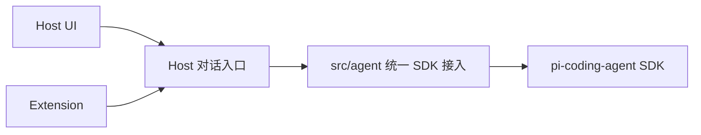

# 浏览器 Demo 与 Host–Agent 接缝设计

当前实现已推进第4项，持久项目、完整原生工具与目录软约束以[第4项确认方案](stage4-persistent-projects-and-agent.md)为准；下文保留第2／3项的设计及验证范围，不把历史内存／空工具限制带入普通项目运行时。

2026-10-28 · 第 2 项设计基线；第 3 项实施见[SDK 与 LLM 准备](stage3-sdk-and-llm.md)

## 界面

目标是本地可点击的对话工作台，comfortable 空态和 balanced 对话/设置密度。参考[实机调研](workbuddy-research.md)的侧栏、输入区和设置分离；使用中性背景、少量紫色品牌强调、系统中英文字体与 8px 间距节奏。亮色为本次观察基线，暗色通过同一语义 token 保持层级。

桌面左栏约 248px，主区对话内容限宽约 800px；窄屏以可展开的正常流导航取代固定侧栏，不使用遮罩弹窗。输入、错误和主操作保留可见。对话区使用真实按钮、外置标签、焦点环及状态文本；中文输入法合成期间 Enter 不发送，Shift+Enter 换行。

顶部分析／决策切换组织两个工作区：分析沿用对话主页，决策展示 decision-platform 待接入的虚拟项目、建议／行动／复盘看板。侧栏新增分析资产、场景组合、连接器、业务插件四个目录，采用分类、搜索筛选、卡片与只读详情。候选资料与 MacBook 项目仅作布局和内容参考，全部明确未接入；[本次修订](demo-capabilities-revision.md)记录来源、范围与验收。场景组合是目标与依赖的组织方式，不新增 Runtime 或 Extension 物理子系统。

按用户后续要求，[项目空间修订](demo-project-space.md)将项目作为唯一创建入口：初始无独立聊天，命名创建项目后承接原对话行为，每个项目当前只有一个连续演示对话。左侧项目空间列表保留稳定名称与草稿入口，右侧可收起的项目文件栏展示 `010_draw`、`020_clean`、`060_reports`。全部仅内存演示，不在磁盘创建目录；窄屏文件栏使用独立视图，关闭回到原工作区。

项目内对话覆盖空态、发送、演示文本逐步显示、停止请求/停止完成、失败/显式重试和项目切换；已有部分输出、错误与草稿保留，重试旧失败提示不会清除另写的下一句草稿。工作区、目录和文件视图切换不清空内容，进行中的演示事件继续归属原项目。设置可从各页进入并返回原页，可编辑供应商示例、地址和模型名，仅保留于内存；密钥框为只读演示占位，真实连接测试禁用且说明原因，不显示假连接成功。

## 职责和 Interface

第 2 项只实现 UI 与演示事件源，没有 SDK、模型请求或网络对话入口。演示事件源位于 `src/host/ui/`，是界面测试材料；`src/agent/` 保持空标记，不放假 Agent 或替代运行循环。

以上为第 2 项验收时的基线。用户通过审核并批准第 3 项后，`src/agent/` 已由真实统一 SDK 接入替代空标记，Node Host 实现配置／内部会话／发送／停止／SSE。设置页通过同源 Host 读写内存配置并主动测试固定短句；普通项目对话仍显式使用演示源，第 4 项才切换真实主链路。

| 能力 | 接缝语义 |
| --- | --- |
| 新项目与内部会话 | Host 创建项目空间，通过统一接入管理该项目内部 SDK 会话；用户不单独创建对话。实际项目存储、目录和 SDK 会话映射在后续方案确定，同项目续聊复用适用上下文 |
| 发文本 | 包含会话、请求标识和文本；已接受与最终完成分开；首版每会话一条在途请求 |
| 停止 | 请求停止先显示正在停止，运行侧确认后才显示已停止；保留部分回答 |
| 订阅 | 投影文本增量、完整消息、终态与可展示错误；按会话/请求标识关联，解除订阅有明确入口 |
| 配置 | Host 管编辑与凭据边界，Agent 只消费有效配置引用；当前演示变更先作用于新项目内部会话，不静默更换在途模型 |
| 释放 | 解除订阅、释放所拥有资源；切换视图不能误销毁其他会话 |

本项展示事件使用 `text.delta`、`message.final`、`run.settled`。这是 UI 投影的内部形状，不是持久化 schema 或公共插件协议。终态区分完成、取消和失败；缺失权威完整消息时不把增量或断流当成功。不静默重试、改模型或重放未知副作用。

## 与 Pi 官方语义的关系

当前[SDK 文档](https://pi.dev/docs/latest/sdk)将会话状态与压缩等交给 AgentSession；会话替换后订阅也需重绑。[事件参考](https://pi.dev/docs/latest/json)区分完整消息与执行结束；当前 `agent_end` 之后仍可有自动恢复工作，不应直接驱动产品完成标记。[消息类型](https://pi.dev/docs/latest/message-types)保留错误和取消等结果。

具体 SDK 方法、终态事件和错误映射必须在第 3 项核对选定版本。不能从第 2 项演示源推导 SDK 真实行为已经验证。

## 第 3 项必须解决

- 核实最新发布、兼容性与具体 API，锁定版本与依赖。
- 仅聊天时显式限定实际工具集合为空，并验证，不能只隐藏工具按钮。
- 显式确定产品资源、设置与凭据来源，避免默认 cwd 加载工程 AGENTS、用户扩展或已有配置。[官方显式配置示例](https://raw.githubusercontent.com/earendil-works/pi/main/packages/coding-agent/examples/sdk/12-full-control.ts)提供 SDK 原生控制位置，无需另造 Runtime。
- 确定真实凭据的本地保存、读回遮罩、配置校验和连接测试；本项不决定持久化格式。
- 经统一接入映射真实事件，验证多轮、取消、失败、释放与会话隔离。真实产品主链路与用户验收在第 4 项完成。

## 本项技术选择

采用单根包的 React + TypeScript + Vite 浏览器 Demo。[React 官方起步说明](https://react.dev/learn/build-a-react-app-from-scratch)与[Vite 官方指南](https://vite.dev/guide/)支持该构建方式。具体安装版本记录在 package.json/lockfile；本机 Node v25.9.0 已核对选定 Vite 的 engines。没有桌面封装、路由框架、后端或持久化数据库。
