# 冻结参考与真实产品对照

左列是冻结 Demo 参考图，右列是候选 g 的实际产品原图。两者角色明确分开；右列绑定 [g 图库及运行回执](README.md)。产品保留原项目/配置/管理入口，原始记录、空对话和数量来自合成业务场景；测量与差异见 [62 项矩阵](../independent-ui/final-review.md)，不以表面截图替代交互或数据验证。

| 页面 | 冻结 Demo（仅参考） | 实际产品 g（待用户确认） |
| --- | --- | --- |
| 工作台首页 | 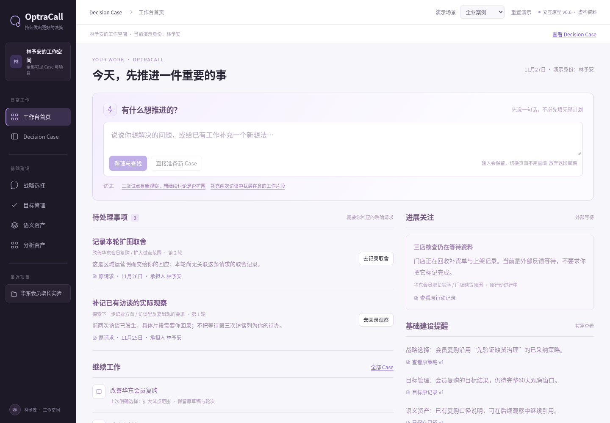 | 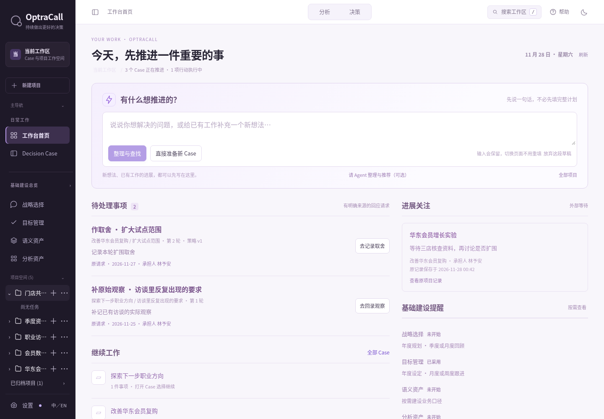 |
| 当前工作·事项列表 | 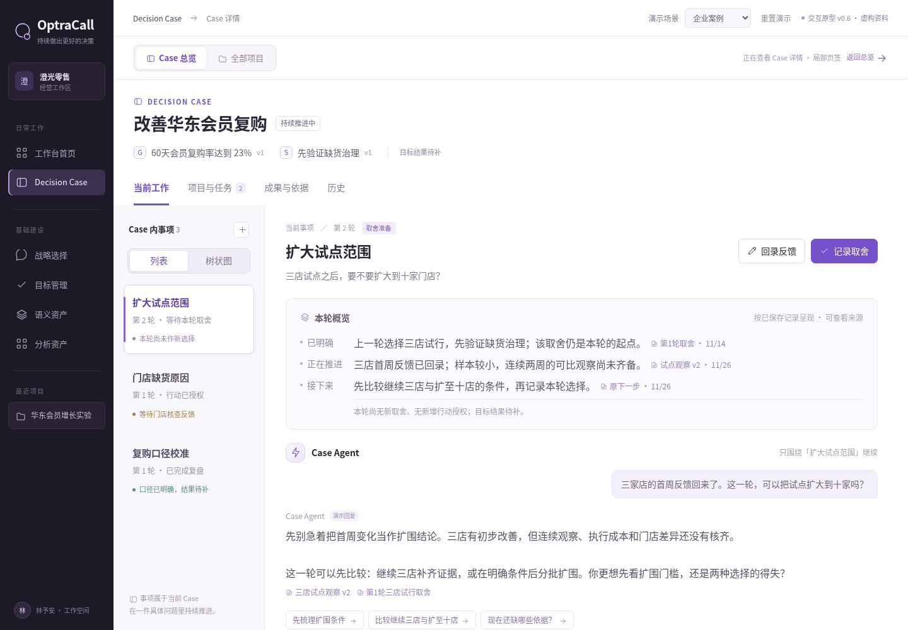 | 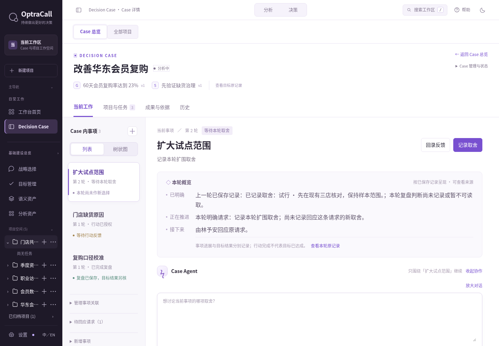 |
| 事项关系树 | 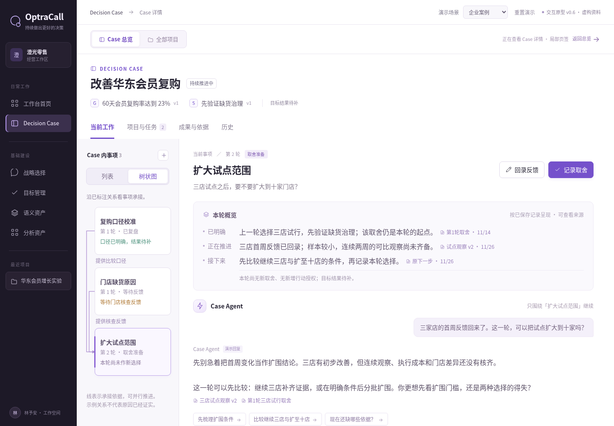 | 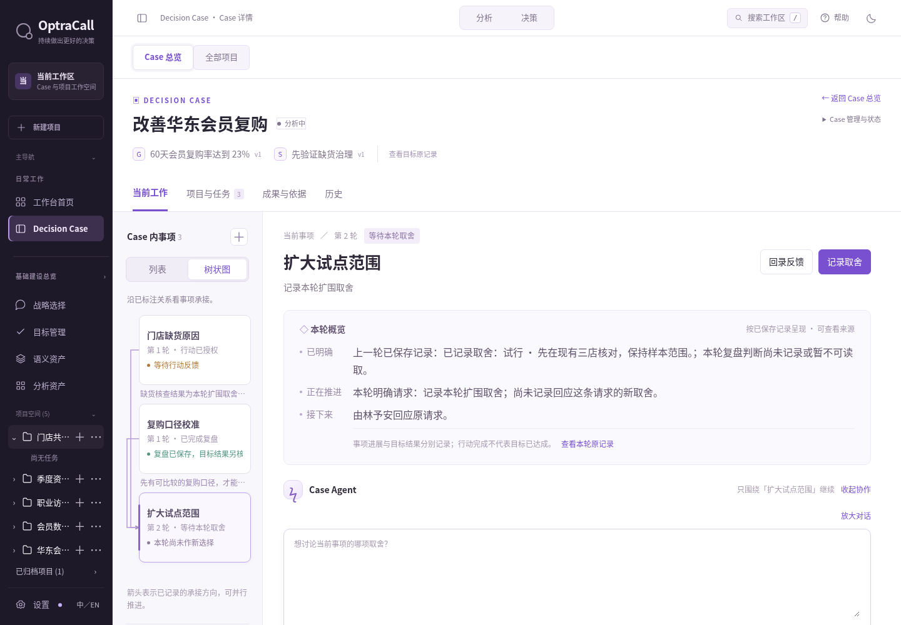 |
| 项目与任务 | 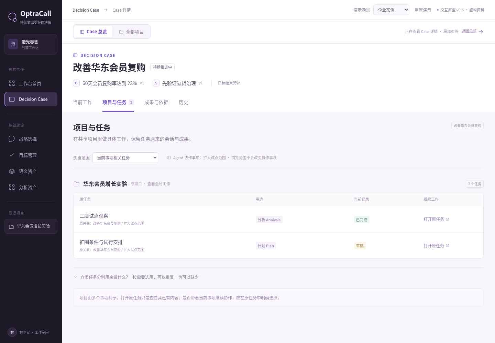 | 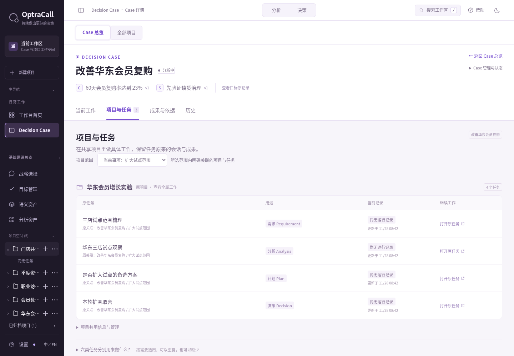 |
| 成果与依据 | 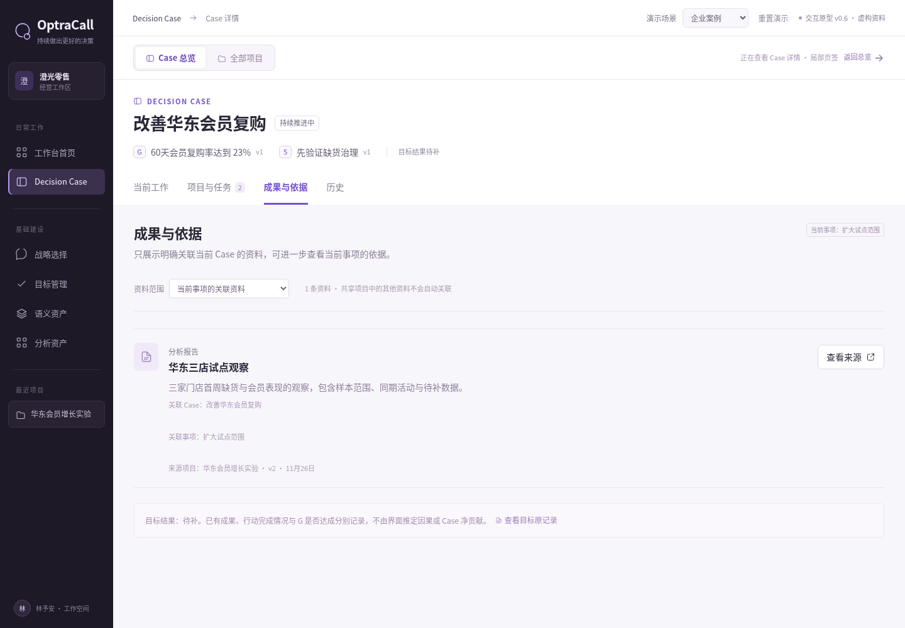 | 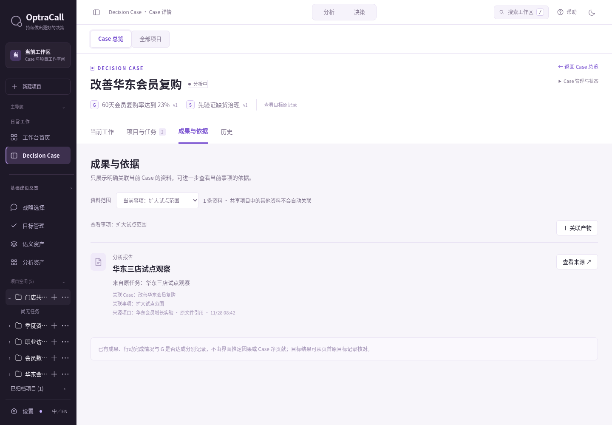 |
| 全部项目 | 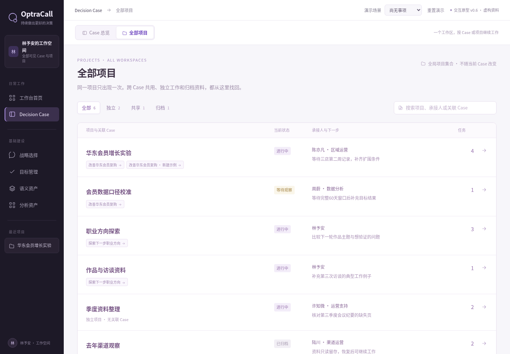 | 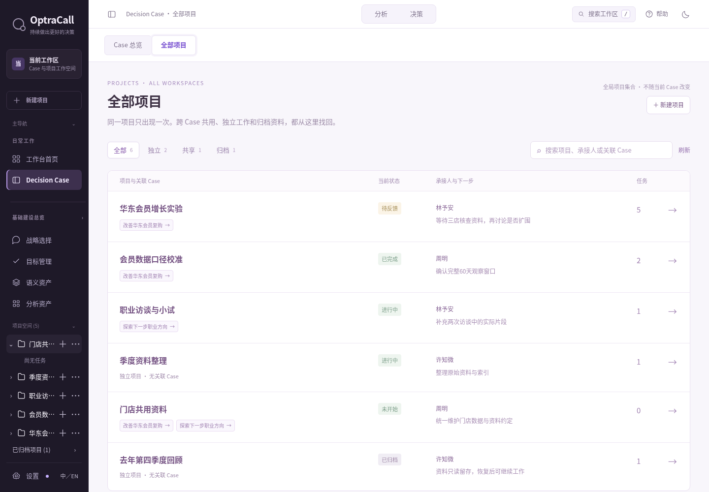 |
| 反馈弹窗 | 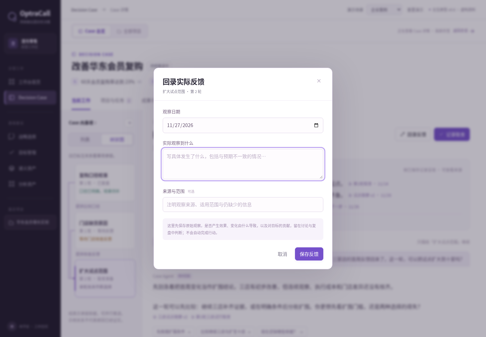 | 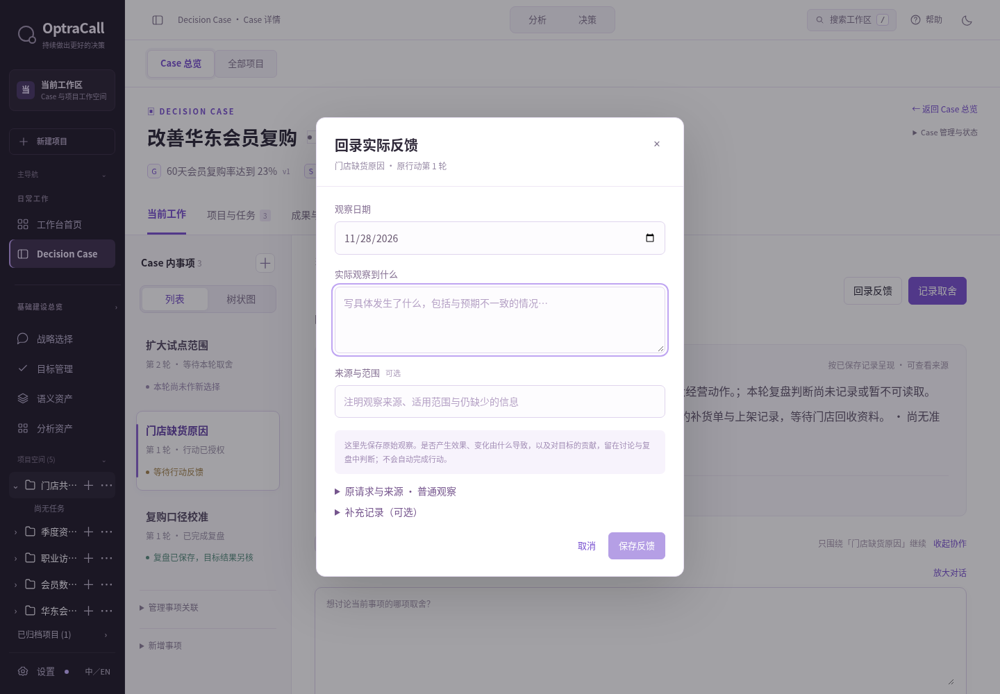 |
