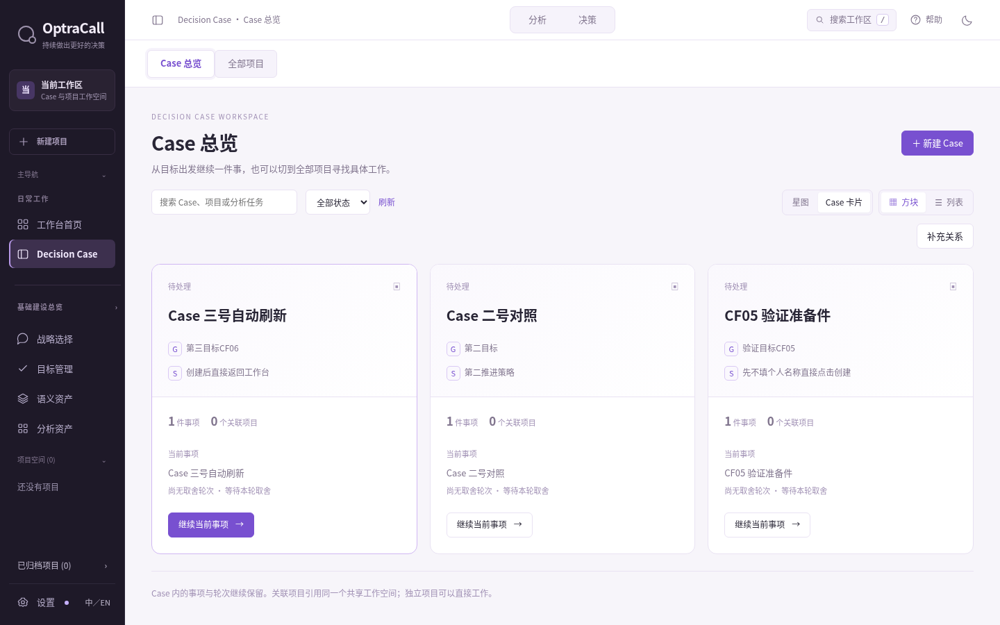
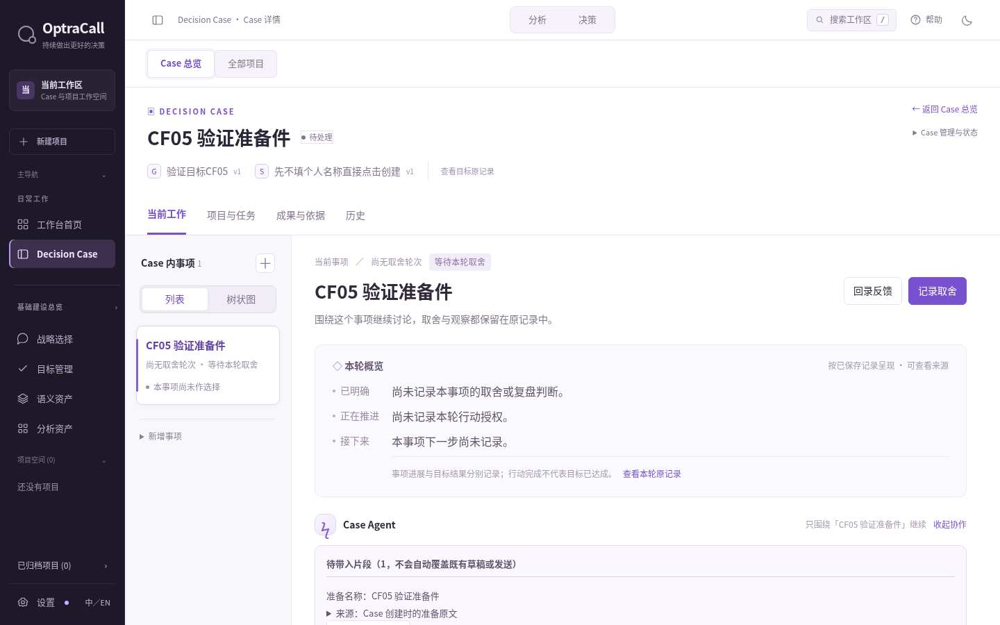
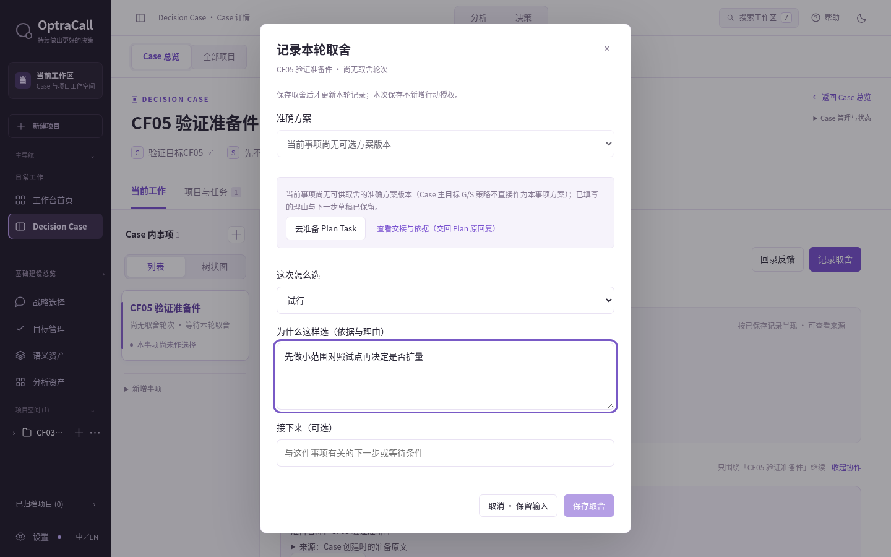
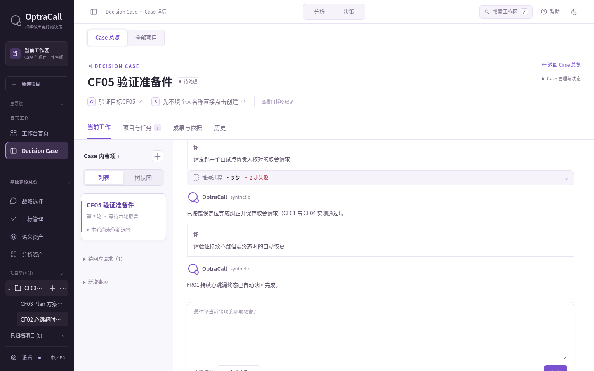

# Issue #154 PM 二审接修与截图确认候选

2026-11-28 · PM Codex。二次交回候选为 `3c2fb5f477297f89d0076dd62286ba7318bb8da0`；按规范接收后由 PM 在 `codex/issue154-pm-final` 完成剩余接修，没有第三次退回或再次领取。当前实际运行/截图候选为 **`a643bf00e79cba01933cbaa49a1616ecb675cf12`**，产品代码固定于 `b88af4aa6dfd7f998bfb3e5e119b87820b287d99`，a643仅修正一行浏览器等待定位器。后续证据提交只补本文/实施说明/图证，不改变产品、测试、SDK或冻结输入；对运行候选的产品与测试输入另作逐文件零漂移核对。

**状态：工程复核已通过（明确范围），等待用户确认本组真实产品截图；T10 的 PR、实际 head CI、获授权合并与 main push CI 均尚未执行。** 主线保持 `74030911ade7a9e06ad1a0213d1fcb93ecbba6dd`。不得将旧截图确认、独立 PASS 或本报告替代本次用户确认。

## 二审发现与 PM 接修

| 标识 | 原问题/证据 | 修正与永久回归 |
| --- | --- | --- |
| PM01 / 原FR01剩余：状态GET正文挂起 | 3c实际组件探针收到200头+JSON前缀后一直等待，推进15秒仍不abort；503退避不覆盖不结束的读取。RED见 `verification/pm-validation/read-body-red.txt` | `BusinessRoleConversation.load`对headers+json共用10秒只读期限、finally清timer、合入owner卸载signal；永久测试验证超时、原输入保留、无stop/open/重放与卸载立即abort。 |
| PM02 / 旧错误晚到 | e72新期限暴露旧GET-A超时晚到污染GET-B已完成界面的边界；独立原样RED保留 | load catch先核alive/ticket；被取代的后台读取不冒作权威idle清错。永久测试与独立原样探针均闭环。 |
| PM03 / 草稿保存后迟到跳转 | 空方案入口先等待保存，卸载旧事项后原onCreate/onLinkProject仍可执行 | 三个跳转在await后核mounted，交接聚焦RAF前再核；保留已成功保存到原位置的草稿。永久覆盖Plan和关联两个入口，原样探针旧callback1→新0。 |
| PM04 / 首事项计数陈旧 | e72总览新增Case标题可见，但卡片显示0事项；首事项POST后缺再次失效。原生产图与独立组件因果RED保留 | 保留Case创建早通知表达部分成功，finishFirstIssue确认后再通知一次；永久测试覆盖前后通知；浏览器升级为真实API首事项1、卡片1、继续当前事项，而非只看标题。 |

根 PM 接修后新建的永久测试、变更范围与原RED均保留。没有改SDK/锁文件、存储格式、G/S或本轮方案权威、取舍/授权/反馈权限、共享项目阈值，也没有自动stop/open/messages、模型重放或设备服务操作。

## 验证与独立复核

- PM对3c重跑正式build/SDK会话边界、50项核心通过，并按首审相同条件复跑真实Host/Pi/Chromium的50秒开流心跳探针，5秒起已自动读回完整回复，原首审P1关闭。该诊断仍仅为受控场景，不裁定Mac自然根因。
- PM补修最终核心 **54/54 PASS，0fail/skip/cancelled**；相关角色/恢复/来源与Case UI的40项在e72阶段实跑通过，其候选范围按独立报告和日志保留，不把旧40项冒充a643重跑。新补丁的源与测试由全新非作者独立重核。
- 最终正式build、`check:agent-sessions`和`npm audit --audit-level=high`通过；审计保留2项moderate、0 high/critical，未执行依赖修复/升级。官方归档下载比对不冒充已重复执行。
- 非作者原文与矩阵：[最终独立复核](verification/pm-final-independent/final-review.md)。其e72三项因果RED保留，修正后独立原样重跑；71项覆盖通过的源/测试输入、a643一行浏览器定位器增量及最终产品图/实际浏览按原文准确绑定，不合计PM与复核者测试数。
- 原领取方3c的完整524文件/3694项（3497pass、197skip、0fail/cancelled）按原 `implementation.md` 保留。PM此轮没有重跑该全量；本增量为明确消费者的前端读取、迟到回调和刷新时点，完整影响映射由上表、54核心、独立71及实际生产E2E覆盖。PR实际head完整CI仍在T10，不能预标通过。

## 实际生产构建与本次截图

本轮由真实Host同源直接服务正式 `dist`，使用实际React/CSS、官方Pi1.4.0与隔离本地合成Provider。运行 `/api/health.runtime` 实际返回：

- commit `a643bf00e79cba01933cbaa49a1616ecb675cf12`，tree `d9ab4d03512adf10a46b7bcb83dc4f8345a63e35`，dirty=false。
- builtAt `2026-11-28T12:58:52.498Z`，instanceId `61e609cf-6867-40a9-920e-dd14996176bc`，codeRoot `/workspace/OptraCall-issue154-second-review`。
- 原始[运行身份](evidence/pm-final-product/runtime-identity.json)、[正式构建戳](evidence/pm-final-product/build-stamp.json)、[浏览器回执](evidence/pm-final-product/e2e-receipt.json)、[16图与内容哈希](evidence/pm-final-product/manifest.json)。临时Host/Provider已正常关闭，合成测试数据保留在隔离根；没有改用户Mac服务。

七条实际浏览器链路均通过（7次合成Provider请求，pageErrors=[]）：

| 范围 | 实际结果 |
| --- | --- |
| CF05 | 缺个人名称定位、聚焦且零Goal/Case创建POST，补全后创建。 |
| CF06 | 创建后直接返回总览，无手刷且唯一Case及首事项1正确；图04/03在元数据稳定后采集。 |
| CF02 | 持续心跳无首帧→期限→耗尽disconnected禁发/保留草稿→显式重连合法snapshot→原草稿发送完成；无自动open/messages/stop。 |
| CF03 | 无项目引导→准确关联→Plan原回复→交回→理由保留的取舍→明确授权→反馈→本轮原记录/原回复/原看板反馈历史；无自动授权。 |
| CF01/CF04 | CaseAgent实际Pi工具两次参数失败后自主纠错保存请求；短暂EOF后正确恢复，无Host固定推理重放。 |
| FR01 | 持续200ms心跳、遗漏业务终态、3秒真实合成回复后自动读回全文，去除正在回复，未stop/重放。 |
| CF07 | 项目动作含项目名，按原项目行/ID仅归档一个并Esc归焦点；同名文本仍需所属行区分，不声称名称就是唯一ID。 |

回执保留8条console资源404观察，pageErrors为空；不宣称浏览器控制台零错误，未从无URL的console摘要逐条归因。本轮没有发现这些观察阻塞上述实际用户链路。原四项历史浏览器脚本FAIL、原Mac/GLM未验证、原74图/native未取得等边界继续保留，不改写为通过。

### 给用户确认的核心原图

Case总览（新Case首事项准确）：

Case详情（本轮概览稳定后采集）：

无方案取舍的原路径引导：

持续心跳漏终态后自动恢复完整回复：

其它实际图（含1024/390、深色、字段校验、任务断开/重连草稿和反馈历史）见同目录与manifest。所有资料为隔离验收样例，不代表实际经营结果。

## 后续门禁

冻结Demo/spec/task与PM接修、新非作者独立原文、实际图证逐项对照；四原则继续为Host管环境、Agent自主执行、复用Pi、减少人工操作。用户确认本组实际图后才能开PR（含draft），再核实际head CI、获授权合并及main push CI，最后回填#154结案。设备更新与真实模型/经营体验另行安排。原严重UI验收事故、首审失败、e72发现及中间图均保留。
