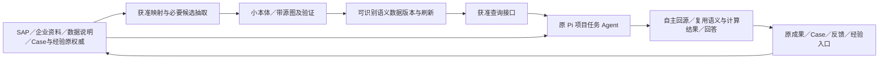

# L2 后台语义建设与首个服饰零售闭环

> 当前实施（2026-11-06）：[正式采用方案D17.1–D17.9](formal-adoption-confirmation.md)全部推荐A已确认，授权A–C必要接线、有限资产维护适配、私有依赖、隔离工程验证及Git／CI固定交付。D正式采用窗口／现有服务切换与真实模型保持未进入；[实施记录](formal-adoption-implementation.md)记录实际差额和结果。原第1–9节为已完成v0.3工程范围，专业可靠性／真实业务闭环分别留证。

总体规格 v0.3 · 2026-11-06（北京时间）· 已确认的工程版与后续最小范围

用户已整体确认本版工程版收尾与S6最小范围，专业可靠性单列后续。当前实施限定在本地工程交接和已有接缝的合成核对，不启动真实模型测试。既有工程和失败按原回执保留，不能将早期“未安装／未建图”的准备状态当当前事实。

## 1. 依据、定位与本轮边界

依据[产品讨论稿 v0.4](../../../docs/OptraCall_产品讨论稿_v0.4.md)，完整承接 [v0.3](../../../docs/OptraCall_产品讨论稿_v0.3.md)、[v0.2](../../../docs/OptraCall_产品讨论稿_v0.2.md)及[四库／双库方案](../../../docs/fourbase-doublebase-plan.md)延续的产品内容；本规格不是 v0.3 后的增量清单。后来的明确决定优先；旧文档的初始化状态、历史授权及失败不改写为当前事实。

L2是后台业务语义支撑：以本体及知识图谱组织可复用的概念、身份、范围、规则、来源、时间与经验关系，帮助原Pi Agent找准定义、方法前提、适用范围和来源，并支持其正确使用。前端只呈现必要结果与依据。最终目标为 Semantica 实际上线、首场景 SAP／本体／图谱实际可用、首个真实分析决策 Case 闭环；不把完整 L2 缩成关系／时间索引。

实施先后按[六阶段计划](phase-plan.md)：S1 场景基线 → S2 后台验证／S3 资产建设 → S4 原 Pi 工程接线 → S5 上线与真实分析 → S6 决策反馈复盘。阶段不是 Agent 运行时的固定分析步骤。

**本版按“L2语义基础设施工程版”明确可收尾成果和后续工作，保留完整v0.4目标。**本次完成S5工程交接并核S6现有接缝，产品源码、接口、依赖和持久结构无必要改动；只在既有测试中补一条集成验证并更新说明。SC-01、已脱敏指标资料、原本体／图、UI Demo和历史结果保持；原企业工作簿与身份值不进入仓库／图／Agent。检查只复用脱敏／合成资料、原隔离依赖及本地模拟Provider；不读取新增真实数据／凭据，不启动真实模型，不切换运行服务、不操作其他设备或执行Git写入／CI。

工程版交付定位、本版S5剩余项及S6最小范围均已整体确认；工程交接和S6核对按本次明确指令执行。后续运行采用及其他开发仍按具体授权。工程、Git／CI、安装／正式采用、专业可靠性和真实业务闭环分别记录，不追溯改写FAIL。

**首场景推荐 SC-01：线下直营可比门店，两期零售额同口径拆解与核查决策。**题面、3核心指标＋1方法、本体／图边界和缺口见[首场景范围](scenario-scope.md)，获准方案源为[去标识候选资料 r1](data/metric-candidates.v0.1.json)。当前没有实际经营数值，是否下降、具体匿名对象／期间和真实反馈仍待核，不再以促销作为默认决策。

### 1.1 Semantica、Agent、Pi与Host的职责

**Agent自主执行包括自主调用Semantica和计算／复核工具，并复用适用结果，不要求LLM每次从头推理。**语义组织、已验证的关系／约束和计算结果可以被重复使用；是否适用于当前问题、如何处理冲突与解释业务结论由Agent负责，必要时委托工具验证，不把这些工作限定为LLM独立完成。

| 产品原则 | 本规格的责任与最少操作 |
| --- | --- |
| Host管环境 | 接通Semantica，管理来源准入、权限、资源、生命周期、版本及保存；不代作业务结论或补业务计算 |
| Agent自主执行 | 判断当前需要什么，自主选择查图、回源、计算或复核，复用结果、解释判断和修正错误；不强制每次查图或固定核查步骤 |
| 优先复用Pi | Semantica沿工具／扩展和统一Pi入口接入，会话、工具调用、上下文管理及恢复继续复用原Runtime |
| 减少人的操作 | 普通用户表达目标、提供资料；查口径、适用性判断和纠错在授权内由Agent完成；人的真实选择／业务授权沿原入口，不新增普通读取审批 |

数值与文字是否一致、某个条件能否支持结论，是Agent需要完成的分析／复核工作，可借助计算和其他适用工具。Semantica提供的定义、方法前提、关系、范围与来源帮助完成这些工作；一次检索／约束通过不等于业务结论已被证明。该分工不削减本体、建图、语义治理与维护方向，也不把完整L2收窄成检索索引。

## 2. 完整产品能力覆盖与实施归属

“复用”指沿已核接缝和原合同继续提供，真实运行状态在 S1 重核；不表示本轮重验了全部已有能力。“后续扩展”保留完整方向，但不作为首个有限 Case 的前置或本轮已完成能力。

| 完整能力 | 已有底座／当前边界 | 本次 L2 补齐及阶段 | 超出本次有限场景的扩展 |
| --- | --- | --- | --- |
| 分析与决策工作台 | 原项目／任务／对话／文件／报告及连续追问、停止恢复 | S4／S5 原入口使用语义；复测主分析 | 不扩为通用办公平台 |
| Data 数据及计算 | 原 M2 固定输入、说明、成果与准确引用；Agent 可选 Python／DuckDB | S1／S3 语义字段映射，S5 核计算与引用 | 不搬所有明细到图、不建新计算引擎 |
| Ontology 概念／本体 | SAP 与字段已有结构，L1 无通用本体引擎 | S2／S3 小本体、身份／范围／关系与必要约束，S5 核正确理解 | 全企业／行业本体、全套 OWL 能力按具体需求扩展 |
| Knowledge 原文及知识 | 企业资料修订、已选知识和来源可查读 | S3 结构化映射＋必要候选抽取、带源声明及图／原文结合查询 | 不全库无差别抽取；向量／混合检索按实际缺口增量 |
| Memory 工作历史与长期经验 | Pi 原生历史；个人知识／经验、选择性保留／归档及召回 | S3 关联来源与条件；S6 用反馈修订并核后续可用性 | 不灌全部对话、不新造消息权威；物理遗忘另核完整保留链 |
| Hypothesis 假设与反证 | 原 Case 中的假设、支持／反对及来源 | S3 带源语义关联，S5 自主分析，S6 反馈修订 | 不强制每次凑假设、不将关系升级为因果 |
| Strategy 策略及取舍 | 原 Case／Board 的备选、选择和理由 | S5 展示条件／风险，S6 分开真实执行／观察／效果 | 不自动执行业务系统，不预判经营收益 |
| RAP 目标与情景 | 本次选定的需求／发布内容按原合同提供 | S1／S3 限定查询和问题范围，保留假设／未知 | 目标、偏好和任务假设不升格为企业全局事实 |
| SAP 指标及方法 | 原指标／方法保存、发布、项目准入与索引；S1已核复用，S3／D16隔离资产已有证据 | S1 重核复用方法成果；S3 建3核心指标＋1参考方法、发布及项目准入；S5 正确参考 | 不把8候选全当已可计算；不重建 IR 链／完整行业库 |
| 多源观点、证据及冲突 | 原显式引用与主张、准确回源、未知 | S3 保留相反材料／身份范围；S4／S5 按需查询、主回答解释 | 不以权重／相似度默认裁决业务真伪 |
| 多源连续分析与前提修订 | 可从制度、事件、用户陈述开始，再在原任务补数据；M5 已有判断／方案修订及影响说明 | S3 关联关键前提及支持／反证；S5／S6 区分受影响与暂未受影响结论，保留新旧稿 | 不自动撤销人的选择、不重放行动；不强制先交表格或切换模式 |
| 语义检索、规则与时间 | L1 find／read／一层 trace；非向量 RAG、非通用 as-of | S2／S3 验证所需查询与约束、已知时间和变化，S5 核适用性 | 事件持续摄取、复杂历史查询等按证据扩展；Graphiti 条件比较 |
| 经验反馈闭环 | 原 Case／反馈／经验入口与历史结果保留 | S5 真实分析，S6 实际决定→后续→反馈→复盘；可固定回放核经验变化 | 跨 Case 模式成熟、普遍增益需后续证据；不强制第二个真实 Case |
| 上下文和 Runtime | 原统一 Pi 会话／工具循环／压缩／分支恢复 | S4 增量供给语义，内容可见、生命周期共用 | 不另建 Agent、自动修正循环或全局调度平台 |
| 交互和依据查看 | 原任务回答旁可选依据，普通提问可连续计算 | S4 必要详情差额；主回答主动解释关键语义，正常新增必做 0 | 无独立业务含义页／后台图谱台／设置向导 |
| Extension 资产／连接器／业务插件 | 沿现有统一入口、源错误及权限合同 | S1 核首 Case 必需依赖，S4 回归受影响消费者 | 不做插件市场、不迁移全部旧插件；新增连接器需具体阻碍 |
| 权限、维护与治理 | 原工作区、授权、归档、版本、日志及限制 | S2 起 V406 源更新／撤回／刷新／访问变化／停用，S5 核运行 | 企业团队治理和全面权限平台不作首 Case 前置 |
| 价值与工程交付 | 原 SDD／TDD、非作者复核；历史 FAIL／UNKNOWN 保留 | S2–S6 语义质量、成本、真实分析与业务闭环分开取证 | 不从单次试点外推普遍更准、更快或因果收益 |

## 3. 业务与后台需求

下表保留完整产品要求。工程版完成、部分工程证据与后续业务目标按第6节分别登记，不把每项都变为工程版收尾或普通用户使用的前置条件。

| 编号 | 必须形成的可观察行为 | 阶段／验收 |
| --- | --- | --- |
| R01 有限 Case 与来源 | 明确问题、对象／时间、决策与反馈责任；准确定位获准源、SAP 版本、数据及说明。未知不被示例补填 | S1；V402／V404／V405 的准入 |
| R02 SAP 实际可用 | 复用或补齐必要指标／方法，沿现有保存→未发布→成功发布→项目可用流程；正式定义与方法来源保持原权威 | S1／S3／S5；V402 |
| R03 小本体 | 表达必需类型、对象身份、别名、范围、粒度／单位、关系方向及有源约束；类型与具体发布版本／对象／声明分开 | S2／S3；V403 |
| R04 带源建图 | 既有结构优先确定性映射；必要文本抽取仅为可核候选，有原文位置、性质与不确定性；同名不自动合并 | S3；V403 |
| R05 冲突及时间 | 反对／支持声明并存，推断不当原文；业务有效时间与系统留存时间分开，未知不补造，旧引用不换最新版 | S2／S3／S5；V403／V406 |
| R06 查询及原文结合 | 按当前问题／准入取得相关定义、关系、条件、冲突、未知与准确来源，并可继续读原文；无命中不证明事实不存在 | S2–S5；V401／V403／V404 |
| R07 约束及规则 | 仅承诺实际验证的检查；结构检查、图路径、显式规则推导、SHACL、OWL和经营因果分析分别取证 | S2／S3；V403 |
| R08 保存与刷新 | 有明确数据版本及装载／发布路径；保存、重开、更新、撤回、失效、重建后可核身份／语义／来源保真，滞后如实报告 | S2–S5；V401／V403／V406 |
| R09 原 Pi 使用 | 语义内容通过原获准工具进入当前 Agent 上下文；原 Agent 自主决定是否查询、选择方法／计算／解释，不强制调用次数和顺序 | S4／S5；V401／V404 |
| R10 权限与资源 | 来源准入约束派生图和输出；模型无任意写图资格；取消／迟到／关闭／权限变化受原生命周期管理，未知副作用不盲重放 | S2／S4／S5；V401／V406 |
| R11 原体验 | 主回答主动说明影响判断的关键口径／范围／冲突／未知；业务含义仅在可选依据内，打开详情不执行分析或保存 | S4／S5；V404 |
| R12 真实闭环 | Agent 建议、人的取舍、实际后续、结果／反馈及复盘分别留证；无反馈开放，不因选择不行动自动关闭 | S5／S6；V405 |
| R13 经验维护 | 值得复用才保留；保持原场景、支持／反证及限制；更新纠错沿原资产，历史失败／旧报告保持；后续应用核适用性 | S3／S6；V405／V406 |
| R14 失败继续 | 语义不可用／空资料／可选来源保存失败不阻断可完成的 L1 与计算；明确必要材料失读／越权则停止受影响部分并说明缺口 | S2／S4／S5；V401／V406 |
| R15 价值对照 | 共同问题、源事实、补充定义、实际模型配置、权限、预算；分开初建／更新／查询／模型与人工成本，保留无增益和新错误 | S5／S6；价值验证，不替代 V405 |
| R16 连续分析及修订 | 制度／访谈／事件等可先形成有边界判断，再追加计算；关键前提变化说明影响哪些判断／报告／备选，保留旧版本及暂未受影响内容 | S3／S5／S6；V404／V405／V406 |
| R17 脱敏源与隔离 | 原企业工作簿、真实姓名／公司／品牌／平台及人员归属／原业务编码版本不入仓库、Demo、图、工具结果或日志；仅获准摘录及匿名输入供后续使用，特例缺失不泛化 | 本轮准备及 S1–S6；V406 |
| R18 SC-01 金额拆解 | 首批3核心指标＋1新整理参考方法，采用实际可比范围与字段后核是否下降；金额分解不证明根因／因果，同式自核不冒充独立对账 | S1／S3／S5；V402／V404 |
| R19 场景语义检索 | 覆盖概念／版本辨义、支付归属与截数／回补／成熟度、适用条件、字段映射及影响、扩展歧义与源更新6类问法，不强制调用顺序 | S2–S5；V401／V403／V404 |
| R20 分层资产准入 | GMV独立辨义；数量歧义牵连市值／折扣暂缓，客单价分支条件成立才扩展；条件未满足不写成已满足，核心发布前仍须核特例及缺口 | S1–S5；V402／V403／V406 |

### 3.1 首批建设交付

| 部分 | 首批明确范围 | 不能用什么替代 |
| --- | --- | --- |
| 业务问题 | 匿名线下直营可比集合，两个等长已结束期间；核成交／退款变化对应金额，支持人的核查／补证决定 | 不虚构真实下降、对象、期间或经营结果，不以促销因果为默认题面 |
| SAP | 终端成交额 C02、零售退款额 C03、零售额 C04 三个核心；“同口径零售额变动拆解与核查”一份参考方法 | 源摘录不是已发布资产，文字公式不是方法库；方法是本次新整理候选，仍须发布及项目准入 |
| 本体 | 概念与准确版本、匿名范围、时间／截数／成熟度、单位／粒度、定义与方法条件、字段角色、带源知识及原 Case／经验 | 不只把3个指标名建成节点；不冻结生产类名／字段或建立真实主体网络 |
| 图谱 | 概念与版本、准确依赖、适用／要求／未满足、字段映射、脱敏源定位、别称／冲突、原成果／Case依据关系 | 不是全部944条指标摄取或逐笔交易入图，不从关系声明推定真伪／因果 |
| 辨义与扩展 | GMV只作辨义；零售量、市值、折扣在依赖与粒度核定后再用；客单价需渠道／分母等条件 | 不以减少指标数为由删掉冲突／未知，也不为完整性强迫首 Case 使用全部指标 |
| 真实后续 | 人选择核交易、核退款或补证／观察等有依据方向，取得实际后续与反馈，再复盘 | 工程修复、数据传输成功、选中方案或仅出报告不等于业务闭环 |

关键源口径：退款额摘要为订单支付时间归属，不能沿旧虚构 Demo 的登记月设定；业务归属与系统／数据截止不同，跨期回补和退款观察成熟度尚未知。金额单位原摘要为“元”，具体币种、税口径、符号、类型重叠／去重和可加总粒度在实际输入映射中核定，不自行补默认。

方法参考 `Δ零售额＝Δ成交额−Δ退款额`，默认交付金额项及对判断的限制，不强制贡献百分比。有独立源净额可核对；若仅由成交减退款派生净额，零残差只是恒等关系，不能证明源数据正确。完整[场景清单、逻辑角色及查询题面](scenario-scope.md)继续属于本规格；原批准范围沿既有回执，本版不重新设计资产或扩大指标数量。

## 4. 技术路线与接入边界

### 4.1 组件选择

Semantica0.7.0已在S2起的隔离环境安装验证，S3建成有限资产、S4接入原Pi、S5/D16取得真实模型使用记录；这不是正式运行采用或专业通过。当前主路径为原Host语义port的只读graph分支及受来源准入的Python worker，沿[S4方案](s4-integration-plan.md)及[D16固定候选](s5-limited-repair-results.md)复用，不重开双路集成。固定发行源码`2a9afec685fe6f4a18350834caed3d6a9affb27a`只标识所核版本，不声称当前最新；变更组件／依赖须说明实际缺口及受影响范围。不默认全量extras、LLM抽取、embedding、完整OWL或第二个图引擎。

Graphiti 保留为持续事件、实体对齐、事实失效／历史检索等明确缺口后的同源比较，两者能力重叠；本计划不默认双引擎上线。原文检索和图查询可结合，当前 L1 没有切片向量 RAG；不把假设的 RAG 当既有实现，也不承诺图普遍优于文本检索。

### 4.2 数据准备和任务运行分开

图是建设与使用的数据关系，不是 Host 按图编排 Agent。原 Store 继续权威，图是可重建的派生表示；经营明细不默认逐笔入图。输入仅限获准脱敏源及后来准入的匿名数据／说明，不能沿上图“原权威”节点自动访问本次企业原附件。物理保存、身份／关系／来源字段和更新策略沿既有[结构决定](structure-decisions.md)、[S3补充](s3-structure-addendum.md)及实施回执；本版不新建schema或第二权威。

### 4.3 Pi 及业务接缝

| 项目 | 本规格约束 |
| --- | --- |
| Runtime／接口 | 沿已实施的Pi1.4.0、Interface v3和[统一接入说明](../../../docs/agent-session-integration.md)；不新增接口版本。未来固定候选变化才核受影响部分；IN01–IN07继续按[工程规范](../../../docs/engineering-workflow.md)执行 |
| owner／profile | 原普通 `project-tasks`，真实 projectId＋taskId、当前 request／operation；Host 静态注册／注入，不新建语义 Agent profile／全局运行队列 |
| 复用入口 | 现有显式 MCP 装载、商圈／天气注册模式、L1 semanticContext port 与模型可见工具结果；原 Pi 会话／工具循环／原生历史／取消继续唯一权威 |
| 最小新增 | 沿已选Host业务port薄适配与原查询合同；原生MCP限制按S2记录保留。S6先核原入口具体引用缺口，必要才补适配，不扩接口平台 |
| 能力范围 | 仅按D13／D14／D16已核的普通project-tasks及受信受管普通路径准入，保持真实owner；独立核算、固定文本／冷读等专用资源不自动获得新图工具或执行权限 |
| 读写归属 | Agent 查询不等于写图；源修改、SAP 发布按原入口，建图／发布／刷新由获准工程维护路径承担。不得把组件全部变更工具直接暴露给模型 |
| 模型与成本 | 复用获准任务模型；组件如需内部 LLM／embedding，单列必要性、实际配置、费用、取消及数据出口。skills 是使用说明，不能代替包安装／加载数据／接线 |
| 返回及记录 | 必要语义、准确且获准的脱敏来源与已知缺口进入 content，details 补界面／状态；限定结果大小并可继续取获准正文，避免截断丢失关键条件。不打开／回传企业原附件，交付、读取／作者声明、正确采用分别判断 |
| 生命周期 | 复用公共取消、关闭、配置变化、owner 隔离及迟到结果保护；请求取消、进程终止和写入结果分别核验，UNKNOWN 保留，不自动重放副作用 |

已核组件存在多入口默认图状态不共享、MCP 工具集合含写图、静态 validator 不等于全推理等限制。S2–S5既有验证范围和失败保持；正式采用仍须核目标环境实际装载／刷新，不能仅凭官方API名称作完成证明。研究依据见[使用链](../fourbase-l2-temporal-projection/semantica-usage-research.md)、[Pi 接缝](../fourbase-l2-temporal-projection/semantica-pi-integration-research.md)与[服饰语义构建](../fourbase-l2-temporal-projection/apparel-retail-semantic-build-research.md)。

## 5. 前端范围及 Demo

[纯前端 Demo](../../../docs/prototypes/fourbase-l2-rollout-ui-demo.html)只回答：后台有了语义能力后，普通用户是否仍能直接提问、看懂关键解释，并自愿核对依据。原Demo已按SC-01题面及去标识资料准备；本版保持其字节、布局和交互，新增前端差额为0。指标摘要来自获准脱敏整理，任务／输入占位／回答为预置示意；不把所有业务规则统称虚构，也不声称已有经营数据、已发布 SAP、实际下降或分析完成。任意输入不解析，无真实查询、模型、计算、保存、Case 决策或后台配置。

| 位置／动作 | 要求与当前差额 |
| --- | --- |
| 原项目任务提问与回答 | 保留原路径。关键口径、范围、实质冲突／未知及对结论的影响直接写进 Agent 回答；这些是回答质量目标，不是 Host 自动生成模板结论 |
| 回答旁查看依据 | 复用 L1 可选面板，必要时补充准确本体概念／SAP 版本／映射及关系说明；“业务含义”为里面默认折叠的可选内容，不增加独立页面／导航 |
| 查准确源 | 只核获准摘录／将来准确发布定义的修订／位置及已知时间；不链接企业原附件，不混同摘录与原文全文；旧源失读说明未知、不换当前版 |
| 追问／纠正 | 加入草稿仅改本页草稿，用户正常发送才继续任务；查看详情不自动分析／重算／写源 |
| 失败与空资料 | 语义查询失败／空图可沿 L1 继续，必需材料失读则保留缺口；查询中可停止，不因打开详情重试 |
| Case／反馈 | 沿已有入口与状态，不造新闭环向导；报告完成仍可待决定／待反馈。Demo 不模拟真实业务执行或一键“已闭环” |

正常新增必做操作为 **0**。无 Case／完整本体／RAP／SAP 的普通问题也能使用原分析路径，不让“首 Case 验收需要完整证据”变成所有任务的入口门槛。前端不提供本体／图谱管理、Semantica 安装设置、部署后台、L2 模式开关或阶段进度条。S1–S3 无产品 UI 变更，S4 只做经确认的必要差额。

浅／深色沿既有产品 token；桌面与窄屏单列、长来源可换行，语义 HTML、表单标签、键盘焦点、对话框关闭返回及状态提示纳入实现验证。原型当时的实际浏览器、375px、主题与焦点NOT_RUN记录保留。本轮前端差额0，不新增浏览器验收；隔离Host／Pi合成接缝检查见[S6结果](s6-minimal-integration.md)，没有切换运行服务。后续确有界面差额再按工程规范准备最小设计与适用验证。

## 6. 验收矩阵与完成边界

**V401–V406是保留的完整产品目标，不是本次工程版完成声明。**工程版可按用户已接受范围收尾，原业务目标保持开放；不以延后专业可靠性改写原FAIL或删除原目标。

| v0.4 验收 | 阶段与最小证据 | 反例／失败判据 |
| --- | --- | --- |
| V401 Semantica 上线 | S2 后台运行／往返，S4 原 Pi 工程，S5 约定环境固定版本、实际查询／重开／刷新／取消／停用 | 只有研究、安装、握手、Explorer、预置回答或合成工程不能算上线 |
| V402 场景 SAP | S3 的3核心＋1方法准确发布、条件与项目可用；GMV辨义及暂缓／扩展不被伪装可执行；S5 正确参考 | 8候选、草稿、原字典文字公式、方法名称或其他分支交付不等于本项目可用 |
| V403 本体／图谱 | S2／S3 核SC-01逻辑角色、身份／依赖／条件／字段／脱敏源、6类查询、冲突／未知、重开与约束负例；S5 实际语义采用 | 3个指标节点、命中率／valid 不代业务正确；SHACL核target及负例；不覆盖别称／数量歧义 |
| V404 首 Case 分析 | S5 实际匿名范围／两期／准入模型，实际语义结果与成果关联；同口径金额拆解、截数／成熟度说明、可核计算和核查／补证备选 | 字典不提供经营数值；同式零残差不是独立对账，金额变化不证明经营根因；Demo不能替真实分析 |
| V405 首 Case 闭环 | S6 人的决定及理由、获准真实行动／补证／观察、结果／反馈、复盘和需修订／保留内容 | 无反馈开放；暂缓／不行动仍需真实后续；结果改善不证明因果，失败可诚实闭环 |
| V406 维护及失败 | S2 起脱敏／源准入、更新撤回／图刷新重建、访问变化、错误取消停用与维护人；保留旧源／报告／Case，原 L1 可继续 | 企业原件／身份值进入仓库或输出、特例删名泛化、旧源换最新版、失权资料新查询、故障阻断主分析或取消当回滚均失败 |

### 6.1 工程版范围与S5剩余状态

| 对象 | 本版状态及可用证据 | 未完成部分 |
| --- | --- | --- |
| 本地工程版 | S3有限资产、S4原Pi接入、D16适用检查及非作者复核已通过；D16试验已停止并封存，本次[限定工程交接](s5-engineering-handoff.md)完成 | Git／CI、安装／发布与正式服务采用不由本地PASS代替，未在本次执行 |
| V401 约定环境上线 | 固定隔离组件、装载与接口已有工程及模型使用证据 | 正式目标环境、代码／构建及语义版本采用、维护责任与运行交接待后续安排 |
| V402／V403 资产与语义 | 3指标＋1方法、小本体／带源图、有限实际Condition取得／采用已有证据 | 真实场景适用、完整回源／分页及正确使用不能从图命中／发布推定；按届时需要核具体接缝 |
| V404 真实首Case分析 | D16已知合成K3首稿／最高固定稿均FAIL，各27/27预定金额匹配、返修新增重要错；实际1/8 | 真实经营材料与责任安排仍缺；专业正确性未达标，真实首分析保持开放 |
| V405 真实决策反馈 | S6原业务入口及准确引用已完成合成组合核对，见下节；产品源码无需新增 | 真实人的决定、实际后续、反馈与复盘未发生；合成工程记录不能代填 |
| V406 维护与失败 | 隔离的更新／撤回／刷新／坏图／取消关闭／L1回退已有工程证据 | 正式采用中的维护人、操作说明与实际变化处理待落实；不是新建维护平台 |

本次工程版交接已复用已有版本、资产、运行说明、失败和证据。专业后续不再作为该工程范围收尾前置，仍影响“可靠业务分析、完整S5及产品闭环”的验收。工程版结项、正式采用、业务验收分别报告。

### 6.2 专业可靠性单列后续

| 后续问题 | 已知事实与后续责任 |
| --- | --- |
| 数值、文字及量的方向一致 | D16混淆单期净额与两期差值方向；由Agent自主复用定义／关系、计算或其他适用复核工具处理，不要求LLM每次从零重算 |
| 条件充分性、快照与成熟度 | 观察天数／已见时滞不自动证明终局；Agent核实际方法前提及证据，必要时计算验证，语义资料有缺口时修正原资产／映射 |
| 来源与推断标记作用域 | 输入直接声明、字段映射推断和企业未知分开理解；不能让局部未确认标记覆盖全部条件 |
| 错误意见处理与复查 | 新反馈引导和复查全文实际到达仍有错；Agent可据源保留、修订或反驳，不以核算意见或“已闭环”文字作为正确证明 |
| 耗时与相对收益 | 19分01秒在研究预算内但未证产品速度；一例已知L2不能证明相对L1收益，保留未知和成本记录 |

以上为后续问题清单，不新增产品模块／Host业务裁判或评测平台。处理方案、模型或计算工具选择、材料和有限复验在需要时另定，优先复用已有能力与自然使用反馈；**本轮不开展这些专业修正，不增加新测试框架、不补跑旧7项、不启动新未见或其他真实模型实验**。旧标准、分数、坏稿及UNKNOWN保持；工程版接受不记为专业PASS。

### 6.3 S6最小建设与业务退出

S6最小范围以[阶段计划S6](phase-plan.md#3-各阶段实施边界与退出证据)的表为内容依据：一个Case及固定成果引用、人的取舍与后续、反馈返回原分析、选择性经验、维护交接。本次已核原Case／Board／Feedback／个人材料和Pi会话的owner／profile与引用接缝，无必要产品改动，仅在既有测试中补组合验证。固定L2附件沿原成果引用进入Case；人的选择／行动／反馈由原人工入口记录，准确反馈经原handoff进入新的普通任务，关联原分析而不改写原会话。Agent的Case只读／草案工具不代作人的选择，Board／反馈写API未自动作为Agent工具开放，受管任务资格也未扩大。范围与适用检查见[S6核对结果](s6-minimal-integration.md)。

本次组合中的图查询实际返回partial／source-validation-gap，固定附件保留state、coverage、准确版本和原限制。可固定引用不表示来源完整、语义全ready、方法适用或专业正确，也不以Case保存替代新查询时的来源资格检查。

工程接缝完成不代V405：真实闭环仍需人的决定与理由、获准真实行动／补证／观察、结果／反馈及复盘。拒绝建议、失败或无改善可以诚实闭环；无反馈则开放，也不能抵销S5专业缺陷。无需强制第二真实Case或增加普通用户必做流程。

必要产品修正沿真实 RED→GREEN 与适用回归；模型探索先定任务／预期／观察，保留失败，不伪造 RED。本次在既有测试文件补一条合成组合验证，核公开Host／Pi与固定引用行为；测试自身的接口错误及修正保留，不冒称产品RED。S4原有全量、保存重开及非作者证据仍按旧范围核定，本次定向检查按[实施记录](engineering-edition-implementation.md)实际结果登记，不沿用旧PASS。S5真实质量与运行采用、S6经营后续及用户产品验收分别留证。

同源对照核概念区分、源与版本、跨源遗漏、冲突／未知和实际采用；并记初建、更新、查询、模型／Token／时间、人工澄清与维护成本。L2 增加的业务定义或人工澄清必须同样向 L1 开放，不把独占答案当图谱收益。首次、重复、无增益和新增错误均保留；首 Case 通过只证明其范围，不外推普遍增益。

## 7. 职责、复用和最少操作核对

| 检查 | 正常／失败路径中的实际分工 | 本轮设计判断 |
| --- | --- | --- |
| Host 环境职责 | 核实际 owner／脱敏来源准入，供给查询、版本、资源与记录；维护图数据发布，不挑业务公式／核查方案，不补计算 | 本轮职责沿既有工程证据，正式采用另核 |
| Agent 自主 | 可直接读源或查图，可回源、选方法／工具及纠错；检索结果是依据，不是强制执行计划 | 不新增强制查图、固定步骤或引用配额 |
| Pi 复用 | 会话、工具循环、原生历史、恢复／取消用原公共入口；只补已证缺口的语义适配 | 不新造Runtime／会话副本；复用S4及D16已核接缝 |
| 人的操作 | 普通提问发送即可；依据／业务含义自愿展开；工程维护不推给用户 | 新增日常必做 0；业务负责人仅处理不可推定定义、真实取舍及必要授权 |
| 异常与恢复 | 语义失效可回原材料；必要源失读说明并暂停受影响判断；取消保留未知，用户无须先修图才能继续其他分析 | 不静默放宽权限、不一键伪造成功 |

四原则设计复核与实现后的专项最终检查分开；本表不是已运行合规结论。完整要求唯一按[工程规范第2–4节](../../../docs/engineering-workflow.md)执行。

## 8. v0.3工程轮事实、剩余项和允许路径（已完成）

| 事项 | 2026-11-06当前状态 | 后续边界 |
| --- | --- | --- |
| 首场景与材料 | SC-01保持；已有脱敏指标候选、隔离发布资产和合成输入，没有真实经营材料与反馈 | 匿名对象／期间、获准数据及业务责任人由实际资料指认；不恢复读取原企业附件或迁入真实主体网络 |
| 指标与方法 | 已复用原方法模块并建设3核心＋1方法、准确Ref和小本体／图；不是完整行业库 | 真实Case核适用性和版本；不重写SAP／IR，也不把图作为第二公式权威 |
| 工程基线 | 本工作树HEAD为2b9800bc…加既有L2 WIP；D16固定候选和依赖身份见[s5-limited-repair-results](s5-limited-repair-results.md) | 工程版收尾不改变HEAD／WIP／旧回执，不等于main／Git交付或正式运行 |
| 环境与模型 | 原隔离Semantica／Pi及MiniMax验证事实沿原记录；本次只用本地模拟Provider做合成工程核对，未启动真实模型或运行采用 | 历史模型／费用授权不自动启动下一轮；未来获准时核真实配置与实时额度，已确认订阅事实不重复索要 |
| 持久结构与接口 | 已核原源Store、Interface v3及普通任务接入，S6引用组合未发现必要产品改动；本版无字段／接口新增 | Case／Board／反馈及受管任务沿原写入资格，API存在不作为自动授权；正式绑定与运行采用另核 |
| 真实后续与维护 | 工程成果可独立收尾，正式维护人、真实决定／行动／观察／反馈仍待落实 | 需要真实业务输入的事项保持开放，不能用合成报告或新开发代填 |

本次实施记录范围为阶段计划、本spec、确认稿与结果记录，以及S5交接、S6核对说明和实施记录；测试差额仅既有`tests/experience-learning-host.test.ts`的一条组合验证。获批v0.3原字节保存在`.local/fourbase-l2-rollout-preparation/engineering-edition-v0.3/implementation/approved-files/`。产品讨论稿、原SC-01／结构决定／Demo、D16及更早结果／分数／模型记录保持。不新增验证脚本、调度／评分／冻结／导出框架或常驻服务；复用现有夹具、隔离依赖和定向检查，适用证据与非作者复核如实留存。

本次核对已沿原Case／Board／反馈／经验接缝完成组合检查，无必要产品适配。未来如有新缺口，再按具体范围安排相称修正与验证；未明确的结构变化、实际材料／模型、Git／CI、环境采用和设备影响不从本版推导授权。

## 9. v0.3工程轮交付状态与整体确认（已完成）

用户已整体确认v0.3的S5剩余项分类、S6最小范围、复用与完成边界，并明确授权按顺序推进。工程版收尾、专业可靠性单列后续，以及Agent自主调用／复用Semantica、计算及复核结果的职责均按已确认范围执行，不重新征询。

S5本地工程版交接完成，S6已有接缝完成合成组合核对；产品源码未改，既有测试中仅补一条集成验证。定向回归、非作者核对与最终结论以[S6结果](s6-minimal-integration.md)、[实施记录](engineering-edition-implementation.md)及[result](result.md)实际记录为准。本次未启动真实模型，不切服务、不操作其他设备或执行Git写入／CI。完整v0.4目标、V401–V406、原FAIL／UNKNOWN和未完成业务目标保持，不将工程结果称为整个L2产品完成。

## 10. 正式采用增量v0.1（D17全部A已确认，A–C实施）

本轮实施[正式采用确认包](formal-adoption-confirmation.md)，D17.1–D17.9全部推荐A已确认。推荐目标为本机现有正式实例，运行基线由本次进程／构建与被动health核为`695b9f10…`，具体根和版本见确认包第1节；没有读正式Store／凭据或改变服务。

拟补差额限原launcher→runHost的显式语义配置、项目到准确快照的绑定、明确graph-off、已有health中的最少采用摘要，以及复用原Store的非空目标有限资产准备适配。底层沿`createHost.semanticGraph.bindingFor`、原authority及Pi1.4.0／Interface v3，不把试验首task helper当正式部署器。正常配置按获准项目覆盖真实已有／新任务和新普通复盘任务；来源每次准入、managed可信起点与各owner工具资格保持，不借“回L1”扩权。

新固定代码先整合届时main及本任务必要差额，Node／Pi与L2 Python／Semantica分别锁定；分析计算Python不替换。首轮目标资产仅一个新SC-01S合成项目的3指标＋1方法与对应图。原trial helper要求全空Store，保留该guard；正式有限适配沿原Store新增／准确hash复用、冲突即停，先在非空隔离合成库验证，目标真实Ref核准后建新UUID；正式根写入纳入获准采用窗口，原研究库／gold／auth／native不迁入。新正式SHA／依赖与目标图身份当前未生成，切换前清单未填实不执行采用。

D17的A–C为确认后拟实施的最小接线、私有依赖、隔离工程验证与原Git／实际候选CI固定交付；D的正常停旧／正式根有限写入／启新及无模型安装回读仍须明确采用指令。首回退候选为本次已核旧release／版本，切换前再核并验证与新增记录兼容；保留业务数据与历史，不以旧备份覆盖，不用不明强杀完成回退。专业可靠性、首次真实模型使用与V404／V405不由本包补写通过。

本轮允许已确认的最小启动／绑定／身份接线、有限非空Store维护适配、私有依赖锁、有限公开源包及相应已有／必要集成测试与交接文档。具体差额与TDD／全检见[实施记录](formal-adoption-implementation.md)及[结果](formal-adoption-result.md)。工程规范／原讨论稿、Demo、旧S5／S6证据和原工作树保持；不新建运行或验证平台，不重开真实模型实验。
