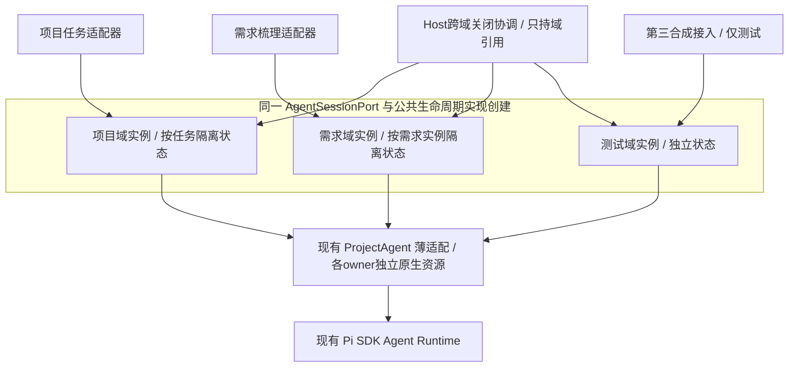

# 统一会话接入与生命周期管理一期

2026-10-30 · v0.3 · DISCUSSION / 折中方向已确认，具体实施包待用户确认。本轮只更新本方案，不修改产品代码、测试、依赖、生效工程规范或运行数据，不调用模型、切换服务或进行Git交付。

本版依据用户最新决定：**统一接口与少量公共实现，会话状态和业务策略分开。** 用户已认可这一方向；本文将其落实为可审阅的职责、迁移、验收与规范固化方案，尚不代表实施获准或任何验收已通过。

前置交付已分开完成：[四项纠偏 PR #8](https://github.com/gadfly-hbo/OptraCall/pull/8) 已合并main `cb178d4b714b7aef559b67ebb52f4265c884a860`，PR CI与main CI均通过，Mac mini主目录已快进。四项本地检查320/320及非作者复核证据保留在原变更；本项目不能继承它们作为未来改造的PASS。新方案基于该main，只增加本文档；用户原项目、会话和文件保持原位。

## 1. 目标、范围和责任

统一Agent功能的会话接入标准，先由现有项目任务和需求梳理两类真实消费者落地。共同实现只收拢两者已证实相同的资源登记、启动去重、配置身份核对、操作占用、取消与关闭、代际保护和事件归属；业务适配器继续决定配置选择、历史恢复和业务流程，Pi Runtime继续负责Agent运行。

共用的是接口和代码。Host通过同一公共实现分别创建项目域、需求域的管理对象；每个域内按owner隔离资源状态、配置快照、原生会话、事件与操作占用。这里的“域”只是Host静态注册的内存归属，不是新项目层级、数据库实体或独立服务。Host只持有各域管理引用，业务适配器不再自行实现生命周期台账。多个隔离实例持有各自的Map属于同一实现的正常实例化，不属于重复实现。

一期交付：Host内部统一Interface及少量公共实现、两类现有适配器的迁移、功能/插件接入规范固化、受影响回归和兼容证据。增加一个仅测试用的第三类合成接入样例，证明后续功能只声明业务/profile即可接入，不复制生命周期代码；不新增真实插件或产品页面。公共层按技术能力提供行为，不加入“如果是需求则……”等业务流程分支；第三样例若依赖大量公共特例，应收窄抽象后再验收。

一期不建设独立会话数据库、任务调度/排队平台、插件市场、跨设备会话同步、多Agent编排、新的自动分析循环或权限沙箱；不新增全局聊天记录、统一业务状态库或全局Agent运行锁。现有HTTP入口及界面行为保留，统一发生在Host内部；无需让所有功能改用一个新的网络接口。同进程的逻辑隔离能减少状态串扰，不能隔离进程崩溃、公共代码缺陷或Provider本身故障。

### 前端UI范围与Demo条件

用户追加确认要求：若有大幅前端UI变化，必须先输出UI Demo供用户确认。当前一期按后台接线与内部Interface改造规划，保留页面布局、导航、按钮语义和主要操作顺序，不新增会话管理页面，暂不需要UI Demo。若实现发现需要新增入口/页面、调整主要布局、合并对话入口或改变主要交互流程，应先补充影响说明及UI Demo，用户确认后才实施该UI变化。必要的少量提示文案或状态修正单列说明，不借后端重构扩大为UI重设计；既有UI正常路径和关键页面对照纳入回归。

| 所在层 | 一期责任 | 状态归属 |
| --- | --- | --- |
| 公共生命周期实现 | 统一如何登记、打开、比较配置、占用、取消、关闭和拒绝过期回调 | 由该实现创建的各域实例内部持有；每个owner独立，不与业务层双写 |
| 业务适配器 | 业务准入、上下文、配置选择、续接参数、业务持久化/回执、事件投影与结果解释 | 原项目/任务与需求实例的业务状态仍在各自原Store中 |
| Host跨域协调 | Provider清理、真实项目范围关闭、应用退出；先阻止对应范围的新准入，再协调各域收尾 | 只保留已注册域的管理引用；不镜像第二本live/opening/operation台账 |

公共模块不解析RAP/SAP/Case，不决定分析步骤、格式修正次数或归档业务准入。需求选择了某个目标项目，也不使它的会话归属变为该项目；项目归档继续只影响真实项目任务。某域启动失败、等待原生UI或被取消时，其他域仍可独立操作；不同域的关闭结果分别收集，一处失败不能使其余域的收尾被跳过。

## 2. 身份与生命周期

| 身份/概念 | 一期定义与存储边界 |
| --- | --- |
| owner | 原有业务归属。项目任务使用projectId+taskId；功能/插件使用Host注册的featureId+instanceId。需求梳理的featureId固定映射到现有插件，instanceId沿用原需求ID。不同类型/功能命名空间隔离，不把需求伪装成真实项目。 |
| SessionRef | Host解析、校验后发出的不透明会话引用，绑定静态注册域、owner及能力；表示调用资格，不表示已启动worker，也不允许调用方塞入任意文件路径。由既有身份确定，不新建持久会话表或业务会话ID；其他域的引用不能拿来调用本域。 |
| native session | Pi自己的sessionId/sessionFile及父会话引用。可能因原生命令/fork而变化；现有snapshot.sessionId仍保持这个含义，不能替换成owner。任务目前仅持久保存sessionFile等既有字段，不新增nativeSessionId字段。 |
| operation | 一次获准操作的运行中归属。普通消息通常一个operation一个turn；需求生成及最多一次格式修正属于一个operation。占用凭证/代际只在内存中，不增加业务持久化字段。 |
| requestId | 每个SDK turn沿用现有请求ID；同任务内原去重和native回执继续有效，不能变成全局跨owner去重。多turn操作中的第二turn使用独立requestId，同一operation的取消覆盖全部turn。 |

新operation从准入登记开始即算busy，包含等待既有Host变更队列、opening、原生UI等待和多turn间隙。相同owner忙时拒绝竞争性新操作，不暗中排队；不同owner/域保持现有并发。停止先撤销后续派发资格，在途调用安全收尾前仍保持busy；正在启动或下一turn尚未发送时也必须有效。关闭释放运行资源，不删除会话历史或业务文件。

资源状态区分未启动、启动中、空闲、操作中、关闭中/已释放；这些是内存运行状态，不新增项目业务状态枚举。业务lastRun与native已知终态/中断证据另行保留，不能用“资源已关闭”推导“业务已完成”。

## 3. 统一Interface候选

名称与形状为待确认契约，尚未实现。采用Host注入的内部 `AgentSessionPort`，调用方获得绑定自身域、owner及能力的引用；普通项目与插件共同走该Interface。域实例的构造、登记和跨域管理留在Host，不向业务暴露可自行创建或替换管理器的工厂。

一期将此内部类型/行为契约标为v1，与产品同包编译并保留接入说明；不增加运行时协议协商、独立SDK包或新的HTTP版本。后续功能沿用同一Interface及能力声明，新增能力先补对应契约与验收。

| 方法 | 行为契约 |
| --- | --- |
| `read(ref)` | 读取现存运行状态/允许读取的保存历史；不创建Agent、不启动worker、不发模型请求或重放。需求没有现成历史展示Interface，一期只提供已有可读状态，不自动扫描最新JSONL续接。 |
| `subscribe(ref, listener)` | 订阅本owner事件，返回取消订阅函数；订阅本身不启动会话，不取得其他owner的事件。 |
| `open(ref)` | 显式初始化原生环境，兼容现有项目POST open及启动阶段扩展交互；不自动发送业务消息。已中断会话的恢复仍按原业务规则，不能把重连当新请求。 |
| `start(ref, turn)` | 单turn入口，支持现有prompt/command能力；返回含requestId、accepted、completion的运行句柄。公共层持有操作占用直到completion，不能在返回句柄或HTTP 202时释放。 |
| `withSession(ref, use)` | 多turn操作入口；在同一Agent/native及捕获配置下给业务回调一个lease。lease提供`run(turn)`并等待该turn终态；业务回调完成才释放操作占用。格式校验、是否发第二turn由需求插件决定。 |
| `busy(ref)` | 包含排队等待、opening、运行和多turn空档；供既有归档/清除准入使用，不能只看底层agent.busy。 |
| `stop(ref)` | 停止当前owner的操作并使后续turn失效；没有运行时可幂等返回。仅取消本owner，不关闭其他业务。 |
| `close(ref)` | 释放本owner的原生资源、opening和操作占用；反复调用安全，旧close/finally不能移除替代代际。 |
| `respondUI` / `setEditorState` | 按注册能力委派现有原生交互与编辑器状态；可处理opening期间的问题，不为回答已有问题重新申请一个运行占用，避免死锁。无此能力的profile明确拒绝，不能假装所有功能都支持。 |

Host另持有管理Interface `closeAll({provider?, projectId?})` 与关闭准入：在已注册域间协调，由各域对自己实际持有的资源执行同一关闭逻辑，按域/资源记录已关闭、失败或未知，不在Host重建资源台账。功能/插件不能获得清除其他owner、供应商或全局会话的权限。项目过滤来自Host解析的真实归属，不靠拼接owner字符串或需求的目标项目字段猜测；Provider过滤逐个核对实际资源捕获的配置。

单turn `start` 与多turn `withSession` 共用同一套登记/打开/配置/取消实现，只提供两种调用便利方式。生命周期状态仅由公共实现创建的域实例持有；业务适配器不再另写opening/operation/代际Map或关闭代码。普通业务集合、草稿及Store仍由业务维护，此限制不等于禁止业务使用Map。现有消费者需要的命令/UI能力按声明提供，不为假想插件预增方法或通用业务回调框架。

lease只在其业务回调生命周期内有效，同一lease最多一个在途run。回调提前返回、抛错或漏await时，公共层使lease失效、禁止后续turn，并按现有停止路径收尾在途run；安全结束前仍保持busy，不能把未结束的调用当成功/空闲。回调外泄的lease后续调用明确拒绝，不重新建会或恢复运行。

运行句柄、lease及已归属operation的事件携带Host提供的opaque operation context，其中`isCurrent()`供适配器在原Host变更门闩内检查资源代际/请求归属。原生事件另有Host提供的resource context，用于无operation/requestId的启动期或空闲事件，只核对owner与资源代际。调用方不能自填generation或维护代际Map，也不为这些事件编造请求ID。操作资格用于阻止旧运行覆盖新运行，不把“已取消”一概视为不能记录本次取消/中断；明确终态的业务写入仍须匹配其requestId，更新运行已接纳时旧资格失效。两种上下文只在Host内存中存在，不进入HTTP/SSE或新的持久记录。

`accepted`沿用当前“原生请求回执可持久读取”的保障，不等同于计算完成或供应商结算。普通项目仍等待accepted后返回现有202，后台completion再由项目适配器更新lastRun。需求generate仍等待结果，返回原proposal/source/repairAttempts，不改成普通聊天的202协议。

## 4. 两类业务差异与配置

| 方面 | 普通项目任务 | 需求梳理 |
| --- | --- | --- |
| 模型选择 | 任务绑定的configuration id/revision；全局选模不悄悄改动旧任务 | 每次operation开始采用当时选中配置；生成与修正期间固定，不跟随中途全局选择变化 |
| 续接 | 使用任务已保存sessionFile，保留草稿、native父链及原生命令后的指针更新 | 进程内同配置可复用现存Agent；重建当前没有传sessionFile，沿用新建native及保留旧文件的现状 |
| 工作区/工具 | 原项目020_clean、010软约束、060_reports、现有工具及指标索引 | 原独立实例workspace、需求系统提示词、defaultTools空数组，不获得项目数据访问能力 |
| 业务处理 | 草稿、lastRun、请求/上下文身份、Case/RAP/SAP、归档与恢复 | 澄清/假设/框架、source指纹、提案采纳、确认/RAP发布、一次格式修正 |
| HTTP/事件展示 | 原消息202、SSE、commands、UI/editor入口 | 原generate结果、stop和SSE入口；不新增需求历史浏览产品 |

Host注册少量profile差异：业务归属与能力、既有业务准入检查、配置选择方式、工作区/工具和原生续接参数。profile只提供实际差异；RAP/SAP/Case、lastRun、草稿、发布、格式修正与事件投影继续留在原业务适配器，由公共事件与归属资格连接，不移入通用策略引擎。profile不实现opening/operation/代际Map、不直接开关Agent。公共实现统一捕获和比较Host已解析的完整配置快照、处理凭据与资源创建；插件只拿非敏感引用，不自行发现Pi凭据或组装Provider客户端。

配置在准入、打开后、后续turn前按同一捕获身份核对。失效时明确失败/取消，不静默换模型、fallback或重放。工具/skills/MCP继续通过现有SDK机制，不改变完整工具与软约束现状，也不把统一Interface表述成新增敏感数据隔离能力。

## 5. 事件、错误、去重与迟到结果

内部事件信封统一关联owner、SessionRef、可用的operation上下文和已有requestId；无requestId的原生状态事件不编造ID。native事件内容沿现有脱敏和SDK语义透传；各业务适配器映射回原有HTTP/SSE字段，前端不强制整体换协议。

每次实际资源实例使用内部代际凭证：晚事件、ui.editor、UI回答和晚completion先核对资源/操作归属。旧代际不得发布到新代际、覆盖新草稿或lastRun；不能只防止Map误删而放过副作用回调。清供应商时按live/opening/operation各自捕获的配置过滤，同owner旧A资源与新B opening共存时，清A不得伤B。

需要写业务结果的回调在既有Host变更门闩内核对资格再写入：completion/lastRun等操作绑定回调使用operation context及requestId，已有lastRun记录还须匹配其当前请求身份；无operation/requestId的opening或空闲ui.editor等事件使用resource context，只核对owner与资源代际，不给草稿新增请求ID字段。带已知请求归属的editor仍用operation guard。这样避免先检查、异步等待后覆盖新结果，同时保留原生空闲交互。pending归属应在等待门闩前登记；SDK打开、原生UI等待及模型执行在门闩外进行，不能以统一管理为由把整个Agent运行锁进全局队列。

原有错误分类和业务投影保留：配置缺失/变化、busy、归档不可写、结构不合格、取消、Runtime异常、结果未知分别表达。格式错误是需求业务处理，不由公共层自动触发分析或补算。已有请求结果未知时保留UNKNOWN/中断，不根据本地worker退出猜测远端副作用或费用。

技术请求关联和native marker透传走公共入口，普通任务仍由原任务native回执、requestFingerprint及Case/RAP身份规则执行去重；legacy缺摘要时原ACK/409/UNKNOWN边界保持。需求generate每次显式操作的现有请求行为保持。一期不宣称所有插件跨重启exactly-once；新接入须按标准提供requestId并明确重复/未知处理，不能自行创造native回执格式或自动重放机制。

读取边界：公共read/subscribe不启动worker或模型；原项目HTTP在读取遗留running状态时按native证据校正lastRun为已知终态或interrupted的既有逻辑，仍留在业务适配器。不能把“不发起新运行”错误扩大成“所有原HTTP GET都绝对零持久写”，也不能借重构取消既有恢复语义。

## 6. 功能与插件接入规则

以下为拟纳入正式规范的强制条款，适用于Codex、Qoder及其他工程开发者；本轮仍只保存于方案，待实施交付时写入唯一工程规范并建立检查。

| 规则 | 开发与接入要求 | 可核对的证据 |
| --- | --- | --- |
| IN01 开发前必读 | 新增/修改Agent交互、SDK接入、会话启停/恢复、模型配置或插件接入前，读取工程规范相关条款及接入说明 | 本变更规格记录规则/Interface版本、owner/profile、修改范围和业务差异；不能沿用旧任务授权 |
| IN02 Host注册与注入 | 通过Host静态注册域/profile并取得绑定owner及能力的port；前端继续调用原业务入口 | 注册点、实际注入/调用链、跨域/跨owner引用被拒绝的验证；不开放业务自行构造管理器 |
| IN03 共用生命周期 | 启动、占用、取消、关闭和事件订阅通过公共port；业务层不直接创建SDK会话、new ProjectAgent或另写生命周期Map/配置监听/全局清理 | 删除旧重复实现；导入/构造路径检查及实际调用链复核。公共实现内部多个隔离实例符合规则 |
| IN04 声明真实差异 | 功能提供上下文、获准工作区/工具、配置选择和续接参数；业务校验、持久化及修正流程留在适配器，多turn明确结束/取消条件 | 项目/需求差异对照及能力声明；公共层没有RAP/SAP/Case解析或按业务名称分支 |
| IN05 Host资源权限 | 凭据解析、原生资源创建、跨owner清理由核准Host路径负责；插件只获得非敏感引用和自身能力 | 不接受调用消息携带任意绝对workspace/sessionFile、密钥或未获准Provider绕过配置；日志/事件继续脱敏 |
| IN06 契约共同维护 | 新能力先补契约、消费者适配及验收；Codex负责Host/Agent集成，Qoder交付Extension接入与证据，不单方面改变另一方契约 | 不兼容变更或范围扩大先补决定；新增白名单路径说明必要性并复核，不能以扩大白名单消除绕过失败 |
| IN07 交付验证 | 新接入覆盖正常路径、取消、配置变化、迟到结果、保存/恢复与相应兼容范围 | 规格、接入说明、确定性检查和非作者复核相互对应；故障/未知不自动重放，真实模型与业务动作依适用授权另验 |

分析资产、工具和skills/MCP扩展继续按SDK职责提供业务能力，不代管Host会话。获得会话port不扩大数据或经营动作授权。第三个纯合成feature fixture仅声明profile、业务请求和结果投影，借公共入口完成启动—运行—取消/关闭；与项目/需求同时存在时验证隔离，不复制资源管理、不宣传为已接入真实业务插件。

### 标准固化与开发前必读

用户明确要求：本期统一完成后，这套标准必须成为未来Codex、Qoder及其他开发者提前知晓并严格遵守的项目规则。固化与可执行检查属于一期必交付，不能只留在本讨论稿中。

| 交付位置 | 责任与验收 |
| --- | --- |
| `docs/engineering-workflow.md` | 在现有唯一工程规范中纳入强制接入条款、责任范围、接口变更规则、例外处理和验收要求；不另建一份竞争性的工程规范。 |
| `AGENTS.md`及实际工具入口 | 用触发明确的条件指针要求IN01必读；分别核验当前安装版Codex/Qoder实际载入路径，不预设Qoder自动读取AGENTS。如需Qoder项目入口，只保留同源引用，不复制正文、擅改全局设置或到MacBook验证。记录工具/版本、实际入口和读取证据；文件存在、理论可访问或口头复述不能代替已读取证据。 |
| 公共Interface及`docs/agent-session-integration.md`（拟新增） | 实现中的类型是准确字段来源；说明文档提供已实现版本、最小接入、两类profile差异、取消/错误/恢复语义及第三合成样例，引用工程规范，避免重复维护规则正文。新接入的规格/交付记录注明读取的接口版本、owner/profile与验证范围。 |
| 本地完整检查与CI | 导入/构造路径约束及共享行为回归加入既有`npm run check`和CI。只有核准的Runtime薄适配、公共模块及明确的测试/连接探针路径可直接使用对应底层能力，业务功能经port接入；同一检查下合规最小样例通过、受控绕过样例失败，恢复合规后通过；不能靠跳过检查、删断言或扩大白名单制造通过。 |
| 独立复核与后续维护 | 审查实际调用链、生命周期资源归属与业务差异；新能力先补契约、适配和验收，更新规范引用。静态检查可拦已知绕过方式，不能保证识别所有动态行为，仍需行为回归和非作者复核。 |

实施时拟使用的入口指针语义为：“涉及Agent交互、SDK接入、会话生命周期、模型配置或插件接入的变更，开始前必须读取工程规范的统一会话接入条款与`docs/agent-session-integration.md`，在本变更规格记录Interface版本、owner/profile及验收范围。”实际入口保持简短，只引用同一规则源。

工具加载验收在Mac mini项目内分别进行：用触发上述分支的只读接入规划任务，核对工具实际读取记录与规则版本；只证明能访问文件不算自动入口生效。某工具不可用或未实际核验时，SM14相应项记NOT_RUN/未完成，不宣称标准固化全部通过，不为获得PASS修改全局设置或启动MacBook开发。

不建立“Codex一套、Qoder另一套”的规则正文。接入约束针对Host会话创建/管理和模型凭据，不妨碍SDK扩展按已授权职责提供业务工具；第三方动态代码的安全隔离不由文档或导入检查自动获得。当前仍是固化方案，以上新条款/检查尚未写入生效规范或实现。

## 7. 兼容迁移与回退

采用“替换接线、原位读取”。本次接线迁移不搬移、重编号或回填历史资料：项目/任务schema2、原ID、configuration引用、draft、sessionStorage/sessionFile、lastRun及原JSON不加字段；native JSONL位置、既有内容、header/parentSession保持。Case SQLite既有schema/逻辑记录、项目work修订、RAP/SAP确认/发布物、指纹和三目录保持，不因接线迁移而改写。

保全有明确时点：对未运行的兼容fixture，在切换接线前后核对路径/文件清单与字节；SQLite使用一致停写副本核对schema和逻辑记录，不用活库文件哈希冒充数据一致性。随后显式进行正常业务时，允许沿原规则追加JSONL、保存草稿/lastRun、更新fork后的会话指针；旧内容与父链仍须可读。原GET的native证据校正、旧schema1前置兼容若产生原有写入，单列为既有行为在隔离fixture验证，不能宣称所有读取永远零写入。本期不新增历史迁移或扩大原schema1转换范围。

不新增统一session表、业务会话ID或需求native续接指针；公共注册/占用/代际均为内存状态，重启不恢复未知在途调用。若实现发现必须改变持久结构、native回执、需求跨重启续接或业务终态枚举，先补充方案重新确认相应变化，不能当作内部重构顺带实施。

实施顺序：①以现有两个业务及失败反例锁定行为，建立合成资料保全基线；②建立公共实现及Host静态域/profile接线；③将需求端换为公共实现创建的独立实例，保留原业务修正逻辑；④将项目端换为另一独立实例，保留202/回执/归档/历史及原生交互；⑤删除已被替代的两套业务生命周期实现，完成第三fixture、跨域隔离、联合背景回归及规范固化。每步有受影响等价检查，运行切换时不让同一owner同时由新旧管理器接管；最终只有一份公共实现和每个资源唯一的权威状态，不长期双写或双轨切换。

拟定修改范围：新增一个Host公共生命周期模块（建议`src/host/agent-sessions.ts`，包含Interface与核心类型）；调整`src/host/server.ts`、`src/host/requirement-sessions.ts`的接线与适配，按必要性拆出薄的项目适配器。`src/agent/project-runtime.ts`仅在委派accepted/completion/原生交互所需时做等价薄适配；默认不改变`project-session.ts`的SDK运行/marker和各Store持久结构。补充相应`tests/`、接入说明和工程入口引用。用户确认后的实施规格须将最终文件范围与本建议对齐，范围扩张或业务语义变化另行说明。

工程验收在隔离合成根执行，不拿真实用户资料试迁移、复现异常或发送模型请求；原运行服务及真实资料保持原位。实际采用新版时按后续单独授权先阻止新准入、等待已接纳操作完成，或由用户显式停止后正常关服务，再启动新代码读取原数据；不热搬worker，不在中途选模变化时迁移已接纳运行。只读查看不能触发重放，未确认的在途结果保留UNKNOWN/中断。

回退只替换已验证兼容的代码并保留全部最新数据，最低回退解析器须支持基线已合并的hypothesis空串。用“新接线生成正常新记录→兼容旧代码打开最新资料”的隔离演练验证可读性及不会重放；不能恢复旧数据副本覆盖后续工作。代码回退不撤销已经发生的远端副作用，也不等于重新接管旧worker。

## 8. 验收范围

| 验收 | 可观察结果 |
| --- | --- |
| SM01 统一接入/复用收益 | 项目与需求经同一公共实现创建的独立域实例完成创建/续接/停止/关闭；旧业务生命周期实现删除，Host无平行资源台账。第三合成feature只声明profile/业务请求/结果投影，不复制生命周期Map、SDK构造或全局清理；共享核心不增加其专属业务分支。实际调用链与导入约束共同验证。 |
| SM02 并发/隔离 | 同owner并发opening不重复建worker；不同owner/域并行。项目、需求、第三fixture同时存在时，一个启动失败/被取消/等待UI不影响其余域运行、读状态或订阅；跨域Ref明确拒绝。既有Host队列等待/启动中取消后不发prompt，清除不等待自己队列后方任务而死锁；不新增全局运行锁。 |
| SM03 操作占用 | 项目202返回后到completion前仍busy；需求首次生成与修正之间仍busy；空档stop使后续turn无法发出；回调漏await/抛错时不提前释放在途run，外泄lease不能调用；重复取消/关闭安全。 |
| SM04 配置 | 原任务绑定配置不随全局选模变化；需求下一operation用当前选择，已准入操作不换配置；失效不fallback、不重放。 |
| SM05 供应商/代际 | 同owner旧A资源与新B opening共存时清A不伤B；旧close/finally不删除新资源，旧事件/editor/completion不覆盖新业务状态。 |
| SM06 业务/跨域关闭 | 项目归档维持原空闲准入，只处理真实本项目任务；即使需求目标项目相同也不误停。Provider/global关闭按捕获配置覆盖各域opening、等待准入、lease和UI等待，关闭范围禁止新派发；一域收尾失败不跳过其他域，失败/未知如实保留，不能报整体已关闭。 |
| SM07 原生交互 | 保留SDK命令、requestId、启动期间UI响应、过期回答拒绝、editor镜像、/fork父会话及sessionFile指针；不自建命令循环或压缩器。 |
| SM08 恢复/只读 | GET/SSE/历史读取不新建worker、不模型、不重放；既有lastRun证据校正仍正确；显式新请求才恢复运行，旧请求去重/legacy边界不退化。 |
| SM09 需求四项 | 未确认/stale/部分草稿、无需新增、无假设路径、来源冲突、确认保留和一次有限修正继续通过；失败/取消/未知不追加调用。 |
| SM10 联合背景 | RAP精确版本+项目启用SAP+指定Case/work修订仍共同进入实际SDK请求；错误/stale背景在Provider前拒绝，不混入未选资料。 |
| SM11 数据保全/回退 | 隔离fixture覆盖旧schema2及适用schema1前置兼容、legacy/task session位置、JSONL/header/parent、草稿/lastRun、Case SQLite逻辑记录、发布物及项目文件原位读回。未运行资料无接线迁移写入；显式续聊/原GET校正等仅产生原有合法变化，旧内容/父链保留；新记录由兼容回退代码打开且不重放。真实用户资料不用于写入式工程验收。 |
| SM12 工程完成 | 受影响RED/GREEN与原始失败保留，真实Host/SDK合成Provider、正常UI及完整npm check；固定候选非作者复核；后续获授权的实际head PR CI及main CI分别记录，不继承PR8通过。 |
| SM13 UI范围 | 关键页面、导航、按钮与正常操作路径保持；若触发大幅变化，先有可审阅Demo及用户确认，再实施对应变化；不把无UI改造的后台迁移强行扩成重设计。 |
| SM14 标准固化 | IN01–IN07进入工程规范，入口指针、接入说明/样例、准确Interface类型及自动约束一并交付。分别记录Mac mini上Codex/Qoder实际版本、入口与读取同一规则的证据，未核验记NOT_RUN；同一检查下合规样例通过、绕过公共入口的受控反例失败、恢复正常接入后通过，不扩大白名单掩盖失败。静态约束与实际调用链独立复核都要完成。 |

现有验证起点：`tests/requirement-lifecycle.test.ts`、`requirement-host-isolation.test.ts`、`requirement-generation-repair.test.ts`、`project-runtime.test.ts`、`host-recovery.test.ts`、`task-host.test.ts`、`project-migration.test.ts`、`joint-context.test.ts`、`requirement-flexible-joint.test.ts`。验证通过公共Interface、正常HTTP/UI、实际合成Provider输入和保存/重开结果，不只断言内部Map或源码字符串。

只用合成数据/Provider做确定性工程验收；真实模型、实际工具分析质量与真实经营效果单列，按后续适用授权验证，不把SDK链路可用当成模型分析正确。

完成判定：SM01–SM14逐项关联本候选的实际证据，保留FAIL、NOT_RUN及UNKNOWN；不能用旧候选PASS代替。当前全部是待实施验收项。本轮只做文档一致性、引用、修改范围及只读复核，不运行或伪造产品RED/GREEN、模型试跑或CI结果。

### 取舍与收益边界

继续各业务重复管理，主要增加规则漂移、同类修复重复、跨入口关闭漏管/误伤和后续接入成本；这类错误此前已有修复记录，不表示当前仍有已知故障。只有两个主要消费者且已共用Pi Runtime时，短期收益是中等的维护收益；后续接入增多时更有价值。只统一文档/类型而仍各写生命周期，不能消除重复修复；扩大为集中调度平台会增加当前无需求的成本。本期选择小型共用实现、隔离状态和业务策略，用SM01/SM02及第三fixture证明收益，不虚构量化ROI或为全部未来插件预建设施。

### 缺点、实施风险与残余限制

以下区分改造新增/迁移风险与原有残余限制，不是新发现的当前产品故障。R01–R03、R05–R07主要是共用实现与迁移的代价；R04即使不统一也存在。已有防范需要由本项目的新候选验收证明；认可折中方向不等于这些风险已消除或实施包已获准。

| 风险 | 可能后果/代价 | 方案中的控制 | 仍然存在的限制 |
| --- | --- | --- | --- |
| R01 高：共同故障影响扩大 | 公共代码缺陷可能同时影响多个入口，修改公共层要做联合回归 | 同一实现的独立域/owner状态；局部启动/取消失败隔离及跨域关闭反例；固定候选非作者复核 | 逻辑隔离不能隔离同进程崩溃、共享代码缺陷或Provider故障 |
| R02 高：业务差异被抹平 | 旧任务换模型、丢续接指针，或需求被强套202/项目工具等 | 第4节差异逐项保留在profile/适配器，公共层仅管理资源 | 后续新业务可能需要补充v1契约，不能保证永不调整 |
| R03 高：异步复杂度转移到公共实现 | opening/多turn空档漏停、一直busy、旧结果覆盖新状态 | 各域提前登记、同owner操作占用、两类guard与原门闩写入、SDK等待在门闩外，构造取消/迟到/漏await反例 | SDK事件交错仍需回归；代码复用不使复杂度消失，也不应演变成全局排队 |
| R04 既有重要残余：配置/恢复与未知结果 | 配置撤销时调用明确失败，断连后用户可能需要判断是否发新请求 | 保留固定配置身份、不fallback/自动重放及native证据/UNKNOWN的原规则 | 分开管理同样无法消除远端副作用或费用未知；本期也不增加跨重启恢复在途调用 |
| R05 高：迁移与采用成本 | 即使不搬数据，接线仍可能遗漏草稿/父链/lastRun；需要受控服务切换 | 原位读回与字节保全，逐个消费者迁移，不热搬worker，回退兼容代码并保留最新资料 | 实际采用有等待/停机窗口，代码回退不能撤销已发生的外部副作用 |
| R06 中：抽象和学习成本 | port/lease/profile增加概念，过度抽象会让新功能更难接入 | 只收拢现有共同能力，用第三合成接入证明少量声明即可复用，不预建平台 | 两类真实业务加fixture不能证明适合所有未来插件；以后可能返工 |
| R07 中：规范失效或被绕过 | 文档无人读，后续又长出SDK直连/另一套生命周期 | 同源规范+工具入口+接入说明+CI约束+独立复核；规范变更随Interface同步 | 静态检查不是完整动态证明，开发者仍需理解差异并维护契约 |

收益主要是消除重复维护、统一可靠性约束；不会自动提高模型分析质量，也不会自动提供业务语义统一、权限沙箱或全插件跨重启恰好一次执行保证。

## 9. 整体确认清单

用户已确认：产品级统一会话标准/Interface；采用“统一接口与少量公共实现，会话状态和业务策略分开”的折中方向；大幅UI变化先Demo确认；标准固化供Codex/Qoder等提前读取并遵守。本轮又明确只更新方案、保留原资料、先确认再实施。这些方向与边界无需重新选择。

以下12项是供整体确认的本版实施约定，目前仅有方案、实现0项，SM01–SM14尚未执行；不会将方向确认或沉默记作开工许可。

| 编号 | 主题 | 本版实施约定 |
| --- | --- | --- |
| US01 | 公共范围/隔离 | 一份少量公共实现创建独立项目域/需求域，按owner隔离；Host只协调，无平行资源账；第三合成fixture验证复用，不建设调度平台 |
| US02 | 身份/存储 | 既有owner与native身份分离；域、Ref/lease/代际仅内存，不加库、业务ID或统一聊天记录 |
| US03 | Interface/UI | 第3节内部v1及按需能力；保留HTTP、页面与主要操作，大幅UI变化先Demo确认 |
| US04 | 占用/并发 | 同owner单operation覆盖等待/opening/间隙；不同owner/域并行；取消撤销后续派发，在途安全收尾前仍busy |
| US05 | 配置/工具 | 业务选择配置及声明工具，公共实现捕获/比较；保留任务绑定和需求当前选择的差异，不暗换模型或扩权限 |
| US06 | 历史/业务 | 项目原指针、父链和草稿保留；需求沿用重建策略，不加跨重启续接；业务校验、保存和一次修正留在适配器 |
| US07 | 事件/关闭 | owner/代际保护及原门闩内写入；Host按实际项目/Provider/全局范围协调各域，隔离取消、失败和迟到结果 |
| US08 | 回执/未知 | 原task去重、Case/RAP指纹、legacy与UNKNOWN边界保留，不自动重放或宣称全插件跨重启exactly-once |
| US09 | 规范固化 | IN01–IN07进入唯一工程规范；工具入口同源指针、接入说明、Interface及自动检查共同交付；Codex/Qoder分别核验实际读取 |
| US10 | 迁移/回退 | 需求后项目逐步换接线并删除重复实现；旧资料原位、无新迁移写入，合法业务追加保留；无活worker热迁移，回退兼容代码不回滚数据 |
| US11 | 验收/限制 | SM01–SM14、第三fixture、正常UI、RAP+SAP+Case、兼容演练、完整检查及非作者复核；新增风险与既有残余分别记录 |
| US12 | 开工/交付边界 | 本轮仅更新方案；收到本版实施确认后再建spec及允许路径。Git/CI交付、运行服务采用、其他设备或真实模型按届时明确授权分别处理 |

不适用的结构类别：无新表/列/索引/枚举持久值、数据聚合/物化视图、跨库身份合并、业务删除或自动迁移；上述既有对象的粒度、唯一性、来源和生命周期均沿用。若之后需要新增，先提出相应补充决定，不以此文档代替用户确认。

## 10. 当前证据与交付位置

工程依据：`docs/engineering-workflow.md`，特别是统一Pi Runtime、Host/Agent/Extension分工、非作者复核与Git/采用分开报告。当前项目资源登记/启动/关闭在`src/host/server.ts:46–87,190–259`，需求资源登记/操作占用在`src/host/requirement-sessions.ts:25–158`；native创建/续接与回执在`src/agent/project-session.ts:99–170`，任务现有存储字段在`src/host/project-store.ts:9–12`。细节以基线cb178d4源文件为准，这些来源证明现状，不证明候选Interface已实现。

本轮只更新本方案文档，并保留前版讨论稿于忽略的本地证据目录；不改产品源/测试/依赖/数据库、生效规范或工具全局配置，不启动模型或变更服务。完成本文一致性、引用和范围复核后交用户确认；待本版实施包获准，再建立实施规格、固定允许修改路径与验证计划。Codex/Qoder实际加载验证、规范生效和SM01–SM14均属于后续实施交付，当前不标PASS。
